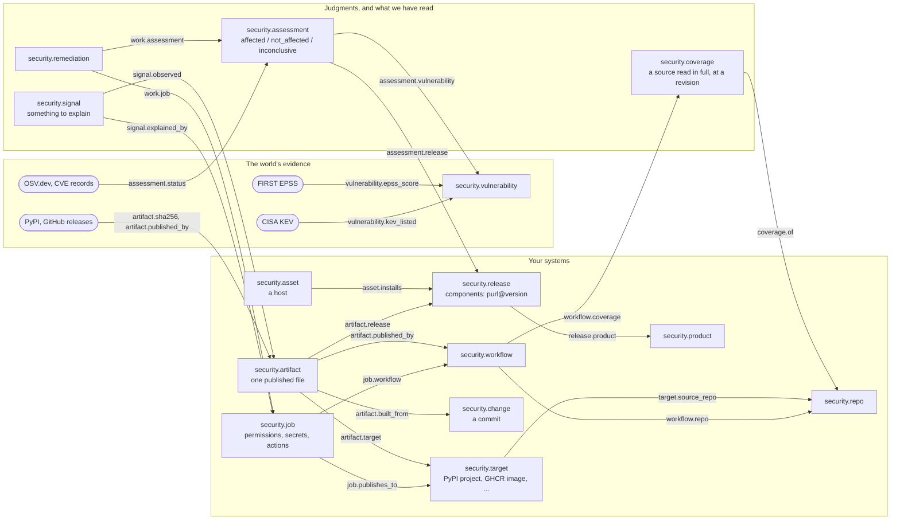

# Security kit

## What it is

The security kit gives your agents a cited model of what you ship and how it is
published, joined to public vulnerability evidence. It holds your releases and
their components, your repositories' CI workflows and jobs, and the registries
you publish to with the files they serve; beside them, what CISA KEV, FIRST
EPSS, OSV.dev and CVE records say about vulnerabilities. Every fact points to the
retained copy of the source it was read from. Judgments, such as whether a
release is affected or what explains a mismatch, are proposed by agents and
settled by your review, or automatically by automation that has earned it.

## What it answers

| Question | Where the answer comes from |
|---|---|
| Which of my releases are exposed to a vulnerability attackers exploit, and which first? | `security.urgent_exposures`: releases assessed affected (by OSV per SBOM component, or by a CVE record's version ranges), KEV-listed first, then by EPSS score |
| Is release X affected by this KEV entry? | `security.triage` for the CVE: each release's assessment, with the CVE's KEV and EPSS facts |
| Which internet-facing hosts run an affected, KEV-listed release? | `security.kev_exposure`: your inventory of hosts and what they install, joined to the assessments |
| What can publish to PyPI without a `v*` tag? | `security.publish_paths` (HQ1): jobs in your repository's workflows that can publish to the target, whose triggers the target's publish gate does not allow |
| Which credentialed jobs run mutable third-party code? | `security.mutable_actions` (HQ3): actions not pinned to a commit SHA in jobs that hold a write permission or a secret |
| Does what PyPI serves match what we built? | `security.served_vs_declared` (HQ5): PyPI's digests and provenance against the workflow and commit that declare them |
| Which exploited vulnerabilities has nobody triaged yet? | `security.kev_triage_backlog`: assessments of KEV-listed CVEs with no status, or inconclusive |

Ask any of them with `cruxible query --name NAME`. The hardening questions
(HQ1-HQ5) are also asked for you on a schedule, and each answer is **found**,
**none** (looked, nothing matches) or **unknown** (not read yet: it names the
pull that would answer it); never "none" for something nobody read.

## How it models your world

Four words carry the rest of this README. A **Subject** is one thing the kit
models, of one kind: a repository, a job, a release, a vulnerability. A
**Claim** is one statement about a Subject (a field and its value) with a role,
either an *observation* (what a source said) or *normative* (what someone
decided), and the evidence it cites. A **Capture** is the retained copy of what
a source returned (a KEV catalog, a repository's workflow files at a commit, a
PyPI answer), kept by content digest so a Claim can point to it. A **Line** is
standing automation: one deterministic Procedure with its inputs, started by
Triggers (a schedule, or a Capture landing) and capped at what it may do:
observe, propose for review, or settle.

<!-- concept-map: checked by source/reference.py -->


**Your systems.** What you ship and how it is published. Pull Lines read your
repository's workflow files at a ref and your registries' published files; parse
Lines turn each read into observations: a workflow's triggers, a job's
permissions, secrets, actions and publish targets, a published file's digest and
the workflow and commit that built it. Releases and their components come from
your CycloneDX SBOMs, hosts and what they install from your own inventory.
Nothing here is asserted by the kit: each fact cites the Capture it was read
from, and the one policy statement, a target's `publish_gate`, is yours.

**The world's evidence.** What public sources say. KEV and EPSS facts land on a
vulnerability (`security.vulnerability`, keyed by CVE id), verbatim from the
catalog or the daily file; OSV.dev and CVE records decide applicability; PyPI and
GitHub releases say what a registry actually serves. World evidence attaches to
your systems in two places: a vulnerability meets a release in an
**assessment**, and what a registry serves meets the workflow and commit that
declare it on an **artifact**.

**Judgments, and what we have read.** An assessment is one (release, CVE) pair,
proposed from OSV or a CVE record, or decided by an analyst. A signal is a
mismatch or event to explain (a served digest that differs from the declared
one); hypotheses (`explained_by`) compete until a cited change resolves them. A
remediation (or an exception, or a compensating control) is the work you decide
on. Coverage is the kit's record of what it has read in full and at which
revision: absence counts as an answer only inside a current coverage, so a
stale or missing read makes an answer unknown, not none.

<!-- BEGIN GENERATED: glance -->
<!-- Generated by source/reference.py from the definitions. -->

| `security` 1.1.0 | Count |
|---|---|
| [Kinds of thing it models](reference.md#what-it-models) | 19 |
| [Fields (ClaimTypes) across them](reference.md#what-it-models) | 87 |
| [Evidence sources (Capture contracts)](reference.md#where-evidence-comes-from) | 12 |
| [Procedures / Blueprints](reference.md#what-runs-on-its-own) | 10 / 9 |
| [Queries](reference.md#what-you-can-ask) | 28 |
| [Example Lines / Triggers / Mandates](reference.md#what-runs-on-its-own) | 15 / 17 / 7 |

<!-- END GENERATED: glance -->

Full reference: every kind, field, contract, Line and query, with diagrams of
where evidence comes from and what starts what, in [reference.md](reference.md)
(generated from this release's definitions).

## One finding, end to end

A mutable action in a job that can publish, found and fixed, with the names the
example automation uses for `cruxible-ai/cruxible`:

1. **Pull (automatic).** Every 6 hours the Line `security.repo-pull.cruxible-ci`
   runs the Blueprint `security.repo-acquire`, which reads `.github/workflows/`
   at `main` and retains it as one Capture under `security.repo-snapshot-v1`.
   The Line's max authority is `observe`: it records the read and nothing else.
2. **Parse (a proposal).** The landing starts `security.repo-parse.cruxible-ci`.
   It proposes observation Claims citing that Capture, among them, for the job
   `publish.yml#publish-client`, `security.job.permission` `id-token:write` and
   `security.job.uses` `pkg:githubactions/actions/checkout@v4`, plus the source's
   `security.coverage.revision` (the commit read). A person or agent reviews and
   activates the proposal (`cruxible proposal review ID`, `cruxible proposal
   activate ID`); an unchanged read proposes nothing.
3. **Ask (automatic).** `security.harden` runs daily and on each landing (or
   `cruxible line run security.harden`) and reads only accepted Claims, so its
   first run after the activation asks HQ3 through `security.mutable_actions`:
   the job holds a write credential and runs an action pinned to a tag, not a
   40-hex commit SHA. The answer is **found**, posted as one inbox item naming
   the job and the action. Harden only observes and posts; it never changes what
   the instance holds.
4. **Decide (needs someone).** An agent reads the finding (`cruxible inbox list
   --line security.harden`) and records the decision: a `security.remediation`
   with `security.work.job` naming the job and `security.work.rationale`, or a
   `security.exception` if the risk is accepted. These are normative Claims in
   the agent's own words; your instance's approval policy decides whether they
   wait for review.
5. **Close (automatic, then a proposal).** After the pin merges, the next pull
   reads a new revision; the parse proposes revising `job.uses` to the SHA and
   the one `coverage.revision` Claim, and nothing else. Once that is accepted,
   harden's next run answers HQ3 **none** for the job, naming the revision it
   read.

The parse step can itself become automatic: once its proposals have been
reviewed long enough, a settle Mandate lets the Line settle verbatim parses
([Measure and graduate](#measure-and-graduate)). Judgments (a status an analyst
decides, `explained_by`, a publish gate) always stay with people and agents.

## Install and first answers

1. **Install.** `cruxible kit add security:1.1.0` previews the change; commit it
   at the coordinate the preview prints: `cruxible kit add security:1.1.0
   --commit --at OID`. This installs the kit's definitions and its Providers
   (the packages its Procedures call to fetch and parse): the bundled
   `security-analysis-provider` (deterministic parsing and classification, no
   network) and
   `security-sources-provider` (OSV.dev, EPSS, GitHub repository, PyPI and
   release-asset reads), and `cruxible-provider-web` 0.2.2 by name from PyPI,
   verified against the recorded hashes.
2. **Adapt the automation.** The kit carries definitions only; the
   [example ChangeSet](examples/automation.json) is an inert starting point,
   explained in [examples/README.md](examples/README.md). Choose Line names;
   the Provider for each of the nine Blueprints (a Blueprint is a Procedure
   whose Provider you choose when you instantiate it; the example binds the KEV,
   CVE, GitHub release and history reads to `cruxible-provider-web` and the rest
   to `security-sources-provider`); your sources (repository, PyPI projects);
   cron times; and Mandate expiry.
3. **Submit it**: `cruxible authoring submit automation.json`, then review and
   activate it under your approval policy. It instantiates nine Blueprints and
   authors fifteen disabled Lines, seventeen Triggers and seven propose-only
   Mandates (a Mandate grants a Procedure the right to propose or settle within
   a scope).
4. **Enable the vulnerability Lines**: `for l in kev-daily kev-triage
   kev-attention epss-daily epss-triage sbom-import osv-applicability
   cve-applicability; do cruxible line enable security.$l; done`. Changing a
   Line, or a Trigger aimed at it, disables it again; `cruxible next` names the
   `line enable` that restarts it.
5. **Import an SBOM.** Put a CycloneDX JSON SBOM in the attached workspace (its
   `metadata.component` names the product and version) and read it:

   ```sh
   echo '{"relative_path": "sboms/app.cdx.json"}' > sbom.json
   cruxible procedure run security.sbom-acquire sbom.json
   ```

   Its landing runs `security.sbom-import`, which proposes the product, release,
   supplier and one `security.release.component` per component purl; review and
   activate it (`cruxible proposal list`, `review`, `activate`). Re-reading an
   SBOM proposes only what is new: a new `metadata.component` version is a new
   release of the same product, a changed SBOM adds its new components, and a
   changed supplier revises the held one. Superseded releases and components an
   SBOM no longer lists are kept; retire them yourself.
6. **Ask OSV**: `cruxible line run security.osv-applicability`, then review and
   activate its proposal: one assessment per (release, CVE) OSV relates.
7. **KEV and EPSS**: `cruxible line run security.kev-daily` and `cruxible line
   run security.epss-daily`, then activate the two triage proposals. From here
   the cron Triggers repeat steps 6 and 7 daily.
8. **The answer**: `cruxible query --name security.urgent_exposures`.

What stays yours: approving the automation, enabling Lines, providing SBOMs and
CVE record requests, reviewing applicability proposals, renewing Mandates before
they expire, and re-instantiating a Blueprint an upgrade changes.

## Your systems: the hardening questions

Stating a target's publish gate is what asks the questions about it.
`security.harden` answers each one per gated target and per read source as
**found** (posted as a finding), **none** (a current coverage answers it and
nothing matches; kept in the run summary, never stored) or **unknown** (no
current coverage: posted as one gap item per source, naming the pull that
answers it, however many questions wait on it).

| # | Question | Found when |
|---|---|---|
| HQ1 `security.publish_paths` | Every path that can publish to T; does any bypass T's gate? | a job with `publishes_to` T whose workflow has a trigger the gate does not list |
| HQ2 `security.credentialed_jobs` | Which jobs hold write credentials, and what triggers them? | a write permission or secret in a job `pull_request_target`, `workflow_run` or `issue_comment` can trigger, or `workflow_dispatch` without an environment |
| HQ3 `security.mutable_actions` | Mutable third-party code inside credentialed jobs? | an action not pinned to a 40-hex SHA in such a job |
| HQ4 `security.shared_dependencies` | Single points of compromise on T's publish paths? | a mutable action or secret every publishing job of T shares |
| HQ5 `security.served_vs_declared` | Does what T serves match the path that declares it? | `published_by`/`publish_environment` not among the publishing jobs at `built_from`, or `declared_sha256` differs from `sha256` |

`job.publishes_to` follows the credential a registry accepts: PyPI needs
`id-token: write` and a publish step, GHCR `packages: write`, a GitHub release
`contents: write`, Pages `pages: write`. A job holding it can publish to every
target of that registry whose `source_repo` is the repository, so "can publish"
leans to over-approximating; harden also counts every credentialed job of a
read source, so a target stated after the last pull is answered at once.

Facts are per source: `main` and a `v0.3.2` tag are two sources with their own
workflows, jobs and coverage. A key that names another Subject uses its readable
locator text (`github.com/owner/repo@ref:path`), and each such key has a
Subject-valued twin (`workflow.repo`, `job.workflow`, `artifact.target`) the
queries traverse.

### Walkthrough

1. **Ask.** State each target's gate (and, outside PyPI, its source repository;
   a PyPI target's comes from its provenance):

   ```json
   {"kind": "change_set", "rationale": "Ask about our release targets.", "members": [
    {"kind": "subject", "subject_kind": "security.target", "key": {"registry": "pypi", "name": "cruxible"}, "rationale": "We publish it."},
    {"kind": "claim", "subject": {"subject_kind": "security.target", "key": {"registry": "pypi", "name": "cruxible"}},
     "predicate": "security.target.publish_gate", "object": {"kind": "literal", "value": "push:tags:v*"},
     "role": "normative", "rationale": "Only a v* tag push may publish.",
     "source": {"kind": "self_source", "body": "gate: push:tags:v*\n"}}]}
   ```

2. **Harden**: enable the system model's Lines (in the example
   `security.repo-pull.cruxible-ci`, `security.repo-parse.cruxible-ci`, the two
   `security.registry-pull.*` and `security.registry-parse.*` Lines, and
   `security.harden`) and run `cruxible line run security.harden`. Every answer
   starts unknown; `cruxible inbox list --line
   security.harden` holds one gap item per source, `{source, pull, input}`, however
   many questions wait on it. Answer one by running its pull with its input:
   `cruxible procedure run security.registry-acquire input.json`.

3. **Parse.** A parse Line reads one source's pulls (its taps are keyed by its
   parameters, never by the landed Capture): the example has
   `security.repo-parse.cruxible-ci` (`main`'s workflows) and
   `security.registry-parse.cruxible`/`-client`, each with its landing Trigger;
   every other landing halts `other_source`. For another source, copy a parse Line
   member with its parameters (`source`, `repo_source`, `forge_host`, `full_name`,
   `ref`, `scope`, `path`) and its landing Trigger, and enable it. Review and
   activate the parse proposals, then run `security.harden` again (its landing
   Triggers fire before you accept, so under propose re-run it after accepting).

4. **Keep it current.** The pull Lines run on cron (the repository every 6 h,
   PyPI daily). The coverage revision is restated on every pull: identical bytes
   are a recorded re-observation (no proposal, no generation) that keeps it fresh;
   a new revision revises that one `coverage.revision` Claim, and only the facts
   that changed change. If pulls stop, coverage goes stale after `stale_after` (12 h, twice
   the cron), reads absent, and every answer resting on it turns unknown, naming
   the source. Widen it by revising the ClaimType (installed definitions are
   yours). Citations of a revision-pinned source (a tag, a SHA) never drift.

5. **Declared vs served.** The digest a release manifest declares and the one a
   registry serves are separate observations from separate sources, compared by
   HQ5, which posts a disagreement citing both Claims. They never compete as two
   answers to one field; that is reserved for competing explanations of a signal.

6. **Investigate a signal** with one pull per hop, each cited:

   | Hop | Pull | Records |
   |---|---|---|
   | 0 | none (an HQ5 finding) | `security.signal` by key (`detector` `security.hq5`) with `signal.observed` and an investigation note section, in one write |
   | 1 | `security.asset-fetch` | `artifact.sha256` (what is served) |
   | 2 | `security.repo-acquire` at the tag, scope `release.manifest` (its parse Line) | `artifact.declared_sha256`; coverage at that SHA |
   | 3 | `security.release-acquire` | `artifact.uploaded_by` |
   | 4 | none if HQ2 already covers the source | the jobs that can write release assets |
   | 5 | `security.history-acquire` (workflow runs) | run attempts and times, cited in the note |
   | 6 | none | hypotheses: `signal.explained_by` (one write each; a second with `--contend`); the slot reads contested |
   | 7 | `security.history-acquire` (commits of a path) | `security.change`; the right hypothesis is revised to it, the other retired `was-wrong`, and the slot resolves |
   | 8 | none | `security.remediation` with `work.job` |

The parse Lines start at propose. Their facts are verbatim parses, so they can
graduate to settle like KEV and EPSS (**Measure and graduate**), with a
condition that holds per target; `signal.explained_by` and `publish_gate` never
enter a Mandate.

## Vulnerabilities in depth

How the vulnerability half names things, decides applicability and keeps KEV
and EPSS current.

### Identity: how Subjects are named

Core names every security Subject; you never choose an id. Each kind is keyed
(its id is the readable rendering of its key) or minted:

| Kind | Key | Uniqueness | Example id |
|---|---|---|---|
| `security.vulnerability` | `cve_id` (trim, uppercase) | unique | `cve-2021-44228` |
| `security.release` | `product_name` + `version` | unique | `apache-log4j2--2.14.1` |
| `security.assessment` | `release_id` + `cve_id` | unique: one assessment per pair | `apache-log4j2-2.14.1--cve-2021-44228` |
| `security.asset` | `hostname` (trim, casefold) | unique | `web-1.example.com` |
| `security.product`, `security.supplier`, `security.team`, `security.service` | `name` (NFKC, trim, collapsed spaces, casefold) | hint | `apache-log4j2` |
| `security.remediation`, `security.exception`, `security.control` | minted | | `sub-...` |

A release's `product_name` is a literal key (key ClaimTypes are literal), beside
its Subject-valued `security.release.product`; an assessment's `release_id` is
the id core gave the release. Creating by a key a live Subject holds names that
Subject and creates nothing, so re-running an import or an analysis reuses what
exists.

**Watched is derived, never implied by existence.** A vulnerability is watched
(KEV and EPSS triage read it, applicability decides it for every related
release, KEV attention counts it as looked at) when **either**:

- an assessment links it to a release in inventory with status `affected` or
  `inconclusive` (the applicability Procedures create these), **or**
- it carries a `security.vulnerability.watch_reason`: an agent's or a person's
  normative decision to track it, and why.

A bare vulnerability Subject (created by key, nothing else) is tracked by
nothing. `security.watched_vulnerabilities` is that derivation; once every
assessment of a CVE is `not_affected` and nobody stated a reason, it drops out.
Track one by hand with a single write, which also creates it by key:

```sh
cruxible set security.vulnerability/CVE-2021-44228 watch_reason "Log4j in vendor appliances" \
  --because "Security review 2026-10-11."
```

In a JSON change set, a `subject` member plus a `watch_reason` claim member.

**Naming Subjects.** A reference takes key text as written, on every route
(`set`, `get`, `inbox link`, authoring): `security.vulnerability/CVE-2021-44228`,
`security.product/Apache Log4j2` (these resolve against accepted state). A
composite key, and any Subject the same change set creates, is named by kind and
key (a mapping of key parts, even for a one-key kind), never by a predicted id:
`{"subject_kind": "security.release", "key": {"product_name": "Apache Log4j2", "version": "2.14.1"}}`
(the SDK's `SubjectKeyReference`). Core resolves it to the Subject a `subject`
member of the same set lands on, else to the live holder of the key.

Inventory by hand, for what no SBOM describes (vendor products, hosts):

```json
{"kind": "change_set", "rationale": "Inventory.", "members": [
 {"kind": "subject", "subject_kind": "security.supplier", "key": "Apache Software Foundation", "rationale": "Our Log4j vendor."},
 {"kind": "subject", "subject_kind": "security.product", "key": "Apache Log4j2", "rationale": "We run it."},
 {"kind": "subject", "subject_kind": "security.release", "key": {"product_name": "Apache Log4j2", "version": "2.14.1"}, "rationale": "Installed on web-1."},
 {"kind": "subject", "subject_kind": "security.asset", "key": "web-1.example.com", "rationale": "The storefront host."},
 {"kind": "claim", "subject": {"subject_kind": "security.release", "key": {"product_name": "Apache Log4j2", "version": "2.14.1"}},
  "predicate": "security.release.product",
  "object": {"kind": "subject", "subject": {"subject_kind": "security.product", "key": {"name": "Apache Log4j2"}}}, "role": "normative", "rationale": "Its product.",
  "source": {"kind": "self_source", "body": "product: Apache Log4j2\n"}},
 {"kind": "claim", "subject": {"subject_kind": "security.product", "key": {"name": "Apache Log4j2"}}, "predicate": "security.product.supplied_by",
  "object": {"kind": "subject", "subject": {"subject_kind": "security.supplier", "key": {"name": "Apache Software Foundation"}}}, "role": "normative", "rationale": "Its vendor.",
  "source": {"kind": "self_source", "body": "supplier: Apache Software Foundation\n"}},
 {"kind": "claim", "subject": {"subject_kind": "security.asset", "key": {"hostname": "web-1.example.com"}}, "predicate": "security.asset.installs",
  "object": {"kind": "subject", "subject": {"subject_kind": "security.release", "key": {"product_name": "Apache Log4j2", "version": "2.14.1"}}},
  "role": "normative", "rationale": "Installed.",
  "source": {"kind": "self_source", "body": "installs Apache Log4j2 2.14.1\n"}},
 {"kind": "claim", "subject": {"subject_kind": "security.asset", "key": {"hostname": "web-1.example.com"}}, "predicate": "security.asset.internet_exposed",
  "object": {"kind": "literal", "value": true}, "role": "normative", "rationale": "Public.",
  "source": {"kind": "self_source", "body": "internet exposed\n"}}]}
```

Add another value of a many-valued field (`installs`, `serves`) with `cruxible
add`: two values of one many-valued slot in the same change set must each
disposition the other by a Claim ID the set itself mints.

### Applicability

An assessment is one (release, CVE) pair: `status` (`affected`, `not_affected`,
`inconclusive`) and, for `not_affected`, its VEX/CSAF `justification`
(`component_not_present`, `vulnerable_code_not_present`,
`vulnerable_code_not_in_execute_path`,
`vulnerable_code_cannot_be_controlled_by_adversary`,
`inline_mitigations_already_exist`). Both are observations citing the source
Capture. Core cannot require a justification only when the status is
`not_affected`; the kit's Procedures always state one with it, and `cruxible
query --name security.assessment_index` shows any assessment without one.

- **`security.osv-applicability`** (open source, by SBOM component). OSV is
  asked about every component `purl@version` of every release and for the
  record of every watched CVE and its aliases. A component OSV lists as affected
  -> `affected` (the CVE is created by key when new, and watched through that
  assessment). A watched CVE OSV has package data for
  but does not list -> `not_affected` with `vulnerable_code_not_present` when one
  of its packages is a component at another version. A failed OSV query for a
  relevant component -> `inconclusive`. A release none of whose components is a
  package the CVE affects is not assessed at all: an SBOM release with no
  assessment for a CVE means OSV relates none of its components to it.
  (Writing `component_not_present` for every such pair is releases x watched
  CVEs: on the self-dogfood instance's second day, 509 answers and 2,545
  proposal items nobody needs to review.) An advisory with no CVE alias cannot
  be keyed; the run's result lists it under `unkeyed`.
- **`security.cve-applicability`** (vendor products, by CVE record). When a CVE
  record lands (`cruxible procedure run security.cve-record-acquire` with
  `{"url": "https://cveawg.mitre.org/api/cve/CVE-..."}`), every release whose
  product name equals an `affected` entry's product (letters and digits,
  case-insensitive) and whose supplier matches the vendor (or is unset) is
  decided by the entry's version ranges (`version`, `lessThan`,
  `lessThanOrEqual`, `changes`; a `lessThan` ending in `*` is open-ended) and
  `defaultStatus`. Conservative: a partial product match, a contradicting
  vendor, or a version the ranges cannot order -> `inconclusive`, never a guess.

A pair whose held answer is unchanged proposes nothing, so a daily re-run is
quiet; a changed answer revises the held Claims and retires a justification an
`affected` answer no longer has. Neither Procedure settles: a person or agent
reviews every applicability proposal.

#### Analyst judgments

`status` and `justification` have two roles, and every read shows which one a
Claim has:

| Role | Who states it | Evidence | Shown as |
|---|---|---|---|
| `observation` | an applicability Procedure (a source's verdict) | the OSV or CVE-record Capture it read | `role: observation` |
| `normative` | an analyst (their own judgment) | their own words, or a workspace file retained by `security.evidence-acquire` | `role: normative`; the analyst's reasoning is the write's `because` |

The normative role is what marks a judgment. `cruxible query security.assessment
--select status,justification --claims` prints each Claim's role, and `cruxible
get CLM-... --detail evidence` its evidence and `because`. The named worklists
(`assessment_index`, `triage`, `applicability_coverage`, `coverage_gaps`,
`urgent_exposures`, `change_impact`) carry a `status_role` column
(`observation` or `normative`). The Procedures never revise an assessment
whose status is normative: their result counts it under `judged`. Retire the
normative status (and justification) to hand the assessment back to them. An
observation in someone's own words has no admitted evidence: core writes it
with verdict `uncovered` (and warns), and no worklist shows it, since they read
supported Claims only.

The workflow, for a proposed `affected` or `inconclusive` you have reviewed:

1. Find it: `cruxible proposal review ID` (before activating), or after,
   `cruxible query --name security.assessment_index` / `security.coverage_gaps`.
2. Retain the evidence (optional; your own words are evidence too): put the
   file in the workspace (code, a config, an analysis note) and
   `echo '{"relative_path": "analysis/jinja2.md"}' > ev.json; cruxible procedure run
   security.evidence-acquire ev.json`; note its `Capture evidence: sha256:...`.
3. Record the judgment in one write (`cruxible write judgment.json`), with your
   reasoning as its `because`:

   ```json
   {"because": "We compile only packaged templates; the attacker-controlled filename never reaches Jinja.",
    "subject": "security.assessment/gate-app-1.0.0--cve-2024-56201",
    "changes": [
     {"op": "set", "field": "status", "value": "not_affected", "role": "normative",
      "evidence": {"kind": "capture", "capture": "sha256:..."}},
     {"op": "set", "field": "justification", "value": "vulnerable_code_not_in_execute_path",
      "role": "normative", "evidence": {"kind": "capture", "capture": "sha256:..."}}]}
   ```

   Without `evidence` each change cites `because` as your own words. `role:
   normative` is the default for these two fields; stating it keeps the write
   readable.

A `not_affected` assessment no longer keeps its CVE watched; if the CVE should
stay on the watch list, state a `watch_reason`.

### KEV, EPSS and attention

`security.kev-triage` compares each retained KEV catalog with every watched
vulnerability and proposes (or, graduated, settles) the KEV fields that changed:
`kev_listed`, `kev_date_added`, `kev_due_date`, `kev_ransomware_use`. A watched
CVE the catalog does not list gets `kev_listed = false` once. An identical
catalog halts `no_change`. `security.epss-triage` does the same for
`epss_score` and `epss_percentile`, verbatim from FIRST's daily file (scores
move a little most days, so expect a daily revision per watched CVE).

`security.kev-attention` reads the same catalog and posts one inbox item per CVE
added in the catalog's last 7 days whose vendor/product matches a release in
inventory that nobody watches the CVE for (no `watch_reason`, no affected or
inconclusive assessment), or nobody has assessed: possibly
exposed, nobody has looked. It never changes accepted state (`cruxible inbox
list --line security.kev-attention --status unread`). Matching leans to
matching (the product name equal to KEV's product or vendor + product, or the
supplier equal to KEV's vendor with one product name containing the other): a
false match costs an inbox item. The payload stays the same while the situation
does, so a daily re-sighting counts on the same item; an item you acknowledged
is unread again at the next sighting while the gap stays open. Close the gap
(assess the release, or state a `watch_reason`) to stop it.

## Predictions: the applicability bet

State what you expect before a source observes it, and let the observation
settle it. Create the assessment by key with `security.assessment.expected_status`
(`affected` or `not_affected`, normative; plus its `release` and
`vulnerability`, naming the assessment by its key), then propose a contract
whose hypothesis is that Claim and whose observation is the assessment's
`security.assessment.status`. The observation selector is the assessment's
artifact path, the id core gave it (`cruxible query --name
security.assessment_index` lists it):

```json
{"contract": {"identity": {"kind": "ResolutionContract", "name": "bet-log4j-2.17.1"},
 "hypothesis": "CLM-...",
 "observation": {"subject": {"tag": "playbill-semantic-address-v1",
   "artifact_path": "subjects/security.assessment/apache-log4j2-2.17.1--cve-2021-44228.json",
   "selector": {"scheme": "artifact-v1", "value": ""}}, "predicate": "security.assessment.status"},
 "rule": {"tag": "playbill-prediction-equality-rule-v1", "operator": "equality"},
 "window": {"kind": "fixed", "starts_at": "NOW", "duration_seconds": 2592000}}}
```

`cruxible prediction propose FILE`, activate it, and once an applicability
Procedure's status Claim is accepted inside the window, `cruxible prediction
settle NAME --observation CLM-...` records whether the bet held. Settlement is
manual in v1; a window that closes unobserved shows in `cruxible next` until the
contract is retired.

## Measure and graduate

`security.kev-triage` declares `kev-backlog-cleared`: the `kev_triage_backlog`
query must be empty 3 days after the Procedure is accepted (review when the
satisfied rate drops below 0.8 over 5 readings).
`cruxible procedure measure security.kev-triage --run-id RUN-...` and
`cruxible procedure readings security.kev-triage --subject-grain procedure_unit`.

When the readings justify it, settle the verbatim KEV and EPSS fields under
settle mandates and raise the triage Lines to `settle` (`gate/recipe.py`'s
`graduate()`):

```json
{"kind": "change_set", "rationale": "Graduate KEV and EPSS triage to settle.", "members": [
 {"kind": "procedure_mandate", "name": "security.kev-triage-settle", "procedure_name": "security.kev-triage", "grants": "settle",
  "namespace": ["claims"], "valid_from": "NOW", "expires_at": "NOW+90d",
  "resource_ceiling": {"max_wall_clock": {"microseconds": 300000000}, "max_provider_calls": 2, "max_capture_bytes": 16777216, "max_items": 5000, "max_repeat_attempts": 1},
  "scope": [{"claim_type": "security.vulnerability.kev_date_added", "change_kinds": ["create", "revise"]},
            {"claim_type": "security.vulnerability.kev_due_date", "change_kinds": ["create", "revise"]},
            {"claim_type": "security.vulnerability.kev_listed", "change_kinds": ["create", "revise"]},
            {"claim_type": "security.vulnerability.kev_ransomware_use", "change_kinds": ["create", "revise"]}],
  "condition": {"query_name": "security.settle_condition", "binding_parameter": "vulnerability_id",
    "required_fields": ["cve_id"], "fallback": "propose"}},
 {"kind": "procedure_mandate", "name": "security.epss-triage-settle", "procedure_name": "security.epss-triage", "grants": "settle",
  "namespace": ["claims"], "valid_from": "NOW", "expires_at": "NOW+90d",
  "resource_ceiling": {"max_wall_clock": {"microseconds": 300000000}, "max_provider_calls": 2, "max_capture_bytes": 33554432, "max_items": 5000, "max_repeat_attempts": 1},
  "scope": [{"claim_type": "security.vulnerability.epss_percentile", "change_kinds": ["create", "revise"]},
            {"claim_type": "security.vulnerability.epss_score", "change_kinds": ["create", "revise"]}],
  "condition": {"query_name": "security.settle_condition", "binding_parameter": "vulnerability_id",
    "required_fields": ["cve_id"], "fallback": "propose"}},
 {"kind": "line", "name": "security.kev-triage", "procedure_name": "security.kev-triage", "acquisition_policy_name": "security.acquisition", "max_authority": "settle", "trigger_input": "catalog"},
 {"kind": "line", "name": "security.epss-triage", "procedure_name": "security.epss-triage", "acquisition_policy_name": "security.acquisition", "max_authority": "settle", "trigger_input": "epss"}]}
```

Re-enable both Lines. The KEV and EPSS fields are verbatim copies of CISA's and
FIRST's data, so every change for a watched vulnerability settles. Core requires
a condition on every settle grant and that it return exactly one row per
target; `security.settle_condition` holds for any keyed vulnerability. It cannot
re-derive "watched" (that needs an optional hop, which core admits only in
path-shaped queries, whose rows are per path), and need not: the triage
Procedures only change watched vulnerabilities, so the grant's scope decides.
The Procedures do
not change, so their digests and track records carry through.

## Upgrading

From 1.0.2, `kit add security:1.1.0` adds the system model's definitions beside
the vulnerability loop's, which are unchanged except for the bundled Providers'
new builds (D8 carries the affected Lines disabled and their Mandates
propose-only, as below). The gate starts from the 1.1.0 bundle and upgrades to a
gate-only 1.1.1 variant (`source/variants/1.1.1-gate`) whose analysis Provider
code and build differ. It also checks keeping a local query edit and blocking
downgrades.

Preview `cruxible kit add security:VERSION`, then commit that one upgrade with
`cruxible kit add security:VERSION --commit --at OID`. Changed bundled builds
are installed alongside the old builds and affected Procedures are re-pinned.
The preview lists carried Lines (same names, disabled) and Mandates losing settle;
Triggers retain their exact bytes.

Read `cruxible next`: each carried Line has `line_disabled_by_upgrade` and a
`cruxible line enable NAME` repair. Enable those Lines to resume proposing.
Re-author and approve the KEV/EPSS settle grants (the **Measure and graduate** recipe)
to restore settlement; enable any Line changed by that authoring. Other
Mandates stay propose-only.

## Operating notes

- **Network.** web.fetch reaches cisa.gov, cveawg.mitre.org and (for the
  system model's release and history pulls) api.github.com;
  `security-sources-provider` reaches api.osv.dev, epss.empiricalsecurity.com,
  api.github.com, raw.githubusercontent.com, pypi.org, and github.com with its
  asset hosts (its declared endpoints). No credential is sent: GitHub allows 60 unauthenticated API calls
  an hour, and a repository pull costs two plus one raw read per file. The SBOM is read from the attached workspace by
  core's built-in `workspace.file`; the Source request is the v2 form, so no
  workspace binding digest is ever authored.
- **Staleness.** The policy refuses a Capture older than 24 h: triage of a
  backfilled catalog after a long outage refuses; run the acquisition Line for a
  fresh one.
- **Storage.** Retained for at least 30 days each: the KEV catalog (~1.8 MB per
  acquisition), the EPSS daily file (~3.6 MB), each OSV answer (every advisory
  record it read) and each SBOM.
- **CVE Services throttles bursts**: fetch CVE records one at a time.
- **Blueprint drift.** Upgrading the kit changes Blueprints, not the Procedures
  instantiated from them; re-instantiate after an upgrade that changes one.
- **Mandates expire** after 90 days in the payloads above; renew them first.

## For maintainers

### Building a release

```sh
python source/build_release.py SCRATCH_DIR --providers
```

with the interpreter of the cruxible build the release targets. It rebuilds both
bundled providers (registration, tests, wheel), starts a daemon on a fresh state
root under `SCRATCH_DIR`, installs `cruxible-provider-web` 0.2.2 and the bundled
wheels, runs `source/authoring/security_definitions.py definitions` and
`procedures` for 1.1.0, `kit build`s it, authors the 1.1.1 successors on the
same instance and builds those, then copies 1.1.0 over `cruxible-kit.json`,
`artifacts/` and `providers/` here and 1.1.1 over `source/variants/1.1.1-gate`,
and regenerates `reference.md` and this README's counts table from the copied
release (`python source/reference.py` does only that step; after editing
`examples/automation.json` run it too, and `--check` also refuses a concept map
that names a kind or field the kit does not define). The same sources build the same kit
digest. After changing a provider, bump its
version. `source/providers/cruxible-provider-web` holds the published 0.2.2
wheel, the lock it embeds and the runtime wheel that lock names by path, so
`kit build` can record the default's hashes; none of those files ship.
`source/variants/1.1.1-gate` is a release-gate fixture (changes `kev_exposure`,
adds `vulnerability.kev_cwes`, changes the kev-acquire Blueprint and the analysis
Provider's KEV rationale), not a published version.

### Release gate

`gate/test_security_kit_gate.py` runs the v1 release gate end to end on a fresh
daemon with a scratch state root and HOME: the kit is published to a throwaway
HTTPS OCI registry on 127.0.0.1, installed, instantiated, automated, fed an
inventory and an SBOM, run through OSV and CVE-record applicability, applicability
bets, KEV triage and attention, EPSS, a restart, measurement, graduation to
settle, the upgrade to `source/variants/1.1.1-gate` and the re-import of a changed
SBOM and a new release, then the system model: gates asked with every answer
unknown and one gap per source, pulls and parses, an unchanged re-pull
(re-observation), a moved `main`, fail-closed freshness, a declared/running
disagreement and a full investigation, asserting each step's observable. It is
offline from every security source: `gate/fixture-sources` (package
`security-gate-sources`) is cruxible-provider-web's own `WebFetch` and the kit's
own OSV, EPSS, repository and PyPI adapters (vendored by its
`build_registration.py`) answering from `responses/` (recorded once by
`record_responses.py` and `record_system_model.py`). Provider installs still
need PyPI.

The upgrade recovery probe deliberately retires and restores an EPSS score.
Core correctly reports `line_settled_prior_refusals` for that settlement on the
same evidence. The gate inspects its retirement receipt, submits the repair's
ready payload (the same EPSS Line capped at `propose`; `cruxible next` prints it
as a `cruxible authoring submit` command), and re-enables the Line before
checking that `next` is empty.

```sh
CRUXIBLE_BIN=$(command -v cruxible) python -m pytest kits/security/gate -x -q
```

It needs `git` and `openssl`, takes about fifteen minutes, and writes
`gate-results.md` and the command log to its scratch root
(`SECURITY_KIT_GATE_ROOT` to choose one). After changing the fixture, run its
`build_registration.py`, `uv lock` and `uv build --wheel --out-dir dist`.

### Self-dogfood

`examples/self-dogfood/` (at the repository root) runs the whole loop live over
Cruxible's own dependency tree: `sbom_from_uv_lock.py` writes a CycloneDX SBOM
per package from a uv.lock, and `run.py` imports them into a fresh instance,
asks OSV, KEV and EPSS, reads `urgent_exposures`, and times settle batches of
~400 KEV Claims.

A persistent instance runs the kit daily over the same dependencies:
`setup_persistent.py` creates it (KEV and EPSS triage graduated to settle,
applicability propose-only: the review queue), `daemon.sh` starts, stops and
checks its daemon, `refresh_sboms.py` re-imports the SBOMs whose bytes changed
after a dependency change, and `snapshot.py` appends one daily metrics line.
The instance root's `OPERATING.md` says how to run and read it.

Setup and refresh require `--core-repo PATH --core-sha FULL_SHA
--providers-repo PATH --providers-sha FULL_SHA`; no branch defaults are used.
Setup prints and retains these exact inputs in `source-pins.json` before
importing the SBOMs. Choose the actual repositories and reviewed commits; the
scripts never change those repositories.
