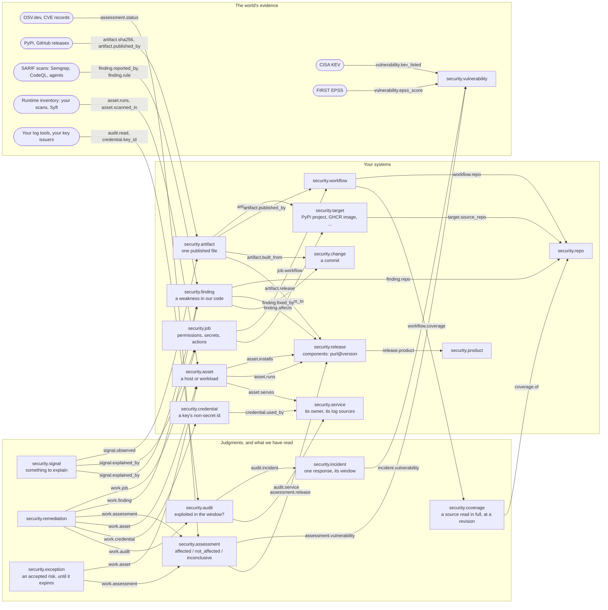

# Security kit

## What it is

The security kit makes Cruxible your organization's security record: a model of
what you run and what you ship, joined to what the world says about
vulnerabilities, that your agents keep current and answer from. It models:

- **What you run.** Your hosts and workloads and what each one actually runs,
  from your inventory and runtime scans; the business services they serve, with
  each service's owning team, criticality and log sources; and the credentials
  those services use, by their non-secret key ids.
- **What you build and ship.** Your repositories and their CI workflows and jobs
  (triggers, permissions, secrets, actions, publish targets), the registries you
  publish to and the files they serve, and your releases with their components
  from your SBOMs.
- **What others say.** CISA KEV, FIRST EPSS, OSV.dev and CVE records about
  vulnerabilities, and what your scanners and agent reviewers report about your
  own code.

On that model it answers the questions a security team asks: which hosts run
something attackers are exploiting, what can publish without a release tag,
which weaknesses in your code are still open. In an incident it carries the
response through: find what is exposed, patch it, audit the logs for
exploitation, rotate the keys.

Cruxible is what makes those answers trustworthy. Every fact points to the
retained copy of the source it was read from. Judgments, such as whether a
release is affected or whether a service was exploited, are proposed by agents
and settled by your review, or automatically once automation has a measured
record. Every answer is **found**, **none** or **unknown**, and never "none" for
something nobody read. Lines keep the model current on a schedule, or whenever
new evidence lands.

## What it answers

| Question | Where the answer comes from |
|---|---|
| Which of my releases are exposed to a vulnerability attackers exploit, and which first? | `security.urgent_exposures`: releases assessed affected (by OSV per SBOM component, or by a CVE record's version ranges), KEV-listed first, then by EPSS score; `component` names the dependency OSV found it in; `asset` is a host that declares installing it (`asset_observed` when a scan also sees it running there) and `observed` a host only a scan sees |
| Is release X affected by this KEV entry? | `security.triage` for the CVE: each release's assessment, with the CVE's KEV and EPSS facts |
| Which internet-facing hosts run an affected, KEV-listed release? | `security.kev_exposure`: your inventory of hosts and what they install, joined to the assessments |
| What can publish to PyPI without a `v*` tag? | `security.publish_paths` (HQ1): jobs in your repository's workflows that can publish to the target, whose triggers the target's publish gate does not allow |
| Which credentialed jobs run mutable third-party code? | `security.mutable_actions` (HQ3): actions not pinned to a commit SHA in jobs that hold a write permission or a secret |
| Does what PyPI serves match what we built? | `security.served_vs_declared` (HQ5): PyPI's digests and provenance against the workflow and commit that declare them |
| Which exploited vulnerabilities has nobody triaged yet? | `security.kev_triage_backlog`: assessments of KEV-listed CVEs with no status, or inconclusive |
| Which weaknesses in our code are still open, and who says so? | `security.open_findings`: every finding of a repository not verified fixed, with its verdict (`conflict` while disputed), severity, location, finders and remediation |
| Do we serve a release with a confirmed, unfixed weakness? | `security.published_findings` (HQ6): confirmed findings not verified fixed in a release a gated target serves a file of |
| How often is each scanner or agent right? | `security.finder_record`: every finding with the finders that reported it and its verdict; upheld (confirmed, not_exploitable) against overturned (false_positive) |
| In an incident: which deployments run an affected release, is each patched, were we exploited, which keys need rotating? | the incident's respond Line (RQ1-RQ5) and `security.incident_exposure`, `security.open_patches`, `security.audit_status`, `security.incident_credentials`, `security.incident_status` ([Respond to an incident](walkthroughs.md#respond-to-an-incident)) |

Ask any of them with `cruxible query --name NAME`. The hardening questions
(HQ1-HQ6) are also asked for you on a schedule, and each answer is **found**,
**none** (looked, nothing matches) or **unknown** (not read yet: it names the
pull that would answer it); never "none" for something nobody read.

An agent doing this work can load two skills. The [security intake
skill](skills/security-intake/SKILL.md) pulls your state in: an SBOM per
repository, a runtime inventory per scope, services and their credentials, and
log sources, then whatever an unknown answer names. The [security analyst
skill](skills/security-analyst/SKILL.md) gives the order to work these
questions in, and the rules that keep its judgments reviewable.

**Coming from the Cruxible quickstart?** You've done [Install and first
answers](#install-and-first-answers), declared an incident and added its respond
Line. To carry the response through (patches, log audits, key rotations, and
the log import Line and re-ask Triggers the quickstart left out), continue at
[Respond to an incident](walkthroughs.md#respond-to-an-incident). For your CI and registries,
see [Your systems](walkthroughs.md#your-systems-the-hardening-questions); for scanner and
reviewer findings in your own code, [Your code's findings](walkthroughs.md#your-codes-findings).

## How it models your world

Four words carry the rest of the kit's docs. A **Subject** is one thing the kit
models, of one kind: a repository, a job, a release, a vulnerability. A
**Claim** is one statement about a Subject (a field and its value) with a role,
either an *observation* (what a source said) or *normative* (what someone
decided), and the evidence it cites. A **Capture** is the retained copy of what
a source returned (a KEV catalog, a repository's workflow files at a commit, a
PyPI answer), kept by content digest so a Claim can point to it. A **Line** is
standing automation: one deterministic Procedure with its inputs, started by
Triggers (a schedule, or a Capture landing) and capped at what it may do:
observe, propose for review, or settle.

<!-- concept-map: checked by source/reference.py -->


**Your systems.** What you ship and how it is published. Pull Lines read your
repository's workflow files at a ref and your registries' published files; parse
Lines turn each read into observations: a workflow's triggers, a job's
permissions, secrets, actions and publish targets, a published file's digest and
the workflow and commit that built it. Releases and their components come from
your CycloneDX SBOMs, hosts and what they install from your own inventory, and
what each host or workload actually runs from your runtime-inventory scans.
Nothing here is asserted by the kit: each fact cites the Capture it was read
from, and the one policy statement, a target's `publish_gate`, is yours. A
finding is one weakness in your own code: what scanners and agents report about
it cites their SARIF log, and its `verdict` is your reviewers' decision.

**The world's evidence.** What public sources say. KEV and EPSS facts land on a
vulnerability (`security.vulnerability`, keyed by CVE id), verbatim from the
catalog or the daily file; OSV.dev and CVE records decide applicability; PyPI and
GitHub releases say what a registry actually serves. World evidence attaches to
your systems in two places: a vulnerability meets a release in an
**assessment**, and what a registry serves meets the workflow and commit that
declare it on an **artifact**.

**Judgments, and what we have read.** An assessment is one (release, CVE) pair,
proposed from OSV or a CVE record, or decided by an analyst. A signal is a
mismatch or event to explain (a served digest that differs from the declared
one); hypotheses (`explained_by`) compete until a cited change resolves them. A
remediation (or an exception, or a compensating control) is the work you decide
on. Coverage is the kit's record of what it has read in full and at which
revision: absence counts as an answer only inside a current coverage, so a
stale or missing read makes an answer unknown, not none. An incident groups the
CVEs of one response; an audit asks, per service, whether you were exploited in
its window, starting from the log sources the service lists; a credential is a
key you may need to rotate, by its non-secret id.

<!-- BEGIN GENERATED: glance -->
<!-- Generated by source/reference.py from the definitions. -->

| `security` 1.3.0 | Count |
|---|---|
| [Kinds of thing it models](reference.md#what-it-models) | 23 |
| [Fields (ClaimTypes) across them](reference.md#what-it-models) | 137 |
| [Capture contracts (plus core's self-source)](reference.md#where-evidence-comes-from) | 5 + 1 |
| [Procedures](reference.md#what-runs-on-its-own) | 28 |
| [Queries](reference.md#what-you-can-ask) | 50 |
| [Example Lines / Triggers / Mandates](reference.md#what-runs-on-its-own) | 19 / 21 / 11 |

<!-- END GENERATED: glance -->

Full reference: every kind, field, contract, Line and query, with diagrams of
where evidence comes from and what starts what, in [reference.md](reference.md)
(generated from this release's definitions).

## How it runs on its own

The kit carries definitions only; the
[example ChangeSet](examples/automation.json) is an inert starting point,
explained in [examples/README.md](examples/README.md). Installing the kit
starts nothing: you adapt the example, submit it and approve it like any other
change ([Install and first answers](#install-and-first-answers), steps 2 to 4).
It authors three kinds of member:

- **Lines**, authored disabled. Each runs one Procedure with its inputs, and its
  max authority caps what a run may do: `observe` (retain a Capture, or post
  inbox items), `propose` (a ChangeSet that waits for review) or `settle`.
- **Triggers**, which start a Line: a cron schedule (UTC), or a Capture landing,
  named by its contract and logical source. An incident adds window-close
  Triggers that re-ask a day after a landing.
- **Mandates**. A Mandate grants a Procedure the right to propose or settle
  within a scope. The example's are propose-only, so everything its Lines find
  is reviewed until you graduate them.

| For | Lines (example names) | Started by | Max authority |
|---|---|---|---|
| KEV and EPSS | `security.kev-daily`, `security.epss-daily` | daily at 14:17 and 13:45 UTC | observe: retains the CISA KEV catalog or the FIRST EPSS daily scores file |
| | `security.kev-triage`, `security.epss-triage` | when a CISA KEV catalog or a FIRST EPSS daily scores file lands, retained by `security.kev-daily` or `security.epss-daily` | propose, until graduated to settle (below) |
| | `security.kev-attention` | when a CISA KEV catalog lands, retained by `security.kev-daily` | observe: posts inbox items |
| Applicability | `security.sbom-import` | when a CycloneDX SBOM lands, retained by a direct `security.sbom-acquire` run on an agent's workspace file | propose |
| | `security.osv-applicability` | daily at 15:30 UTC | propose |
| | `security.cve-applicability` | when a CVE record lands, retained by a direct `security.fetch` run | propose |
| Your systems | `security.repo-pull.cruxible-ci`, `security.registry-pull.*` | every 6 hours at :05 UTC (the repository); daily at 06:20 and 06:25 UTC (PyPI) | observe |
| | `security.repo-parse.cruxible-ci`, `security.registry-parse.*` | when a GitHub repository snapshot or a PyPI release read lands, retained by a pull Line | propose |
| | `security.harden` | daily at 07:40 UTC, and when either of those lands | observe: posts inbox items |
| Your code's findings | `security.sarif-import.cruxible`, `security.sarif-attention.cruxible` (a pair per repository) | when a SARIF scan log lands, retained by a direct `security.sarif-acquire` run on an agent's workspace file | propose; observe |
| Incidents | `security.inventory-import.prod` (one per scope), `security.credential-import` | when a runtime-inventory scan or a credential key-state read lands, retained by a direct `security.inventory-acquire` or `security.credential-acquire` run on an agent's workspace file | propose |
| | `security.respond.<incident>`, `security.log-import.<incident>` (declared with each incident) | daily, and a day after a scan or key-state read lands (window close); when a log read lands, retained by a direct `security.log-acquire` run | observe; propose |

Every Line, what starts it and what a run does is in [reference.md](reference.md#what-runs-on-its-own).

The automation example states the instance acquisition default once:
`SourceAcquisitionPolicy:default`, `max_age: P1D`. Kit ownership uses dotted
prefixes, so this instance setting is part of the consumer ChangeSet rather than
the exported `security.` definitions. Lines inherit it without policy references.

### One finding, end to end

A mutable action in a job that can publish, found and fixed, with the names the
example automation uses for `cruxible-ai/cruxible`:

1. **Pull (automatic).** Every 6 hours the Line `security.repo-pull.cruxible-ci`
   runs the Procedure `security.repo-acquire`, which reads `.github/workflows/`
   at `main` and retains it as one Capture under `security.fetched-v1`.
   The Line's max authority is `observe`: it records the read and nothing else.
2. **Parse (a proposal).** The landing starts `security.repo-parse.cruxible-ci`.
   It proposes observation Claims citing that Capture, among them, for the job
   `publish.yml#publish-client`, `security.job.permission` `id-token:write` and
   `security.job.uses` `pkg:githubactions/actions/checkout@v4`, plus the source's
   `security.coverage.revision` (the commit read). A person or agent reviews and
   activates the proposal (`cruxible proposal review ID`, `cruxible proposal
   activate ID`); an unchanged read proposes nothing.
3. **Ask (automatic).** `security.harden` runs daily and on each landing (or
   `cruxible line run security.harden`) and reads only accepted Claims, so its
   first run after the activation asks HQ3 through `security.mutable_actions`:
   the job holds a write credential and runs an action pinned to a tag, not a
   40-hex commit SHA. The answer is **found**, posted as one inbox item naming
   the job and the action. Harden only observes and posts; it never changes what
   the instance holds.
4. **Decide (needs someone).** An agent reads the finding (`cruxible inbox list
   --line security.harden`) and records the decision: a `security.remediation`
   with `security.work.job` naming the job and `security.work.rationale`, or a
   `security.exception` if the risk is accepted. These are normative Claims in
   the agent's own words; your instance's approval policy decides whether they
   wait for review.
5. **Close (automatic, then a proposal).** After the pin merges, the next pull
   reads a new revision; the parse proposes revising `job.uses` to the SHA and
   the one `coverage.revision` Claim, and nothing else. Once that is accepted,
   harden's next run answers HQ3 **none** for the job, naming the revision it
   read.

The parse step can itself become automatic: once its proposals have been
reviewed long enough, a settle Mandate lets the Line settle verbatim parses
([Measure and graduate](#measure-and-graduate)). Judgments (a status an analyst
decides, `explained_by`, a publish gate) always stay with people and agents.

### Measure and graduate

`security.kev-triage` declares `kev-backlog-cleared`: the `kev_triage_backlog`
query must be empty 3 days after the Procedure is accepted (review when the
satisfied rate drops below 0.8 over 5 readings).
`cruxible procedure measure security.kev-triage --run-id RUN-...` and
`cruxible procedure readings security.kev-triage --subject-grain procedure_unit`.

When the readings justify it, settle the verbatim KEV and EPSS fields under
settle mandates and raise the triage Lines to `settle`, in one change set from
the Python SDK (`cruxible-client`, which `cruxible` installs; `gate/recipe.py`'s
`graduate()` is the same change set as JSON, for `cruxible authoring submit`):

```python
from datetime import UTC, datetime, timedelta

from cruxible_client import Cruxible
from cruxible_client.contracts.authoring.inputs import ProcedureMandateInput
from cruxible_client.contracts.authoring.models import (
    MandateConditionAuthoring,
    MandateScopeAuthoring,
)
from cruxible_client.contracts.procedures.models import ProcedureHardCaps

cx = Cruxible.connect()
now = datetime.now(UTC).replace(microsecond=0)
condition = MandateConditionAuthoring(
    query_name="security.settle_condition", binding_parameter="vulnerability_id",
    required_fields=("cve_id",), fallback="propose",
)
# Procedure -> (the verbatim fields it settles, its capture-byte ceiling, its trigger input)
triage = {
    "security.kev-triage": (
        ("kev_date_added", "kev_due_date", "kev_listed", "kev_ransomware_use"),
        16_777_216, "catalog"),
    "security.epss-triage": (("epss_percentile", "epss_score"), 33_554_432, "epss"),
}

draft = cx.changes(rationale="Graduate KEV and EPSS triage to settle.")
for procedure, (fields, capture_bytes, trigger_input) in triage.items():
    draft.procedure_mandate(ProcedureMandateInput(
        kind="procedure_mandate", name=f"{procedure}-settle", procedure_name=procedure,
        grants="settle", namespace=("claims",),
        valid_from=now, expires_at=now + timedelta(days=90),
        resource_ceiling=ProcedureHardCaps(
            max_wall_clock={"microseconds": 300_000_000}, max_provider_calls=2,
            max_capture_bytes=capture_bytes, max_items=5000, max_repeat_attempts=1),
        scope=tuple(
            MandateScopeAuthoring(claim_type=f"security.vulnerability.{field}",
                                  change_kinds=("create", "revise"))
            for field in fields),
        condition=condition,
    ))
    draft.line(name=procedure, procedure=procedure, max_authority="settle",
               trigger_input=trigger_input)
intent = draft.submit()
intent.outcome.status   # 'landed'
```

Re-enable both Lines. The KEV and EPSS fields are verbatim copies of CISA's and
FIRST's data, so every change for a watched vulnerability settles. Core requires
a condition on every settle grant and that it return exactly one row per
target; `security.settle_condition` holds for any keyed vulnerability. It cannot
re-derive "watched" (that needs an optional hop, which core admits only in
path-shaped queries, whose rows are per path), and need not: the triage
Procedures only change watched vulnerabilities, so the grant's scope decides.
The Procedures do
not change, so their digests and track records carry through.

The parse Lines of the system model start at propose too. Their facts are verbatim
parses, so they can graduate to settle like KEV and EPSS, with a condition that
holds per target; `signal.explained_by` and `publish_gate` never enter a Mandate.

Graduation never covers judgments. The SARIF import's report observations (the
finding by key, `rule`, `reported_by`, a scan's `severity`) may graduate to settle
per finder once its record holds, with `security.finding_settle_condition` as the
condition; the default is propose.

## Install and first answers

Cruxible includes `uv` for Provider installation and execution. The generator
recipes need their own tools (`uv`/`uvx` for Python or `npm`/`npx` for
JavaScript). [Intake recipes](intake.md) holds the commands and their gaps;
the [security intake skill](skills/security-intake/SKILL.md) explains the inputs
and what unknown answers mean.

1. **Install.** `cruxible kit add security:1.3.0` previews the change; commit it
   at the coordinate the preview prints: `cruxible kit add security:1.3.0
   --commit --at OID`. This installs the kit's definitions and its Providers
   (the packages its Procedures call to fetch and parse): the bundled
   `security-analysis-provider` (deterministic parsing and classification, no
   network) and
   `security-sources-provider` (OSV.dev, EPSS, GitHub repository, PyPI and
   release-asset reads), and `cruxible-provider-web` 0.2.2 by name from PyPI,
   verified against the recorded hashes.
2. **Adapt the automation**, the [example ChangeSet](examples/automation.json)
   ([How it runs on its own](#how-it-runs-on-its-own)). Choose Line names;
   your sources (repository, PyPI projects); Provider slots bind by fit with one
   installed build per interface, so the example needs no explicit bindings;
   cron times; and Mandate expiry. Nine Lines in it are examples named for the
   kit's own repository (`security.repo-pull.cruxible-ci`, `...registry-*.cruxible*`,
   `...sarif-*.cruxible`, `security.harden`): rename them for your sources or
   leave them out (a submitted Line you never enable is a `line_not_enabled` row in
   every `cruxible next`).
3. **Submit it**: `cruxible authoring submit automation.json`, then review and
   activate it under your approval policy. It authors nineteen disabled Lines, twenty-one Triggers and eleven propose-only
   Mandates.
4. **Enable the vulnerability Lines**: `for l in kev-daily kev-triage
   kev-attention epss-daily epss-triage sbom-import osv-applicability
   cve-applicability; do cruxible line enable security.$l; done`. Changing a
   Line, or a Trigger aimed at it, disables it again; `cruxible next` names the
   `line enable` that restarts it.
5. **Import an SBOM.** Put a CycloneDX JSON SBOM in the attached workspace (its
   `metadata.component` names the product and version) and read it:

   ```sh
   echo '{"relative_path": "sboms/app.cdx.json"}' > sbom.json
   cruxible procedure run security.sbom-acquire sbom.json
   ```

   Its landing runs `security.sbom-import`, which proposes the product, release,
   supplier and one `security.release.component` per component purl; review and
   activate it (`cruxible proposal list`, `review`, `activate`). Re-reading an
   SBOM proposes only what is new: a new `metadata.component` version is a new
   release of the same product, a changed SBOM adds its new components, and a
   changed supplier revises the held one. Superseded releases and components an
   SBOM no longer lists are kept; retire them yourself.
6. **Ask OSV**: `cruxible line run security.osv-applicability`, then review and
   activate its proposal: one assessment per (release, CVE) OSV relates, and
   each release's `osv_coverage` (`partial` names the purl types OSV never
   indexes, `pkg:brew` and `pkg:generic` among them). An acquire returns before
   its import proposes (`Next: done` means the Capture landed), and OSV answers
   only the releases and CVEs it holds when it runs: **run it again** after an
   SBOM or inventory scan adds releases, and after an incident or a watch adds a
   CVE, or those pairs stay unknown until the daily run.
7. **KEV and EPSS**: `cruxible line run security.kev-daily` and `cruxible line
   run security.epss-daily`, then activate the two triage proposals. From here
   the cron Triggers repeat steps 6 and 7 daily.
8. **The answer**: `cruxible query --name security.urgent_exposures`: every
   exposure, KEV-listed first (`kev_listed`), then by EPSS. "Exploited
   vulnerabilities we run" is its KEV-listed rows; the rest are affected releases
   nobody has seen exploited.

What stays yours: approving the automation, enabling Lines, providing SBOMs and
CVE record requests, reviewing applicability proposals, renewing Mandates before
they expire, and reviewing a Procedure revision an upgrade changes.

## Upgrading

Preview `cruxible kit add security:VERSION`, then commit with
`cruxible kit add security:VERSION --commit --at OID`. Version 1.3.0 folds the nine
old Blueprints into seven slotted Procedures; the upgrade retires those Blueprints
without `keep`. Existing exact instances remain historical Procedures; update your
Lines and direct calls to the names and parameters in the example.

Compatible named Procedure revisions retain Line bytes and enablements. An exact
Procedure revision carries its Mandates to propose-only; review and re-author the
KEV/EPSS settle grants to restore settlement. Triggers retain their exact bytes.
A Line or Trigger you edit still needs explicit enablement. A provider move that
changes a Line's bindings is a Line revision and needs that enablement too.
A release shipping a new provider build re-binds the affected Lines and disables
them until they are explicitly re-enabled.

Provider builds remain installed alongside older builds. A direct or invoked run
requires one fitting build per slot; use `--bind slot=provider` for a direct run or
`bindings` on its Line when the choice is ambiguous. Invoked children bind by fit
independently; a parent's Line bindings do not select their builds. Retire obsolete
builds only after reviewing their live dependents.

The instance policy `default` is shared: another kit or consumer can revise it,
changing the acquisition age bound inherited by these Procedures.

## Operating notes

- **Network.** web.fetch reaches cisa.gov, cveawg.mitre.org and (for the
  system model's release and history pulls) api.github.com;
  `security-sources-provider` reaches api.osv.dev, epss.empiricalsecurity.com,
  api.github.com, raw.githubusercontent.com, pypi.org, and github.com with its
  asset hosts (its declared endpoints). No credential is sent: GitHub allows 60 unauthenticated API calls
  an hour, and a repository pull costs two plus one raw read per file. The SBOM is read from the attached workspace by
  core's built-in `workspace.file`; the Source request is the v2 form, so no
  workspace binding digest is ever authored.
- **Staleness.** The policy refuses a Capture older than 24 h: triage of a
  backfilled catalog after a long outage refuses; run the acquisition Line for a
  fresh one.
- **Storage.** Retained for at least 30 days each: the KEV catalog (~1.8 MB per
  acquisition), the EPSS daily file (~3.6 MB), each OSV answer (every advisory
  record it read) and each SBOM.
- **CVE Services throttles bursts**: fetch CVE records one at a time.
- **Provider slots.** Procedures declare interfaces; Lines and direct runs choose fitting builds.
- **Mandates expire** after 90 days in the payloads above; renew them first.
- **Findings Lines per repository.** Each repository's `security.sarif-import` and
  `security.sarif-attention` Lines read every SARIF landing and halt `wrong_repo` for
  another repository's log after parsing it, so a landing costs one parse per
  repository Line. The import's tap reads the repository's held findings
  (`security.finding_index`, up to 2000; a truncated tap refuses rather than read a
  held finding as new).
- **Workspace files are at most 1 MiB.** Core's built-in `workspace.file` structures
  at most 1 MiB, so every workspace-file Procedure (SBOM, evidence, SARIF,
  reproduction, inventory, log read, credential state) budgets 1 MiB: split a larger
  SBOM, scan or inventory scope.
- **Incident Lines.** An inventory import reads one scope's held assets and runs
  (`security.inventory_index` and `security.inventory_patches`, up to 2000 rows each:
  split a scope that grows past it; a truncated tap refuses). The credential import
  reads every held credential (`security.rotation_work`). Respond and the log import
  read one incident's rows. A landing costs one import per scope or incident Line.
- **Secret slips.** A credential-state body is an allow-list, but its bytes are
  retained before the import refuses it; the three incident contracts authorize
  erasure (`cruxible capture erase`): see [Respond to an
  incident](walkthroughs.md#respond-to-an-incident). Every other kit contract (SBOM, evidence,
  SARIF, reproduction and the public-source reads) keeps its bytes for good, so
  check a file for secrets before you acquire it.

## Where next

- [walkthroughs.md](walkthroughs.md): the hardening questions, your code's
  findings and an incident response (PHP2Shell), each end to end.
- [intake.md](intake.md): recipes for bringing your state in: SBOMs, services,
  credentials, runtime inventory, log sources, generic HTTP reads.
- [in-depth.md](in-depth.md): how the vulnerability half names Subjects, decides
  applicability, records analyst judgments and keeps KEV and EPSS current, and
  predictions.
- [reference.md](reference.md): every kind, field, contract, Line, Procedure and
  query, generated from this release's definitions.
- [examples/README.md](examples/README.md): the example automation, member by
  member.
- The [security intake](skills/security-intake/SKILL.md) and [security
  analyst](skills/security-analyst/SKILL.md) skills, for an agent doing the work.
- [source/README.md](source/README.md): for maintainers, building a release, the
  release gate and self-dogfood (in the kits repository; not part of the bundle).
