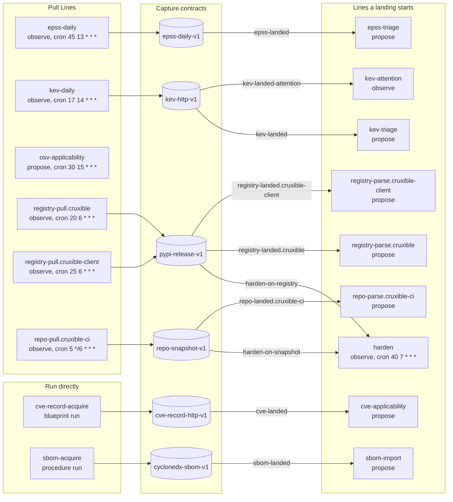

# security kit

Answers two questions with evidence. **Which of my releases are exposed to a
vulnerability attackers exploit, and which first?** And, from a symbolic model
of your systems (see [The system model](#the-system-model-what-your-systems-declare-and-serve)):
**can anything publish my artifacts except the path my policy allows, and does
what a registry serves match the path that declares it?** The kit keeps the first
answer current from five sources:

| Source | What it gives | How it arrives |
|---|---|---|
| CycloneDX SBOM (your workspace) | each release's components (`purl@version`) | `security.sbom-acquire` (direct run per SBOM) -> `security.sbom-import` |
| OSV.dev | which components an advisory affects, precisely by version | `security.osv-applicability` (daily, or on demand) |
| CVE record (cveawg.mitre.org) | vendor product version ranges | `security.cve-record-acquire` (direct run per CVE) -> `security.cve-applicability` |
| CISA KEV | exploited in the wild, due dates | `security.kev-acquire` (daily) -> `security.kev-triage`, `security.kev-attention` |
| FIRST EPSS | probability of exploitation | `security.epss-acquire` (daily) -> `security.epss-triage` |

The second answer comes from what your repositories declare and your registries
serve: a GitHub repository's workflows at a ref, PyPI's files and their
provenance, and GitHub release assets, each pulled on a schedule or on demand and
parsed when it lands.

Every observation Claim cites the retained Capture it was read from.
Applicability answers are proposed for review, never settled by the kit; the
verbatim KEV and EPSS fields can graduate to settling under a mandate. A kit
carries definitions only: the Lines, Triggers, mandates and inventory below are
yours to author.

Two parts of this README are generated from this release's own definitions, so
they always match what `kit add` installs: [At a glance](#at-a-glance) just
below (what the kit defines and installs, how evidence reaches each kind, what
starts what in the example automation) and the reference after the walkthroughs
([What it models](#what-it-models), [Where evidence comes from](#where-evidence-comes-from),
[What runs on its own](#what-runs-on-its-own), [What you can ask](#what-you-can-ask)).
Everything else is hand-written. The same generated content is in
[reference.md](reference.md).

<!-- BEGIN GENERATED: overview -->
<!-- Generated by source/reference.py from the definitions. -->

## At a glance

Kit `security` version **1.1.0**, defining every name under `security.`. Generated from the release's own definitions (`cruxible-kit.json`, `artifacts/`) and the example ChangeSet; `python source/reference.py` rewrites it and `scripts/kits.py check` fails when it is out of date.

| Definitions | Count | Notes |
|---|---|---|
| Subject kinds | 19 | [What it models](#what-it-models) |
| ClaimTypes | 87 | 7 shared by several kinds |
| Capture contracts | 12 | [Where evidence comes from](#where-evidence-comes-from) |
| Procedures | 10 | - |
| Blueprints | 9 | you bind each one's Provider slots |
| Queries | 28 | [What you can ask](#what-you-can-ask) |
| Provider interfaces | 15 | - |
| Acquisition policies | 1 | `security.acquisition` |
| Example Lines | 15 | with 17 Triggers and 7 Mandates in `examples/automation.json`: [What runs on its own](#what-runs-on-its-own) |

Providers `kit add` installs:

| Package | Version | Delivery | Interfaces |
|---|---|---|---|
| `cruxible-provider-web` | 0.2.2 | by name from the index | `search.web`, `web.fetch` |
| `security-analysis-provider` | 1.1.0 | bundled wheel | `security.cve-applicability`, `security.cyclonedx-components`, `security.epss-scores`, `security.harden`, `security.kev-attention`, `security.kev-catalog`, `security.osv-applicability`, `security.registry-facts`, `security.workflow-facts` |
| `security-sources-provider` | 1.1.0 | bundled wheel | `security.epss-daily`, `security.osv-query`, `security.pypi-release`, `security.release-asset`, `security.repo-snapshot` |

### How evidence reaches each kind

Each box on the left is one source and the Capture contract it is retained under, grouped by the kind of evidence it is; an arrow points to a Subject kind whose ClaimTypes may cite it. A thick arrow carries at least one ClaimType that requires a Capture (`captured`); a dotted arrow only ClaimTypes that may cite one. The number is how many of that kind's ClaimTypes the contract backs. Names drop the `security.` prefix. Not drawn: the statements that may instead cite their author's own word (Evidence `own word` below), and kinds that hold only statements their author's origin supports.

```mermaid
flowchart LR
  subgraph g0["Fetched from a source (HTTP)"]
    direction TB
    c_security_cve_record_http_v1["cve.record<br/>as cve-record-http-v1"]
    c_security_epss_daily_v1["first.epss.daily<br/>as epss-daily-v1"]
    c_security_github_api_v1["github.api<br/>as github-api-v1"]
    c_security_github_release_v1["github.release<br/>as github-release-v1"]
    c_security_kev_http_v1["cisa.kev.catalog<br/>as kev-http-v1"]
    c_security_observation_output_v1["security.observation<br/>as observation-output-v1"]
    c_security_osv_query_v1["osv.dev.query<br/>as osv-query-v1"]
    c_security_pypi_release_v1["pypi.release<br/>as pypi-release-v1"]
    c_security_release_asset_v1["github.release.asset<br/>as release-asset-v1"]
    c_security_repo_snapshot_v1["github.repo.snapshot<br/>as repo-snapshot-v1"]
  end
  subgraph g1["SBOM documents"]
    direction TB
    c_security_cyclonedx_sbom_v1["cyclonedx.sbom<br/>as cyclonedx-sbom-v1"]
  end
  subgraph g2["Workspace files an analyst cites"]
    direction TB
    c_security_workspace_evidence_v1["security.analysis.evidence<br/>as workspace-evidence-v1"]
  end
  subgraph kinds["ClaimTypes, by Subject kind"]
    direction TB
    k_security_artifact["artifact"]
    k_security_assessment["assessment"]
    k_security_control["control"]
    k_security_coverage["coverage"]
    k_security_exception["exception"]
    k_security_job["job"]
    k_security_product["product"]
    k_security_release["release"]
    k_security_remediation["remediation"]
    k_security_signal["signal"]
    k_security_target["target"]
    k_security_vulnerability["vulnerability"]
    k_security_workflow["workflow"]
  end
  c_security_cve_record_http_v1 -. "4" .-> k_security_assessment
  c_security_cve_record_http_v1 == "2" ==> k_security_vulnerability
  c_security_cyclonedx_sbom_v1 -. "1" .-> k_security_product
  c_security_cyclonedx_sbom_v1 == "2, 1 captured" ==> k_security_release
  c_security_epss_daily_v1 == "2" ==> k_security_vulnerability
  c_security_github_api_v1 == "1" ==> k_security_artifact
  c_security_github_api_v1 -. "2" .-> k_security_signal
  c_security_github_release_v1 == "6, 5 captured" ==> k_security_artifact
  c_security_github_release_v1 -. "2" .-> k_security_signal
  c_security_kev_http_v1 == "6" ==> k_security_vulnerability
  c_security_observation_output_v1 -. "2" .-> k_security_assessment
  c_security_observation_output_v1 == "1" ==> k_security_control
  c_security_observation_output_v1 == "1" ==> k_security_exception
  c_security_observation_output_v1 == "1" ==> k_security_remediation
  c_security_observation_output_v1 -. "1" .-> k_security_signal
  c_security_observation_output_v1 == "4" ==> k_security_vulnerability
  c_security_osv_query_v1 -. "4" .-> k_security_assessment
  c_security_pypi_release_v1 == "6, 5 captured" ==> k_security_artifact
  c_security_pypi_release_v1 == "2" ==> k_security_coverage
  c_security_pypi_release_v1 -. "2" .-> k_security_signal
  c_security_pypi_release_v1 -. "1" .-> k_security_target
  c_security_release_asset_v1 == "1" ==> k_security_artifact
  c_security_release_asset_v1 -. "2" .-> k_security_signal
  c_security_repo_snapshot_v1 == "2" ==> k_security_artifact
  c_security_repo_snapshot_v1 == "2" ==> k_security_coverage
  c_security_repo_snapshot_v1 == "7" ==> k_security_job
  c_security_repo_snapshot_v1 -. "2" .-> k_security_signal
  c_security_repo_snapshot_v1 -. "1" .-> k_security_target
  c_security_repo_snapshot_v1 == "3" ==> k_security_workflow
  c_security_workspace_evidence_v1 -. "2" .-> k_security_assessment
  c_security_workspace_evidence_v1 -. "1" .-> k_security_signal
```



### What starts what

From the example ChangeSet: pull Lines (on a cron) and Procedures you run directly retain Captures; a landing Trigger on a contract starts the Lines that read it. Each Line shows its max authority and any cron. The arrow label is the Trigger.



<!-- END GENERATED: overview -->

## Quick start: from `kit add` to an exposure answer

Nine steps; provider installs take most of the time. Every manual step that
remains is listed at the end of this section.

1. **Install.** `cruxible kit add security:1.1.0` previews; commit it at the
   coordinate the preview prints: `cruxible kit add security:1.1.0 --commit --at OID`.
   This installs the bundled `security-analysis-provider` and
   `security-sources-provider` and the default `cruxible-provider-web` 0.2.2
   (by name from PyPI, verified against the recorded hashes).

2. **Choose the nine Blueprint bindings.** The example binds KEV, CVE, GitHub
   release and history acquisition to `cruxible-provider-web`, and EPSS
   acquisition, OSV applicability and the repository, PyPI and release-asset
   pulls to `security-sources-provider`. Inspect the installed ProviderInterfaces and
   adapt those bindings to your approved Providers.

3. **Adapt the [example ChangeSet](examples/automation.json)** using the
   [walkthrough](examples/README.md): choose instance and Line names, Provider
   bindings, namespaces, inputs, cron times and mandate expiry. Capture-landing
   Triggers name their CaptureContract; prepare resolves and pins its digest.

4. **Submit your adapted ChangeSet** with `cruxible authoring submit automation.json`.
   Review the proposal and satisfy your instance's approval policy before activation.
   It instantiates nine Blueprints and authors fifteen disabled Lines, seventeen
   Triggers and seven propose-only Mandates (eight Lines, eight Triggers and five
   Mandates are the vulnerability loop; the rest are the system model's). The gate
   and self-dogfood scripts read this exact file.

5. **Enable the Lines**: `for l in kev-daily kev-triage kev-attention epss-daily
   epss-triage sbom-import osv-applicability cve-applicability; do cruxible line
   enable security.$l; done` (the system model's Lines are enabled in its own
   walkthrough below). A change to a Line or to a Trigger aimed at it stops
   its enablement; `cruxible next` names the `line enable` that restarts it.

6. **Import an SBOM.** Put a CycloneDX JSON SBOM in the attached workspace (its
   `metadata.component` names the product and version) and read it:

   ```sh
   echo '{"relative_path": "sboms/app.cdx.json"}' > sbom.json
   cruxible procedure run security.sbom-acquire sbom.json
   ```

   The Capture's landing runs `security.sbom-import`, which proposes the product
   and release (created by key, or the ones you already have), the supplier, and
   one `security.release.component` per component purl. Review and activate it:
   `cruxible proposal list`, `cruxible proposal review ID`, `cruxible proposal
   activate ID`.

   Re-reading an SBOM proposes only what the instance does not hold yet: a new
   `metadata.component` version is a new release of the same product, a changed
   SBOM for a held release adds its new components, and a changed supplier
   revises the held one. A superseded release is kept, with its components and
   assessments, since it may still be deployed; retire it yourself when it is
   not. Components an SBOM no longer lists are not removed.

7. **Ask OSV**: `cruxible line run security.osv-applicability`, then review and
   activate its proposal. Each (release, CVE) OSV relates gets an assessment; a
   CVE found in a component is created by key and is watched through its
   `affected` assessment.

8. **KEV and EPSS**: `cruxible line run security.kev-daily` and `cruxible line
   run security.epss-daily`; activate the two triage proposals. (From here the
   cron Triggers do this daily.)

9. **The answer**: `cruxible query --name security.urgent_exposures`: every
   release assessed affected, KEV-listed first, then by EPSS score, with the
   assets that install it.

Consumers choose the automation and approve its proposal, enable Lines, provide
SBOM/CVE inputs, review applicability proposals and renew Mandates before expiry.
Blueprint instances remain consumer-authored; re-instantiate after a changed Blueprint.

## Identity

Core names every security Subject; you never choose an id. Each kind is keyed
(its id is the readable rendering of its key) or minted:

| Kind | Key | Uniqueness | Example id |
|---|---|---|---|
| `security.vulnerability` | `cve_id` (trim, uppercase) | unique | `cve-2021-44228` |
| `security.release` | `product_name` + `version` | unique | `apache-log4j2--2.14.1` |
| `security.assessment` | `release_id` + `cve_id` | unique: one assessment per pair | `apache-log4j2-2.14.1--cve-2021-44228` |
| `security.asset` | `hostname` (trim, casefold) | unique | `web-1.example.com` |
| `security.product`, `security.supplier`, `security.team`, `security.service` | `name` (NFKC, trim, collapsed spaces, casefold) | hint | `apache-log4j2` |
| `security.remediation`, `security.exception`, `security.control` | minted | | `sub-...` |

A release's `product_name` is a literal key (key ClaimTypes are literal), beside
its Subject-valued `security.release.product`; an assessment's `release_id` is
the id core gave the release. Creating by a key a live Subject holds names that
Subject and creates nothing, so re-running an import or an analysis reuses what
exists.

**Watched is derived, never implied by existence.** A vulnerability is watched
(KEV and EPSS triage read it, applicability decides it for every related
release, KEV attention counts it as looked at) when **either**:

- an assessment links it to a release in inventory with status `affected` or
  `inconclusive` (the applicability Procedures create these), **or**
- it carries a `security.vulnerability.watch_reason`: an agent's or a person's
  normative decision to track it, and why.

A bare vulnerability Subject (created by key, nothing else) is tracked by
nothing. `security.watched_vulnerabilities` is that derivation; once every
assessment of a CVE is `not_affected` and nobody stated a reason, it drops out.
Track one by hand with a single write, which also creates it by key:

```sh
cruxible set security.vulnerability/CVE-2021-44228 watch_reason "Log4j in vendor appliances" \
  --because "Security review 2026-10-11."
```

In a JSON change set, a `subject` member plus a `watch_reason` claim member.

**Naming Subjects.** A reference takes key text as written, on every route
(`set`, `get`, `inbox link`, authoring): `security.vulnerability/CVE-2021-44228`,
`security.product/Apache Log4j2` (these resolve against accepted state). A
composite key, and any Subject the same change set creates, is named by kind and
key (a mapping of key parts, even for a one-key kind), never by a predicted id:
`{"subject_kind": "security.release", "key": {"product_name": "Apache Log4j2", "version": "2.14.1"}}`
(the SDK's `SubjectKeyReference`). Core resolves it to the Subject a `subject`
member of the same set lands on, else to the live holder of the key.

Inventory by hand, for what no SBOM describes (vendor products, hosts):

```json
{"kind": "change_set", "rationale": "Inventory.", "members": [
 {"kind": "subject", "subject_kind": "security.supplier", "key": "Apache Software Foundation", "rationale": "Our Log4j vendor."},
 {"kind": "subject", "subject_kind": "security.product", "key": "Apache Log4j2", "rationale": "We run it."},
 {"kind": "subject", "subject_kind": "security.release", "key": {"product_name": "Apache Log4j2", "version": "2.14.1"}, "rationale": "Installed on web-1."},
 {"kind": "subject", "subject_kind": "security.asset", "key": "web-1.example.com", "rationale": "The storefront host."},
 {"kind": "claim", "subject": {"subject_kind": "security.release", "key": {"product_name": "Apache Log4j2", "version": "2.14.1"}},
  "predicate": "security.release.product",
  "object": {"kind": "subject", "subject": {"subject_kind": "security.product", "key": {"name": "Apache Log4j2"}}}, "role": "normative", "rationale": "Its product.",
  "source": {"kind": "self_source", "body": "product: Apache Log4j2\n"}},
 {"kind": "claim", "subject": {"subject_kind": "security.product", "key": {"name": "Apache Log4j2"}}, "predicate": "security.product.supplied_by",
  "object": {"kind": "subject", "subject": {"subject_kind": "security.supplier", "key": {"name": "Apache Software Foundation"}}}, "role": "normative", "rationale": "Its vendor.",
  "source": {"kind": "self_source", "body": "supplier: Apache Software Foundation\n"}},
 {"kind": "claim", "subject": {"subject_kind": "security.asset", "key": {"hostname": "web-1.example.com"}}, "predicate": "security.asset.installs",
  "object": {"kind": "subject", "subject": {"subject_kind": "security.release", "key": {"product_name": "Apache Log4j2", "version": "2.14.1"}}},
  "role": "normative", "rationale": "Installed.",
  "source": {"kind": "self_source", "body": "installs Apache Log4j2 2.14.1\n"}},
 {"kind": "claim", "subject": {"subject_kind": "security.asset", "key": {"hostname": "web-1.example.com"}}, "predicate": "security.asset.internet_exposed",
  "object": {"kind": "literal", "value": true}, "role": "normative", "rationale": "Public.",
  "source": {"kind": "self_source", "body": "internet exposed\n"}}]}
```

Add another value of a many-valued field (`installs`, `serves`) with `cruxible
add`: two values of one many-valued slot in the same change set must each
disposition the other by a Claim ID the set itself mints.

## Applicability

An assessment is one (release, CVE) pair: `status` (`affected`, `not_affected`,
`inconclusive`) and, for `not_affected`, its VEX/CSAF `justification`
(`component_not_present`, `vulnerable_code_not_present`,
`vulnerable_code_not_in_execute_path`,
`vulnerable_code_cannot_be_controlled_by_adversary`,
`inline_mitigations_already_exist`). Both are observations citing the source
Capture. Core cannot require a justification only when the status is
`not_affected`; the kit's Procedures always state one with it, and `cruxible
query --name security.assessment_index` shows any assessment without one.

- **`security.osv-applicability`** (open source, by SBOM component). OSV is
  asked about every component `purl@version` of every release and for the
  record of every watched CVE and its aliases. A component OSV lists as affected
  -> `affected` (the CVE is created by key when new, and watched through that
  assessment). A watched CVE OSV has package data for
  but does not list -> `not_affected` with `vulnerable_code_not_present` when one
  of its packages is a component at another version. A failed OSV query for a
  relevant component -> `inconclusive`. A release none of whose components is a
  package the CVE affects is not assessed at all: an SBOM release with no
  assessment for a CVE means OSV relates none of its components to it.
  (Writing `component_not_present` for every such pair is releases x watched
  CVEs: on the self-dogfood instance's second day, 509 answers and 2,545
  proposal items nobody needs to review.) An advisory with no CVE alias cannot
  be keyed; the run's result lists it under `unkeyed`.
- **`security.cve-applicability`** (vendor products, by CVE record). When a CVE
  record lands (`cruxible procedure run security.cve-record-acquire` with
  `{"url": "https://cveawg.mitre.org/api/cve/CVE-..."}`), every release whose
  product name equals an `affected` entry's product (letters and digits,
  case-insensitive) and whose supplier matches the vendor (or is unset) is
  decided by the entry's version ranges (`version`, `lessThan`,
  `lessThanOrEqual`, `changes`; a `lessThan` ending in `*` is open-ended) and
  `defaultStatus`. Conservative: a partial product match, a contradicting
  vendor, or a version the ranges cannot order -> `inconclusive`, never a guess.

A pair whose held answer is unchanged proposes nothing, so a daily re-run is
quiet; a changed answer revises the held Claims and retires a justification an
`affected` answer no longer has. Neither Procedure settles: a person or agent
reviews every applicability proposal.

### Analyst judgments

`status` and `justification` have two roles, and every read shows which one a
Claim has:

| Role | Who states it | Evidence | Shown as |
|---|---|---|---|
| `observation` | an applicability Procedure (a source's verdict) | the OSV or CVE-record Capture it read | `role: observation` |
| `normative` | an analyst (their own judgment) | their own words, or a workspace file retained by `security.evidence-acquire` | `role: normative`; the analyst's reasoning is the write's `because` |

The normative role is what marks a judgment. `cruxible query security.assessment
--select status,justification --claims` prints each Claim's role, and `cruxible
get CLM-... --detail evidence` its evidence and `because`. The named worklists
(`assessment_index`, `triage`, `applicability_coverage`, `coverage_gaps`,
`urgent_exposures`, `change_impact`) carry a `status_role` column
(`observation` or `normative`). The Procedures never revise an assessment
whose status is normative: their result counts it under `judged`. Retire the
normative status (and justification) to hand the assessment back to them. An
observation in someone's own words has no admitted evidence: core writes it
with verdict `uncovered` (and warns), and no worklist shows it, since they read
supported Claims only.

The workflow, for a proposed `affected` or `inconclusive` you have reviewed:

1. Find it: `cruxible proposal review ID` (before activating), or after,
   `cruxible query --name security.assessment_index` / `security.coverage_gaps`.
2. Retain the evidence (optional; your own words are evidence too): put the
   file in the workspace (code, a config, an analysis note) and
   `echo '{"relative_path": "analysis/jinja2.md"}' > ev.json; cruxible procedure run
   security.evidence-acquire ev.json`; note its `Capture evidence: sha256:...`.
3. Record the judgment in one write (`cruxible write judgment.json`), with your
   reasoning as its `because`:

   ```json
   {"because": "We compile only packaged templates; the attacker-controlled filename never reaches Jinja.",
    "subject": "security.assessment/gate-app-1.0.0--cve-2024-56201",
    "changes": [
     {"op": "set", "field": "status", "value": "not_affected", "role": "normative",
      "evidence": {"kind": "capture", "capture": "sha256:..."}},
     {"op": "set", "field": "justification", "value": "vulnerable_code_not_in_execute_path",
      "role": "normative", "evidence": {"kind": "capture", "capture": "sha256:..."}}]}
   ```

   Without `evidence` each change cites `because` as your own words. `role:
   normative` is the default for these two fields; stating it keeps the write
   readable.

A `not_affected` assessment no longer keeps its CVE watched; if the CVE should
stay on the watch list, state a `watch_reason`.

## KEV, EPSS and attention

`security.kev-triage` compares each retained KEV catalog with every watched
vulnerability and proposes (or, graduated, settles) the KEV fields that changed:
`kev_listed`, `kev_date_added`, `kev_due_date`, `kev_ransomware_use`. A watched
CVE the catalog does not list gets `kev_listed = false` once. An identical
catalog halts `no_change`. `security.epss-triage` does the same for
`epss_score` and `epss_percentile`, verbatim from FIRST's daily file (scores
move a little most days, so expect a daily revision per watched CVE).

`security.kev-attention` reads the same catalog and posts one inbox item per CVE
added in the catalog's last 7 days whose vendor/product matches a release in
inventory that nobody watches the CVE for (no `watch_reason`, no affected or
inconclusive assessment), or nobody has assessed: possibly
exposed, nobody has looked. It never changes accepted state (`cruxible inbox
list --line security.kev-attention --status unread`). Matching leans to
matching (the product name equal to KEV's product or vendor + product, or the
supplier equal to KEV's vendor with one product name containing the other): a
false match costs an inbox item. The payload stays the same while the situation
does, so a daily re-sighting counts on the same item; an item you acknowledged
is unread again at the next sighting while the gap stays open. Close the gap
(assess the release, or state a `watch_reason`) to stop it.

## The system model: what your systems declare and serve

Every fact about your systems is one source's observation, citing the Capture it
was read from; your policy (a target's publish gate) is the only normative
statement; and absence is an answer only inside a current **coverage** belief.

| Kind | Key | What it is |
|---|---|---|
| `security.repo` | `forge_host` + `full_name` (trim, casefold) | a source repository |
| `security.workflow` | `source` (`github.com/owner/repo@ref`) + `path` | one CI workflow file, as one source declares it |
| `security.job` | `workflow_ref` (`source:path`) + `job_key` | holds the permissions, secrets, environment and actions |
| `security.target` | `registry` (`pypi`, `ghcr`, `github_release`, `github_pages`) + `name` | where artifacts land: the trust boundary a gate guards |
| `security.artifact` | `target_ref` (`registry/name`) + `name` | one published file (a release asset as `tag/asset`) |
| `security.change` | `repo_ref` + `commit_sha` | a commit, created when a question needs it |
| `security.coverage` | `source` + `scope` (`ci.workflows`, `release.manifest`, `registry.files`) | the belief that the source was read in full at a revision |
| `security.signal` | `detector` + `fingerprint` | an observation an investigation starts from |

A key that names another Subject names it by its locator text, never by an id: a
parse creates a workflow and its jobs in one terminal, before any id exists. Each
such key has a Subject-valued twin (`workflow.repo`, `job.workflow`,
`artifact.target`) the queries traverse. Facts are per source: `main` and a
`v0.3.2` tag are two sources with their own workflows, jobs and coverage.

**Three states.** `security.harden` answers each question per target and per
covered source as **found** (the facts answer it, and it is a problem: posted as
a finding), **none** (a current coverage answers it and nothing matches: it
names the coverage's source and revision, and stays in the run summary; `none`
answers are never stored) or **unknown** (no current coverage: it names the
source and the pull that answers it, posted as one gap item per source).
"Nobody asked" is a target without a gate; "looked and found nothing" is current
coverage with no matching row.

| # | Question | found |
|---|---|---|
| HQ1 `security.publish_paths` | Every path that can publish to T; does any bypass T's gate? | a job with `publishes_to` T whose workflow has a trigger the gate does not list |
| HQ2 `security.credentialed_jobs` | Which jobs hold write credentials, and what triggers them? | a write permission or secret in a job `pull_request_target`, `workflow_run` or `issue_comment` can trigger, or `workflow_dispatch` without an environment |
| HQ3 `security.mutable_actions` | Mutable third-party code inside credentialed jobs? | an action not pinned to a 40-hex SHA in such a job |
| HQ4 `security.shared_dependencies` | Single points of compromise on T's publish paths? | a mutable action or secret every publishing job of T shares |
| HQ5 `security.served_vs_declared` | Does what T serves match the path that declares it? | `published_by`/`publish_environment` not among the publishing jobs at `built_from`, or `declared_sha256` differs from `sha256` |

`job.publishes_to` follows the credential a registry accepts: PyPI needs
`id-token: write` and a publish step, GHCR `packages: write`, a GitHub release
`contents: write`, Pages `pages: write`. A job holding it can publish to every
target of that registry whose `source_repo` is the repository, so "can publish"
leans to over-approximating. The parse derives those edges against the targets it
knows; `security.harden` also counts every job of a covered source that holds the
credential, so a target stated after the last pull is answered at once.

### Walkthrough

1. **Ask.** State each target's gate (and, outside PyPI, its source repository;
   a PyPI target's comes from its provenance):

   ```json
   {"kind": "change_set", "rationale": "Ask about our release targets.", "members": [
    {"kind": "subject", "subject_kind": "security.target", "key": {"registry": "pypi", "name": "cruxible"}, "rationale": "We publish it."},
    {"kind": "claim", "subject": {"subject_kind": "security.target", "key": {"registry": "pypi", "name": "cruxible"}},
     "predicate": "security.target.publish_gate", "object": {"kind": "literal", "value": "push:tags:v*"},
     "role": "normative", "rationale": "Only a v* tag push may publish.",
     "source": {"kind": "self_source", "body": "gate: push:tags:v*\n"}}]}
   ```

2. **Harden**: enable `security.harden` and run it (`cruxible line run
   security.harden`). Every answer starts unknown; `cruxible inbox list --line
   security.harden` holds one gap item per source, `{source, pull, input}`, however
   many questions wait on it. Answer one by running its pull with its input:
   `cruxible procedure run security.registry-acquire input.json`.

3. **Parse.** A parse Line reads one source's pulls (its taps are keyed by its
   parameters, never by the landed Capture): the example has
   `security.repo-parse.cruxible-ci` (`main`'s workflows) and
   `security.registry-parse.cruxible`/`-client`, each with its landing Trigger;
   every other landing halts `other_source`. For another source, copy a parse Line
   member with its parameters (`source`, `repo_source`, `forge_host`, `full_name`,
   `ref`, `scope`, `path`) and its landing Trigger, and enable it. Review and
   activate the parse proposals, then run `security.harden` again (its landing
   Triggers fire before you accept, so under propose re-run it after accepting).

4. **Keep it current.** The pull Lines run on cron (the repository every 6 h,
   PyPI daily). The coverage revision is restated on every pull: identical bytes
   are a recorded re-observation (no proposal, no generation) that keeps it fresh;
   a new revision revises that one `coverage.revision` Claim, and only the facts
   that changed change. If pulls stop, coverage goes stale after `stale_after` (12 h, twice
   the cron), reads absent, and every answer resting on it turns unknown, naming
   the source. Widen it by revising the ClaimType (installed definitions are
   yours). Citations of a revision-pinned source (a tag, a SHA) never drift.

5. **Declared vs running** are separate per-source predicates compared by the
   queries and the classifier, never a contention: HQ5 posts a disagreement with
   both Claims (the declared digest from the manifest snapshot, the served one
   from the asset or registry). Contention is reserved for competing explanations.

6. **Investigate a signal** with one pull per hop, each cited:

   | Hop | Pull | Records |
   |---|---|---|
   | 0 | none (an HQ5 finding) | `security.signal` by key (`detector` `security.hq5`) with `signal.observed` and an investigation note section, in one write |
   | 1 | `security.asset-fetch` | `artifact.sha256` (what is served) |
   | 2 | `security.repo-acquire` at the tag, scope `release.manifest` (its parse Line) | `artifact.declared_sha256`; coverage at that SHA |
   | 3 | `security.release-acquire` | `artifact.uploaded_by` |
   | 4 | none if HQ2 already covers the source | the jobs that can write release assets |
   | 5 | `security.history-acquire` (workflow runs) | run attempts and times, cited in the note |
   | 6 | none | hypotheses: `signal.explained_by` (one write each; a second with `--contend`); the slot reads contested |
   | 7 | `security.history-acquire` (commits of a path) | `security.change`; the right hypothesis is revised to it, the other retired `was-wrong`, and the slot resolves |
   | 8 | none | `security.remediation` with `work.job` |

The parse Lines start at propose. Their facts are verbatim parses, so they can
graduate to settle like KEV and EPSS (**Measure and graduate**), with a
condition that holds per target; `signal.explained_by` and `publish_gate` never
enter a Mandate.

## Predictions: the applicability bet

State what you expect before a source observes it, and let the observation
settle it. Create the assessment by key with `security.assessment.expected_status`
(`affected` or `not_affected`, normative; plus its `release` and
`vulnerability`, naming the assessment by its key), then propose a contract
whose hypothesis is that Claim and whose observation is the assessment's
`security.assessment.status`. The observation selector is the assessment's
artifact path, the id core gave it (`cruxible query --name
security.assessment_index` lists it):

```json
{"contract": {"identity": {"kind": "ResolutionContract", "name": "bet-log4j-2.17.1"},
 "hypothesis": "CLM-...",
 "observation": {"subject": {"tag": "playbill-semantic-address-v1",
   "artifact_path": "subjects/security.assessment/apache-log4j2-2.17.1--cve-2021-44228.json",
   "selector": {"scheme": "artifact-v1", "value": ""}}, "predicate": "security.assessment.status"},
 "rule": {"tag": "playbill-prediction-equality-rule-v1", "operator": "equality"},
 "window": {"kind": "fixed", "starts_at": "NOW", "duration_seconds": 2592000}}}
```

`cruxible prediction propose FILE`, activate it, and once an applicability
Procedure's status Claim is accepted inside the window, `cruxible prediction
settle NAME --observation CLM-...` records whether the bet held. Settlement is
manual in v1; a window that closes unobserved shows in `cruxible next` until the
contract is retired.

## Measure and graduate

`security.kev-triage` declares `kev-backlog-cleared`: the `kev_triage_backlog`
query must be empty 3 days after the Procedure is accepted (review when the
satisfied rate drops below 0.8 over 5 readings).
`cruxible procedure measure security.kev-triage --run-id RUN-...` and
`cruxible procedure readings security.kev-triage --subject-grain procedure_unit`.

When the readings justify it, settle the verbatim KEV and EPSS fields under
settle mandates and raise the triage Lines to `settle` (`gate/recipe.py`'s
`graduate()`):

```json
{"kind": "change_set", "rationale": "Graduate KEV and EPSS triage to settle.", "members": [
 {"kind": "procedure_mandate", "name": "security.kev-triage-settle", "procedure_name": "security.kev-triage", "grants": "settle",
  "namespace": ["claims"], "valid_from": "NOW", "expires_at": "NOW+90d",
  "resource_ceiling": {"max_wall_clock": {"microseconds": 300000000}, "max_provider_calls": 2, "max_capture_bytes": 16777216, "max_items": 5000, "max_repeat_attempts": 1},
  "scope": [{"claim_type": "security.vulnerability.kev_date_added", "change_kinds": ["create", "revise"]},
            {"claim_type": "security.vulnerability.kev_due_date", "change_kinds": ["create", "revise"]},
            {"claim_type": "security.vulnerability.kev_listed", "change_kinds": ["create", "revise"]},
            {"claim_type": "security.vulnerability.kev_ransomware_use", "change_kinds": ["create", "revise"]}],
  "condition": {"query_name": "security.settle_condition", "binding_parameter": "vulnerability_id",
    "required_fields": ["cve_id"], "fallback": "propose"}},
 {"kind": "procedure_mandate", "name": "security.epss-triage-settle", "procedure_name": "security.epss-triage", "grants": "settle",
  "namespace": ["claims"], "valid_from": "NOW", "expires_at": "NOW+90d",
  "resource_ceiling": {"max_wall_clock": {"microseconds": 300000000}, "max_provider_calls": 2, "max_capture_bytes": 33554432, "max_items": 5000, "max_repeat_attempts": 1},
  "scope": [{"claim_type": "security.vulnerability.epss_percentile", "change_kinds": ["create", "revise"]},
            {"claim_type": "security.vulnerability.epss_score", "change_kinds": ["create", "revise"]}],
  "condition": {"query_name": "security.settle_condition", "binding_parameter": "vulnerability_id",
    "required_fields": ["cve_id"], "fallback": "propose"}},
 {"kind": "line", "name": "security.kev-triage", "procedure_name": "security.kev-triage", "acquisition_policy_name": "security.acquisition", "max_authority": "settle", "trigger_input": "catalog"},
 {"kind": "line", "name": "security.epss-triage", "procedure_name": "security.epss-triage", "acquisition_policy_name": "security.acquisition", "max_authority": "settle", "trigger_input": "epss"}]}
```

Re-enable both Lines. The KEV and EPSS fields are verbatim copies of CISA's and
FIRST's data, so every change for a watched vulnerability settles. Core requires
a condition on every settle grant and that it return exactly one row per
target; `security.settle_condition` holds for any keyed vulnerability. It cannot
re-derive "watched" (that needs an optional hop, which core admits only in
path-shaped queries, whose rows are per path), and need not: the triage
Procedures only change watched vulnerabilities, so the grant's scope decides.
The Procedures do
not change, so their digests and track records carry through.

## Upgrading

From 1.0.2, `kit add security:1.1.0` adds the system model's definitions beside
the vulnerability loop's, which are unchanged except for the bundled Providers'
new builds (D8 carries the affected Lines disabled and their Mandates
propose-only, as below). The gate starts from the 1.1.0 bundle and upgrades to a
gate-only 1.1.1 variant (`source/variants/1.1.1-gate`) whose analysis Provider
code and build differ. It also checks keeping a local query edit and blocking
downgrades.

Preview `cruxible kit add security:VERSION`, then commit that one upgrade with
`cruxible kit add security:VERSION --commit --at OID`. Changed bundled builds
are installed alongside the old builds and affected Procedures are re-pinned.
The preview lists carried Lines (same names, disabled) and Mandates losing settle;
Triggers retain their exact bytes.

Read `cruxible next`: each carried Line has `line_disabled_by_upgrade` and a
`cruxible line enable NAME` repair. Enable those Lines to resume proposing.
Re-author and approve the KEV/EPSS settle grants (the **Measure and graduate** recipe)
to restore settlement; enable any Line changed by that authoring. Other
Mandates stay propose-only.

## Operating notes

- **Network.** web.fetch reaches cisa.gov, cveawg.mitre.org and (for the
  system model's release and history pulls) api.github.com;
  `security-sources-provider` reaches api.osv.dev, epss.empiricalsecurity.com,
  api.github.com, raw.githubusercontent.com, pypi.org, and github.com with its
  asset hosts (its declared endpoints). No credential is sent: GitHub allows 60 unauthenticated API calls
  an hour, and a repository pull costs two plus one raw read per file. The SBOM is read from the attached workspace by
  core's built-in `workspace.file`; the Source request is the v2 form, so no
  workspace binding digest is ever authored.
- **Staleness.** The policy refuses a Capture older than 24 h: triage of a
  backfilled catalog after a long outage refuses; run the acquisition Line for a
  fresh one.
- **Storage.** Retained for at least 30 days each: the KEV catalog (~1.8 MB per
  acquisition), the EPSS daily file (~3.6 MB), each OSV answer (every advisory
  record it read) and each SBOM.
- **CVE Services throttles bursts**: fetch CVE records one at a time.
- **Blueprint drift.** Upgrading the kit changes Blueprints, not the Procedures
  instantiated from them; re-instantiate after an upgrade that changes one.
- **Mandates expire** after 90 days in the payloads above; renew them first.

<!-- BEGIN GENERATED: reference -->
<!-- Generated by source/reference.py from the definitions. -->

## What it models

One section per Subject kind: what it is, how core names it (its key), and the ClaimTypes that can be stated about it. **Role**: an `observation` is a source's word, a `normative` statement is someone's decision. **Evidence**: the Capture contracts a Claim may cite (`own word`: its author's statement). **Captured required**: a Claim must cite a retained Capture under one of them (`per rule`: the evidence rules decide). **Contention**: what the slot reads when two current, supported answers compete: `unresolved` (a one-valued slot then reads contested, with no value) or `all held` (a many-valued slot keeps every answer).

### security.artifact

One published file of a target, named by target and file name.

Key: `target_ref` + `name` (uniqueness `unique`).

| Field | Meaning | Value | Cardinality | Role | Evidence | Captured required | Freshness | Contention |
|---|---|---|---|---|---|---|---|---|
| `built_from` | The commit the artifact was built from. | Subject: `security.change` | one | observation | `security.github-api-v1`, `security.github-release-v1`, `security.pypi-release-v1` | yes | - | unresolved |
| `declared_sha256` | The digest a release manifest in the repository declares for the artifact. | text `^sha256:[0-9a-f]{64}$` | one | observation | `security.repo-snapshot-v1` | yes | - | unresolved |
| `name` | The published file's name (a release asset as tag/asset); with target_ref, the artifact's key. | text | one | normative | - | no | - | unresolved |
| `publish_environment` | The deployment environment the publishing run used, as provenance states it, or none. | text | one | observation | `security.pypi-release-v1` | yes | - | unresolved |
| `published_by` | The workflow (at the commit it ran from) that published the artifact, as its provenance states. | Subject: `security.workflow` | one | observation | `security.github-release-v1`, `security.pypi-release-v1` | yes | - | unresolved |
| `release` | The release the artifact is a file of: joins the SBOM, OSV and KEV path. | Subject: `security.release` | one | normative | own word, `security.github-release-v1`, `security.pypi-release-v1` | no (per rule) | - | unresolved |
| `sha256` | The digest of the bytes the target serves (PyPI's digest, or a fetched asset's). | text `^sha256:[0-9a-f]{64}$` | one | observation | `security.github-release-v1`, `security.pypi-release-v1`, `security.release-asset-v1` | yes | - | unresolved |
| `target` | The target the artifact is published to. | Subject: `security.target` | one | observation | `security.github-release-v1`, `security.pypi-release-v1`, `security.repo-snapshot-v1` | yes | - | unresolved |
| `target_ref` | The artifact's target as registry/name; with name, the artifact's key. | text | one | normative | - | no | - | unresolved |
| `uploaded_by` | Who uploaded the release asset (login). | text | one | observation | `security.github-release-v1` | yes | - | unresolved |

### security.assessment

Whether one release is affected by one CVE: one per pair.

Key: `release_id` + `cve_id` (uniqueness `unique`).

| Field | Meaning | Value | Cardinality | Role | Evidence | Captured required | Freshness | Contention |
|---|---|---|---|---|---|---|---|---|
| `cve_id` | The CVE this assessment is about; with release_id, the assessment's key. | text `^CVE-[0-9]{4}-[0-9]{4,}$` | one | normative | - | no | - | unresolved |
| `expected_status` | An agent's stated bet on the assessment's status before a source observes it; predictions test it against security.assessment.status. | `affected` / `not_affected` | one | normative | - | no | - | unresolved |
| `justification` | Why a not_affected release is not affected (the VEX/CSAF justification): an observation from a source, or (normative) an analyst's judgment. Required in practice with every not_affected status; core cannot require it. | one of 5 (below) | one | normative (or observation) | own word, `security.cve-record-http-v1`, `security.observation-output-v1`, `security.osv-query-v1`, `security.workspace-evidence-v1` | no (per rule) | - | unresolved |
| `release` | The release this applicability assessment is about. | Subject: `security.release` | one | normative | own word, `security.cve-record-http-v1`, `security.osv-query-v1` | no (per rule) | - | unresolved |
| `release_id` | The id of the release this assessment is about; with cve_id, the assessment's key. | text | one | normative | - | no | - | unresolved |
| `status` | Whether the release is affected by the vulnerability. An observation is a source's verdict (OSV, a CVE record) citing its Capture; a normative Claim is an analyst's judgment citing their own words or a workspace file, with their reasoning in its because. The kit's Procedures never revise a normative status; retire it to hand the assessment back to them. | `affected` / `inconclusive` / `not_affected` | one | normative (or observation) | own word, `security.cve-record-http-v1`, `security.observation-output-v1`, `security.osv-query-v1`, `security.workspace-evidence-v1` | no (per rule) | - | unresolved |
| `vulnerability` | The vulnerability this applicability assessment is about. | Subject: `security.vulnerability` | one | normative | own word, `security.cve-record-http-v1`, `security.osv-query-v1` | no (per rule) | - | unresolved |

`justification` is one of:

- `component_not_present`: The vulnerable component is not in the release.
- `inline_mitigations_already_exist`: Built-in protections prevent exploitation.
- `vulnerable_code_cannot_be_controlled_by_adversary`: The vulnerable code cannot be reached with adversary-controlled input.
- `vulnerable_code_not_in_execute_path`: The vulnerable code is present but never runs.
- `vulnerable_code_not_present`: The component is present but not the vulnerable code (for example, a fixed version).

### security.asset

A host, named by its hostname.

Key: `hostname` (uniqueness `unique`).

| Field | Meaning | Value | Cardinality | Role | Evidence | Captured required | Freshness | Contention |
|---|---|---|---|---|---|---|---|---|
| `environment` | The environment the asset runs in. | `production` / `staging` | one | normative | - | no | - | unresolved |
| `hostname` | The asset's hostname; its key. | text | one | normative | - | no | - | unresolved |
| `installs` | A software release installed on the asset. | Subject: `security.release` | many | normative | - | no | - | all held |
| `internet_exposed` | Whether the asset is reachable from the internet. | true / false | one | normative | - | no | - | unresolved |
| `serves` | A service the asset serves. | Subject: `security.service` | many | normative | - | no | - | all held |

### security.change

A commit of a repository, created when an investigation needs it.

Key: `repo_ref` + `commit_sha` (uniqueness `unique`).

| Field | Meaning | Value | Cardinality | Role | Evidence | Captured required | Freshness | Contention |
|---|---|---|---|---|---|---|---|---|
| `commit_sha` | The commit SHA; with repo_ref, the change's key. | text `^[0-9a-f]{40}$` | one | normative | - | no | - | unresolved |
| `repo_ref` | The change's repository as host/owner/repo; with commit_sha, its key. | text | one | normative | - | no | - | unresolved |

### security.control

A compensating control (minted id).

Key: minted id.

| Field | Meaning | Value | Cardinality | Role | Evidence | Captured required | Freshness | Contention |
|---|---|---|---|---|---|---|---|---|
| `activation` | Whether the compensating control is active. | `declared_active` / `planned` / `retired` | one | normative | - | no | - | unresolved |
| `kind` | The kind of compensating control. | `access_restriction` / `monitoring` / `network_isolation` | one | normative | - | no | - | unresolved |

Also the shared `security.work.assessment`, `security.work.asset`, `security.work.job`, `security.work.owner`, `security.work.rationale`, `security.work.review_at`, `security.work.verification` (see [Shared ClaimTypes](#shared-claimtypes)).

### security.coverage

The belief that a source was read in full at a revision: absence is an answer only inside current coverage.

Key: `source` + `scope` (uniqueness `unique`).

| Field | Meaning | Value | Cardinality | Role | Evidence | Captured required | Freshness | Contention |
|---|---|---|---|---|---|---|---|---|
| `of` | What the source belongs to: a repository, or a registry target. | Subject: `security.repo`, `security.target` | one | observation | `security.pypi-release-v1`, `security.repo-snapshot-v1` | yes | - | unresolved |
| `revision` | The revision every file was read at: a commit SHA, or the digest of a registry's served file set, re-read on every pull and stale 12 h after the last. Absence inside current coverage is an answer; outside it, unknown. | text | one | observation | `security.pypi-release-v1`, `security.repo-snapshot-v1` | yes | stale after 12 h | unresolved |
| `scope` | What was read in full: ci.workflows, release.manifest or registry.files. | `ci.workflows` / `registry.files` / `release.manifest` | one | normative | - | no | - | unresolved |
| `source` | The fully read source (host/owner/repo@ref:path, or registry/name); with scope, the coverage's key. | text | one | normative | - | no | - | unresolved |

### security.exception

A risk exception (minted id).

Key: minted id.

| Field | Meaning | Value | Cardinality | Role | Evidence | Captured required | Freshness | Contention |
|---|---|---|---|---|---|---|---|---|
| `approval` | Whether the risk exception is approved. | `approved` / `revoked` | one | normative | - | no | - | unresolved |
| `expires_at` | When the risk exception expires. | date-time | one | normative | - | no | - | unresolved |

Also the shared `security.work.assessment`, `security.work.asset`, `security.work.job`, `security.work.owner`, `security.work.rationale`, `security.work.review_at`, `security.work.verification` (see [Shared ClaimTypes](#shared-claimtypes)).

### security.job

One job of a workflow, named by its workflow (source:path) and job key: it holds the permissions, secrets, environment and actions.

Key: `workflow_ref` + `job_key` (uniqueness `unique`).

| Field | Meaning | Value | Cardinality | Role | Evidence | Captured required | Freshness | Contention |
|---|---|---|---|---|---|---|---|---|
| `environment` | The deployment environment the job runs in, or none. | text | one | observation | `security.repo-snapshot-v1` | yes | - | unresolved |
| `job_key` | The job's key in its workflow file; with workflow_ref, the job's key. | text | one | normative | - | no | - | unresolved |
| `needs` | A job this job waits for. | Subject: `security.job` | many | observation | `security.repo-snapshot-v1` | yes | - | all held |
| `permission` | An effective token permission as scope:level (the workflow default applied; token:repository-default when none is declared). | text `^[A-Za-z*_-]+:[A-Za-z_-]+$` | many | observation | `security.repo-snapshot-v1` | yes | - | all held |
| `publishes_to` | A target the job can publish to: it holds the credential the registry accepts (the analysis provider's publish rule table). | Subject: `security.target` | many | observation | `security.repo-snapshot-v1` | yes | - | all held |
| `secret` | A secret the job references (GITHUB_TOKEN included; *inherit for secrets: inherit). | text | many | observation | `security.repo-snapshot-v1` | yes | - | all held |
| `uses` | An action or reusable workflow the job runs, as pkg:githubactions/owner/repo[/path]@ref. | text `^pkg:[a-z0-9.+-]+/.+@.+$` | many | observation | `security.repo-snapshot-v1` | yes | - | all held |
| `workflow` | The workflow the job is declared in. | Subject: `security.workflow` | one | observation | `security.repo-snapshot-v1` | yes | - | unresolved |
| `workflow_ref` | The job's workflow as source:path; with job_key, the job's key. | text | one | normative | - | no | - | unresolved |

### security.product

A software product, named by its name.

Key: `name` (uniqueness `hint`).

| Field | Meaning | Value | Cardinality | Role | Evidence | Captured required | Freshness | Contention |
|---|---|---|---|---|---|---|---|---|
| `name` | The product's name; its key. | text | one | normative | - | no | - | unresolved |
| `supplied_by` | The supplier of the product. | Subject: `security.supplier` | one | normative | own word, `security.cyclonedx-sbom-v1` | no (per rule) | - | unresolved |

### security.release

One version of a product, named by product name and version.

Key: `product_name` + `version` (uniqueness `unique`).

| Field | Meaning | Value | Cardinality | Role | Evidence | Captured required | Freshness | Contention |
|---|---|---|---|---|---|---|---|---|
| `component` | A component of the release, as its package URL with version (purl@version), observed in an SBOM. | text `^pkg:[a-z0-9.+-]+/.+@.+$` | many | observation | `security.cyclonedx-sbom-v1` | yes | - | all held |
| `product` | The product this release is a version of. | Subject: `security.product` | one | normative | own word, `security.cyclonedx-sbom-v1` | no (per rule) | - | unresolved |
| `product_name` | The product's name; with version, the release's key. | text | one | normative | - | no | - | unresolved |
| `version` | The release's version string; with product_name, the release's key. | text | one | normative | - | no | - | unresolved |

### security.remediation

A remediation work item (minted id).

Key: minted id.

| Field | Meaning | Value | Cardinality | Role | Evidence | Captured required | Freshness | Contention |
|---|---|---|---|---|---|---|---|---|
| `due_at` | When the remediation is due. | date-time | one | normative | - | no | - | unresolved |
| `progress` | Where the remediation stands. | `cancelled` / `completed` / `in_progress` / `planned` | one | normative | - | no | - | unresolved |
| `target_release` | The release the remediation moves to. | Subject: `security.release` | one | normative | - | no | - | unresolved |

Also the shared `security.work.assessment`, `security.work.asset`, `security.work.job`, `security.work.owner`, `security.work.rationale`, `security.work.review_at`, `security.work.verification` (see [Shared ClaimTypes](#shared-claimtypes)).

### security.repo

A source repository, named by forge host and owner/repository.

Key: `forge_host` + `full_name` (uniqueness `unique`).

| Field | Meaning | Value | Cardinality | Role | Evidence | Captured required | Freshness | Contention |
|---|---|---|---|---|---|---|---|---|
| `forge_host` | The forge host (github.com); with full_name, the repository's key. | text | one | normative | - | no | - | unresolved |
| `full_name` | owner/repository; with forge_host, the repository's key. | text `^[A-Za-z0-9_.-]+/[A-Za-z0-9_.-]+$` | one | normative | - | no | - | unresolved |

### security.service

A business service, named by its name.

Key: `name` (uniqueness `hint`).

| Field | Meaning | Value | Cardinality | Role | Evidence | Captured required | Freshness | Contention |
|---|---|---|---|---|---|---|---|---|
| `criticality` | How critical the service is to the organization. | `critical` / `standard` | one | normative | - | no | - | unresolved |
| `name` | The service's name; its key. | text | one | normative | - | no | - | unresolved |
| `owned_by` | The team accountable for the service. | Subject: `security.team` | one | normative | - | no | - | unresolved |

### security.signal

An observation an investigation starts from, named by its detector and fingerprint.

Key: `detector` + `fingerprint` (uniqueness `unique`).

| Field | Meaning | Value | Cardinality | Role | Evidence | Captured required | Freshness | Contention |
|---|---|---|---|---|---|---|---|---|
| `detector` | What observed the signal (a question such as security.hq5, or manual); with fingerprint, the signal's key. | text | one | normative | - | no | - | unresolved |
| `explained_by` | A hypothesis for the signal: what is responsible. Competing hypotheses contend (set --contend); the slot resolves when one remains. | Subject: `security.change`, `security.job`, `security.target`, `security.workflow` | one | normative | own word, `security.github-api-v1`, `security.github-release-v1`, `security.pypi-release-v1`, `security.release-asset-v1`, `security.repo-snapshot-v1` | no (per rule) | - | unresolved |
| `fingerprint` | What identifies the observation; with detector, the signal's key. | text | one | normative | - | no | - | unresolved |
| `observed` | What the signal was observed on: a source's observation, or someone's own words. | Subject: `security.artifact`, `security.job`, `security.target`, `security.workflow` | many | normative (or observation) | own word, `security.github-api-v1`, `security.github-release-v1`, `security.observation-output-v1`, `security.pypi-release-v1`, `security.release-asset-v1`, `security.repo-snapshot-v1`, `security.workspace-evidence-v1` | no (per rule) | - | all held |

### security.supplier

A product's supplier, named by its name.

Key: `name` (uniqueness `hint`).

| Field | Meaning | Value | Cardinality | Role | Evidence | Captured required | Freshness | Contention |
|---|---|---|---|---|---|---|---|---|
| `name` | The supplier's name; its key. | text | one | normative | - | no | - | unresolved |

### security.target

Where artifacts land (a PyPI project, a GHCR image, a GitHub release or Pages site): the trust boundary a publish gate guards.

Key: `registry` + `name` (uniqueness `unique`).

| Field | Meaning | Value | Cardinality | Role | Evidence | Captured required | Freshness | Contention |
|---|---|---|---|---|---|---|---|---|
| `name` | The target's name in its registry (a PyPI project, an image, owner/repo for a release or Pages site); with registry, the target's key. | text | one | normative | - | no | - | unresolved |
| `publish_gate` | A trigger the organization allows to publish to the target (push:tags:v*). Stating a gate is what asks the hardening questions about the target. | text | many | normative | - | no | - | all held |
| `registry` | Where artifacts land (pypi, ghcr, github_release, github_pages); with name, the target's key. | `ghcr` / `github_pages` / `github_release` / `pypi` | one | normative | - | no | - | unresolved |
| `source_repo` | The repository the target is published from: its provenance's, or the owner's words. | Subject: `security.repo` | one | normative | own word, `security.pypi-release-v1`, `security.repo-snapshot-v1` | no (per rule) | - | unresolved |

### security.team

An accountable team, named by its name.

Key: `name` (uniqueness `hint`).

| Field | Meaning | Value | Cardinality | Role | Evidence | Captured required | Freshness | Contention |
|---|---|---|---|---|---|---|---|---|
| `name` | The team's name; its key. | text | one | normative | - | no | - | unresolved |

### security.vulnerability

A CVE, named by its id. Tracked when it has a watch_reason or an affected/inconclusive assessment; existing alone tracks nothing.

Key: `cve_id` (uniqueness `unique`).

| Field | Meaning | Value | Cardinality | Role | Evidence | Captured required | Freshness | Contention |
|---|---|---|---|---|---|---|---|---|
| `cve_id` | The CVE identifier; the vulnerability's key. | text `^CVE-[0-9]{4}-[0-9]{4,}$` | one | normative | - | no | - | unresolved |
| `epss_percentile` | The EPSS score's percentile among all scored CVEs, as the daily file states it. | text `^(0(\.[0-9]+)?\|1(\.0+)?)$` | one | observation | `security.epss-daily-v1` | yes | - | unresolved |
| `epss_score` | FIRST's EPSS probability of exploitation in the next 30 days, as the daily file states it. | text `^(0(\.[0-9]+)?\|1(\.0+)?)$` | one | observation | `security.epss-daily-v1` | yes | - | unresolved |
| `kev_date_added` | The date CISA added the vulnerability to the KEV catalog (dateAdded). | text `^\d{4}-(0[1-9]\|1[0-2])-(0[1-9]\|[12]\d\|3[01])$` | one | observation | `security.kev-http-v1`, `security.observation-output-v1` | yes | - | unresolved |
| `kev_due_date` | The KEV remediation due date for federal agencies (dueDate). | text `^\d{4}-(0[1-9]\|1[0-2])-(0[1-9]\|[12]\d\|3[01])$` | one | observation | `security.kev-http-v1`, `security.observation-output-v1` | yes | - | unresolved |
| `kev_listed` | Whether the CISA Known Exploited Vulnerabilities catalog lists the vulnerability. | true / false | one | observation | `security.kev-http-v1`, `security.observation-output-v1` | yes | - | unresolved |
| `kev_ransomware_use` | Whether KEV reports known ransomware campaign use (knownRansomwareCampaignUse). | `known` / `unknown` | one | observation | `security.kev-http-v1`, `security.observation-output-v1` | yes | - | unresolved |
| `title` | The vulnerability's title as a retained source states it. | text | one | observation | `security.cve-record-http-v1`, `security.kev-http-v1` | yes | - | unresolved |
| `vendor_product` | The affected vendor and product as a retained source states it. | text | one | observation | `security.cve-record-http-v1`, `security.kev-http-v1` | yes | - | unresolved |
| `watch_reason` | The decision to track the vulnerability, and why. A vulnerability is tracked when it has one, or when an affected or inconclusive assessment links it to a release in inventory; a bare vulnerability Subject is tracked by nothing. | text | one | normative | - | no | - | unresolved |

### security.workflow

One CI workflow file, named by the source it was read from (host/owner/repo@ref) and its path.

Key: `source` + `path` (uniqueness `unique`).

| Field | Meaning | Value | Cardinality | Role | Evidence | Captured required | Freshness | Contention |
|---|---|---|---|---|---|---|---|---|
| `coverage` | The coverage (source at a revision) the workflow was read under. | Subject: `security.coverage` | one | observation | `security.repo-snapshot-v1` | yes | - | unresolved |
| `path` | The workflow file's path in the repository; with source, the workflow's key. | text | one | normative | - | no | - | unresolved |
| `repo` | The repository the workflow file is in. | Subject: `security.repo` | one | observation | `security.repo-snapshot-v1` | yes | - | unresolved |
| `source` | The source the workflow was read from (host/owner/repo@ref); with path, the workflow's key. | text | one | normative | - | no | - | unresolved |
| `trigger` | An event that triggers the workflow, as event[:filter:pattern] (push:tags:v*, workflow_dispatch, schedule:cron:0 6 * * *). | text | many | observation | `security.repo-snapshot-v1` | yes | - | all held |

### Shared ClaimTypes

Each of `security.control`, `security.exception`, `security.remediation` accepts these.

| Field | Meaning | Value | Cardinality | Role | Evidence | Captured required | Freshness | Contention |
|---|---|---|---|---|---|---|---|---|
| `security.work.assessment` | The assessment this work item answers. | Subject: `security.assessment` | one | normative | - | no | - | unresolved |
| `security.work.asset` | The asset this work item covers. | Subject: `security.asset` | one | normative | - | no | - | unresolved |
| `security.work.job` | The job this work item changes. | Subject: `security.job` | one | normative | - | no | - | unresolved |
| `security.work.owner` | The team accountable for this work item. | Subject: `security.team` | one | normative | - | no | - | unresolved |
| `security.work.rationale` | Why this work item exists. | text | one | normative | - | no | - | unresolved |
| `security.work.review_at` | When this work item is next reviewed. | date-time | one | normative | - | no | - | unresolved |
| `security.work.verification` | Whether the work was verified, as observed from retained evidence. | `failed` / `inconclusive` / `verified` | one | observation | `security.observation-output-v1` | yes | - | unresolved |

## Where evidence comes from

One row per Capture contract. **Produced by**: the Procedures and Blueprints that retain it, with the Provider (or the Blueprint slot you bind) and the example Lines that run them. **Landings start**: the example Lines a landing Trigger on it starts. **Supports**: the ClaimTypes that may cite it.

| Contract | Captures | Grade | Produced by | Landings start | Supports |
|---|---|---|---|---|---|
| `security.cve-record-http-v1` | cve.record (http_response) | observed | Blueprint `security.cve-record-acquire` (slot `web.fetch`; direct run) | `security.cve-applicability` | 6 ClaimTypes; 2 require a Capture |
| `security.cyclonedx-sbom-v1` | cyclonedx.sbom (sbom_document) | observed | Procedure `security.sbom-acquire` (core's built-in `workspace.file`; direct run) | `security.sbom-import` | 3 ClaimTypes; 1 requires a Capture |
| `security.epss-daily-v1` | first.epss.daily (http_response) | observed | Blueprint `security.epss-acquire` (slot `security.epss-daily`; Line `security.epss-daily`) | `security.epss-triage` | 2 ClaimTypes; 2 require a Capture |
| `security.github-api-v1` | github.api (http_response) | observed | Blueprint `security.history-acquire` (slot `web.fetch`; direct run) | - | 3 ClaimTypes; 1 requires a Capture |
| `security.github-release-v1` | github.release (http_response) | observed | Blueprint `security.release-acquire` (slot `web.fetch`; direct run) | - | 8 ClaimTypes; 5 require a Capture |
| `security.kev-http-v1` | cisa.kev.catalog (http_response) | observed | Blueprint `security.kev-acquire` (slot `web.fetch`; Line `security.kev-daily`) | `security.kev-attention`, `security.kev-triage` | 6 ClaimTypes; 6 require a Capture |
| `security.observation-output-v1` | security.observation (http_response) | observed | Blueprint `security.epss-acquire` (its run's output; Line `security.epss-daily`); Blueprint `security.kev-acquire` (its run's output; Line `security.kev-daily`) | - | 8 ClaimTypes; 5 require a Capture |
| `security.osv-query-v1` | osv.dev.query (http_response) | observed | Blueprint `security.osv-applicability` (slot `security.osv-query`; Line `security.osv-applicability`) | - | 4 ClaimTypes; 0 require a Capture |
| `security.pypi-release-v1` | pypi.release (http_response) | observed | Blueprint `security.registry-acquire` (slot `security.pypi-release`; Line `security.registry-pull.cruxible`, `security.registry-pull.cruxible-client`) | `security.harden`, `security.registry-parse.cruxible`, `security.registry-parse.cruxible-client` | 11 ClaimTypes; 7 require a Capture |
| `security.release-asset-v1` | github.release.asset (http_response) | observed | Blueprint `security.asset-fetch` (slot `security.release-asset`; direct run) | - | 3 ClaimTypes; 1 requires a Capture |
| `security.repo-snapshot-v1` | github.repo.snapshot (http_response) | observed | Blueprint `security.repo-acquire` (slot `security.repo-snapshot`; Line `security.repo-pull.cruxible-ci`) | `security.harden`, `security.repo-parse.cruxible-ci` | 17 ClaimTypes; 14 require a Capture |
| `security.workspace-evidence-v1` | security.analysis.evidence (workspace_file) | observed | Procedure `security.evidence-acquire` (core's built-in `workspace.file`; direct run) | - | 3 ClaimTypes; 0 require a Capture |

## What runs on its own

The example ChangeSet (`examples/automation.json`) authors these Lines disabled; you adapt, approve and enable them. **Max authority** caps what a run may do (`observe`, `propose`, `settle`).

| Line | Procedure | Triggers | Max authority | What it may settle |
|---|---|---|---|---|
| `security.cve-applicability` | `security.cve-applicability` | `security.cve-landed`: lands `security.cve-record-http-v1` | propose | nothing: proposes for review within `claims`, `subjects/security.assessment`, `subjects/security.vulnerability` |
| `security.epss-daily` | `security.epss-acquire` | `security.epss-daily`: cron `45 13 * * *` | observe | nothing: retains a Capture |
| `security.epss-triage` | `security.epss-triage` | `security.epss-landed`: lands `security.epss-daily-v1` | propose | nothing: proposes for review within `claims`; its terminal settles once a settle Mandate and a `settle` cap graduate it |
| `security.harden` | `security.harden` | `security.harden-daily`: cron `40 7 * * *`; `security.harden-on-registry`: lands `security.pypi-release-v1`; `security.harden-on-snapshot`: lands `security.repo-snapshot-v1` | observe | nothing: posts inbox items |
| `security.kev-attention` | `security.kev-attention` | `security.kev-landed-attention`: lands `security.kev-http-v1` | observe | nothing: posts inbox items |
| `security.kev-daily` | `security.kev-acquire` | `security.kev-daily`: cron `17 14 * * *` | observe | nothing: retains a Capture |
| `security.kev-triage` | `security.kev-triage` | `security.kev-landed`: lands `security.kev-http-v1` | propose | nothing: proposes for review within `claims`; its terminal settles once a settle Mandate and a `settle` cap graduate it |
| `security.osv-applicability` | `security.osv-applicability` | `security.osv-daily`: cron `30 15 * * *` | propose | nothing: proposes for review within `claims`, `subjects/security.assessment`, `subjects/security.vulnerability` |
| `security.registry-parse.cruxible` | `security.registry-parse` | `security.registry-landed.cruxible`: lands `security.pypi-release-v1` | propose | nothing: proposes for review within `claims`, `subjects/security.artifact`, `subjects/security.change`, `subjects/security.coverage`, `subjects/security.release`, `subjects/security.repo`, `subjects/security.target`, `subjects/security.workflow` |
| `security.registry-parse.cruxible-client` | `security.registry-parse` | `security.registry-landed.cruxible-client`: lands `security.pypi-release-v1` | propose | nothing: proposes for review within `claims`, `subjects/security.artifact`, `subjects/security.change`, `subjects/security.coverage`, `subjects/security.release`, `subjects/security.repo`, `subjects/security.target`, `subjects/security.workflow` |
| `security.registry-pull.cruxible` | `security.registry-acquire` | `security.registry-pull.cruxible`: cron `20 6 * * *` | observe | nothing: retains a Capture |
| `security.registry-pull.cruxible-client` | `security.registry-acquire` | `security.registry-pull.cruxible-client`: cron `25 6 * * *` | observe | nothing: retains a Capture |
| `security.repo-parse.cruxible-ci` | `security.repo-parse` | `security.repo-landed.cruxible-ci`: lands `security.repo-snapshot-v1` | propose | nothing: proposes for review within `claims`, `subjects/security.artifact`, `subjects/security.coverage`, `subjects/security.job`, `subjects/security.repo`, `subjects/security.target`, `subjects/security.workflow` |
| `security.repo-pull.cruxible-ci` | `security.repo-acquire` | `security.repo-pull.cruxible-ci`: cron `5 */6 * * *` | observe | nothing: retains a Capture |
| `security.sbom-import` | `security.sbom-import` | `security.sbom-landed`: lands `security.cyclonedx-sbom-v1` | propose | nothing: proposes for review within `claims`, `subjects/security.product`, `subjects/security.release`, `subjects/security.supplier` |

Every Procedure and Blueprint, what its terminal does, and the example Lines that run it (`direct`: `cruxible procedure run`):

| Definition | Kind | Does | What it is | Example Lines |
|---|---|---|---|---|
| `security.asset-fetch` | Blueprint | retains a Capture | Read the bytes one GitHub release asset serves (input.url: its download URL, https://github.com/OWNER/REPO/releases/download/TAG/NAME) and retain them under security.release-asset-v1; the summary's body_digest is the served digest (security.artifact.sha256). | direct |
| `security.cve-applicability` | Procedure | proposes a ChangeSet | Read the CVE record Capture that triggered the Line (security.cve-record-http-v1) and propose an assessment for every release whose product (and supplier) the record's affected entries name: affected / not_affected by the record's version ranges, inconclusive when the match or the ranges are ambiguous. | `security.cve-applicability` |
| `security.cve-record-acquire` | Blueprint | retains a Capture | Fetch one CVE record (pass the full https://cveawg.mitre.org/api/cve/<CVE> URL as input.url) and retain it under security.cve-record-http-v1; security.cve-applicability reads it when it lands. | direct |
| `security.epss-acquire` | Blueprint | retains a Capture | Fetch FIRST's current EPSS daily scores file (gzip CSV) and retain it under security.epss-daily-v1. | `security.epss-daily` |
| `security.epss-triage` | Procedure | settles a ChangeSet | Read the EPSS daily file Capture that triggered the Line (security.epss-daily-v1) and the watched vulnerabilities, and settle epss_score and epss_percentile for each watched CVE whose scores changed, exactly as the file states them (or propose them under a propose cap). | `security.epss-triage` |
| `security.evidence-acquire` | Procedure | retains a Capture | Read one workspace file an analyst cites for a judgment (input.relative_path: code, a config, an analysis note) and retain it under security.workspace-evidence-v1; cite the Capture with `cruxible set ... --capture CAP-...`. | direct |
| `security.harden` | Procedure | posts inbox items | Ask the five hardening questions (HQ1-HQ5) about every gated target (a target with a security.target.publish_gate) and answer each in three states: found (posted as a finding), none (a current coverage answers it; run summary only) or unknown (posted as one gap item per source, naming the pull: {source, pull, input}). | `security.harden` |
| `security.history-acquire` | Blueprint | retains a Capture | Fetch one GitHub API answer about history (input.url: commits?path=...&sha=..., or actions/workflows/W/runs?branch=...) and retain it under security.github-api-v1: which commit changed a path, which runs ran. | direct |
| `security.kev-acquire` | Blueprint | retains a Capture | Fetch the CISA KEV catalog (static JSON, no rendering) and retain it under security.kev-http-v1. | `security.kev-daily` |
| `security.kev-attention` | Procedure | posts inbox items | Read the KEV catalog Capture that triggered the Line and post one inbox item per CVE added in the catalog's last 7 days whose vendor/product matches a release in inventory that nobody watches the CVE for or nobody has assessed: possibly exposed, nobody has looked. | `security.kev-attention` |
| `security.kev-triage` | Procedure | settles a ChangeSet | Read the KEV catalog Capture that triggered the Line (security.kev-http-v1) and the watched vulnerabilities, and settle one observation Claim per KEV field that changed (kev_listed, kev_date_added, kev_due_date, kev_ransomware_use) under a settle mandate, or propose it under a propose cap. | `security.kev-triage` |
| `security.osv-applicability` | Blueprint | retains a Capture, proposes a ChangeSet | Ask OSV.dev about every SBOM component (purl@version) of every release and every watched CVE, retain the answer under security.osv-query-v1, and propose an assessment per (release, CVE) whose answer changed: affected (watching the CVE when it is new), not_affected with its VEX justification, or inconclusive. | `security.osv-applicability` |
| `security.registry-acquire` | Blueprint | retains a Capture | Read what PyPI serves for one project (input: project, versions = the newest N, default 3): each file's digest and provenance, retained under security.pypi-release-v1. | `security.registry-pull.cruxible`, `security.registry-pull.cruxible-client` |
| `security.registry-parse` | Procedure | proposes a ChangeSet | Read the PyPI release Capture that triggered the Line (security.pypi-release-v1) for the Line's project (parameters: source pypi/PROJECT, project, versions) and propose what changed: each served file as an artifact with its digest, release, and (from provenance) the workflow at the commit that published it, its environment and the commit; the target's source repository; the coverage restated. | `security.registry-parse.cruxible`, `security.registry-parse.cruxible-client` |
| `security.release-acquire` | Blueprint | retains a Capture | Fetch one GitHub release (input.url: https://api.github.com/repos/OWNER/REPO/releases/tags/TAG) and retain it under security.github-release-v1: its assets, their digests, uploader and update times. | direct |
| `security.repo-acquire` | Blueprint | retains a Capture | Read what one GitHub repository declares at one ref for one scope (input: forge_host, full_name, ref, scope ci.workflows or release.manifest, path) and retain it under security.repo-snapshot-v1: the revision R and every file at R. An unchanged source is the same bytes. | `security.repo-pull.cruxible-ci` |
| `security.repo-parse` | Procedure | proposes a ChangeSet | Read the repository snapshot that triggered the Line (security.repo-snapshot-v1) for the Line's source (parameters: source, repo_source, forge_host, full_name, ref, scope, path) and propose what changed: workflows, jobs and their triggers, permissions, secrets, environment, actions and publish targets, or a manifest's declared digests, plus the source's coverage restated (an unchanged snapshot re-observes it; a new revision revises it). | `security.repo-parse.cruxible-ci` |
| `security.sbom-acquire` | Procedure | retains a Capture | Read one CycloneDX JSON SBOM from the attached workspace (input.relative_path) and retain it under security.cyclonedx-sbom-v1; security.sbom-import reads it when it lands. | direct |
| `security.sbom-import` | Procedure | proposes a ChangeSet | Read the CycloneDX SBOM Capture that triggered the Line (security.cyclonedx-sbom-v1) and propose its product and release (created by key, or the held ones), the release's product link, supplier, and one security.release.component observation per component purl the release does not hold yet. | `security.sbom-import` |

## What you can ask

`cruxible query --name NAME`. Every query is scoped to supported, current Claims, and missing evidence is not a negative finding.

| Query | The question it answers | Parameters |
|---|---|---|
| `security.applicability_coverage` | Every installed release with its assessment for one vulnerability. | `vulnerability` (subject reference) |
| `security.assessment_index` | Every assessment with its key, status, the status's role (normative: an analyst's judgment) and justification. | - |
| `security.change_impact` | Asset links to one vulnerability's assessments and remediation. | `vulnerability` (subject reference) |
| `security.controls` | Compensating controls and evidence. | - |
| `security.coverage_gaps` | Installed releases unassessed or inconclusive for one vulnerability. | `vulnerability` (subject reference) |
| `security.coverage_index` | One source's coverage (source, scope) with the revision it was read at and what it belongs to, stale or current: the parse Procedures' tap. | `scope` (string), `source` (string) |
| `security.credentialed_jobs` | HQ2: every job of a covered source of a gated target's repository, with its permissions, secrets, environment and triggers. | - |
| `security.exceptions` | Scoped risk exceptions and expiry. | - |
| `security.expired_exceptions` | Expired approved exceptions requiring review. | - |
| `security.incomplete_work` | Remediation actions missing accountable information. | - |
| `security.inventory_context` | Assets with their releases, products, suppliers, services and owning teams. | - |
| `security.kev_exposure` | Internet-facing assets with a release assessed affected by a KEV-listed vulnerability. | - |
| `security.kev_triage_backlog` | Assessments of KEV-listed vulnerabilities still unresolved (no status, or inconclusive). | - |
| `security.mutable_actions` | HQ3: every job of a covered source of a gated target's repository, with the actions it runs and the credentials it holds. | - |
| `security.ownership_gaps` | Assets serving a service with no owning team. | - |
| `security.publish_paths` | HQ1: every job that can publish to a gated target, with its workflow's triggers, beside the coverage of the target's repository. | - |
| `security.registry_facts` | One target (by registry and name) with every artifact it serves and what each was published by and built from: the parse Procedures' tap. | `name` (string), `registry` (string) |
| `security.release_inventory` | Every release with its product, supplier and components. | - |
| `security.remediation_work` | Remediation actions and verification. | - |
| `security.repo_targets` | One repository (by forge host and owner/repository) and the targets published from it: the repo parse's tap. | `forge_host` (string), `full_name` (string) |
| `security.served_vs_declared` | HQ5: every artifact a gated target serves, its served and declared digests, and the workflow and jobs that published it at the commit it was built from. | - |
| `security.settle_condition` | One vulnerability by id with its CVE key; the condition the KEV and EPSS triage settle mandates evaluate per changed Claim (triage only changes watched ones). | `vulnerability_id` (string) |
| `security.shared_dependencies` | HQ4: every publishing job of a gated target, with the actions and secrets it runs on. | - |
| `security.source_facts` | Every workflow read from one source (host/owner/repo@ref) and its jobs, with each many-valued fact's Claims: the repo parse's tap. | `source` (string) |
| `security.supplier_concentration` | Shared component and supplier dependencies. | - |
| `security.triage` | Applicability, exposure, KEV and EPSS facts for one vulnerability. | `vulnerability` (subject reference) |
| `security.urgent_exposures` | Every release assessed affected, KEV-listed first, then by EPSS score, with the assets that install it. | - |
| `security.watched_vulnerabilities` | Every watched vulnerability (a watch_reason, or an affected or inconclusive assessment of a release in inventory) with its current KEV and EPSS Claims. | - |

<!-- END GENERATED: reference -->

## Building a release

```sh
python source/build_release.py SCRATCH_DIR --providers
```

with the interpreter of the cruxible build the release targets. It rebuilds both
bundled providers (registration, tests, wheel), starts a daemon on a fresh state
root under `SCRATCH_DIR`, installs `cruxible-provider-web` 0.2.2 and the bundled
wheels, runs `source/authoring/security_definitions.py definitions` and
`procedures` for 1.1.0, `kit build`s it, authors the 1.1.1 successors on the
same instance and builds those, then copies 1.1.0 over `cruxible-kit.json`,
`artifacts/` and `providers/` here and 1.1.1 over `source/variants/1.1.1-gate`,
and regenerates this README's generated sections and `reference.md` from the
copied release (`python source/reference.py` does only that step; after editing
`examples/automation.json` run it too). The same sources build the same kit
digest. After changing a provider, bump its
version. `source/providers/cruxible-provider-web` holds the published 0.2.2
wheel, the lock it embeds and the runtime wheel that lock names by path, so
`kit build` can record the default's hashes; none of those files ship.
`source/variants/1.1.1-gate` is a release-gate fixture (changes `kev_exposure`,
adds `vulnerability.kev_cwes`, changes the kev-acquire Blueprint and the analysis
Provider's KEV rationale), not a published version.

## Release gate

`gate/test_security_kit_gate.py` runs the v1 release gate end to end on a fresh
daemon with a scratch state root and HOME: the kit is published to a throwaway
HTTPS OCI registry on 127.0.0.1, installed, instantiated, automated, fed an
inventory and an SBOM, run through OSV and CVE-record applicability, applicability
bets, KEV triage and attention, EPSS, a restart, measurement, graduation to
settle, the upgrade to `source/variants/1.1.1-gate` and the re-import of a changed
SBOM and a new release, then the system model: gates asked with every answer
unknown and one gap per source, pulls and parses, an unchanged re-pull
(re-observation), a moved `main`, fail-closed freshness, a declared/running
disagreement and a full investigation, asserting each step's observable. It is
offline from every security source: `gate/fixture-sources` (package
`security-gate-sources`) is cruxible-provider-web's own `WebFetch` and the kit's
own OSV, EPSS, repository and PyPI adapters (vendored by its
`build_registration.py`) answering from `responses/` (recorded once by
`record_responses.py` and `record_system_model.py`). Provider installs still
need PyPI.

The upgrade recovery probe deliberately retires and restores an EPSS score.
Core correctly reports `line_settled_prior_refusals` for that settlement on the
same evidence. The gate inspects its retirement receipt, submits the repair's
ready payload (the same EPSS Line capped at `propose`; `cruxible next` prints it
as a `cruxible authoring submit` command), and re-enables the Line before
checking that `next` is empty.

```sh
CRUXIBLE_BIN=$(command -v cruxible) python -m pytest kits/security/gate -x -q
```

It needs `git` and `openssl`, takes about fifteen minutes, and writes
`gate-results.md` and the command log to its scratch root
(`SECURITY_KIT_GATE_ROOT` to choose one). After changing the fixture, run its
`build_registration.py`, `uv lock` and `uv build --wheel --out-dir dist`.

## Self-dogfood

`examples/self-dogfood/` (at the repository root) runs the whole loop live over
Cruxible's own dependency tree: `sbom_from_uv_lock.py` writes a CycloneDX SBOM
per package from a uv.lock, and `run.py` imports them into a fresh instance,
asks OSV, KEV and EPSS, reads `urgent_exposures`, and times settle batches of
~400 KEV Claims.

A persistent instance runs the kit daily over the same dependencies:
`setup_persistent.py` creates it (KEV and EPSS triage graduated to settle,
applicability propose-only: the review queue), `daemon.sh` starts, stops and
checks its daemon, `refresh_sboms.py` re-imports the SBOMs whose bytes changed
after a dependency change, and `snapshot.py` appends one daily metrics line.
The instance root's `OPERATING.md` says how to run and read it.

Setup and refresh require `--core-repo PATH --core-sha FULL_SHA
--providers-repo PATH --providers-sha FULL_SHA`; no branch defaults are used.
Setup prints and retains these exact inputs in `source-pins.json` before
importing the SBOMs. Choose the actual repositories and reviewed commits; the
scripts never change those repositories.
