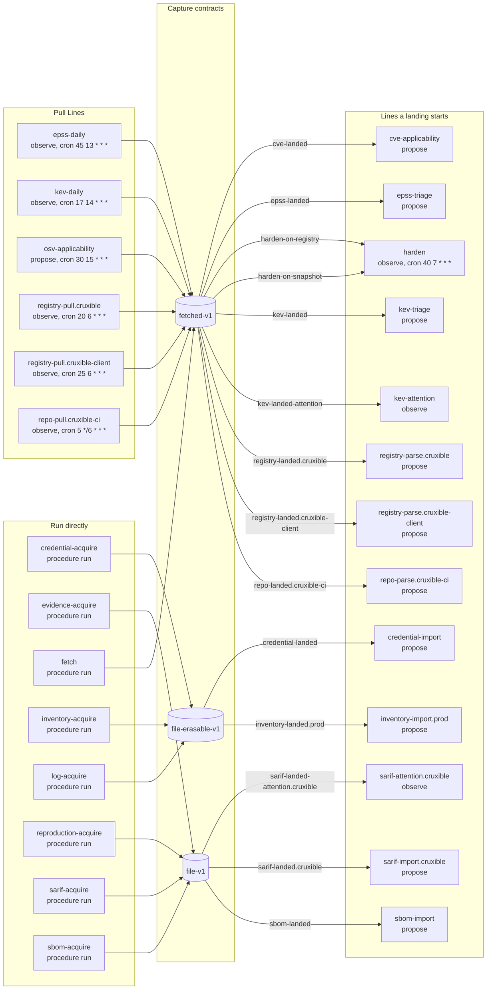

# security kit 1.3.0 reference

Every kind, field, contract, Line, Procedure and query in this release, generated from its definitions (`cruxible-kit.json`, `artifacts/`) and the example ChangeSet (`examples/automation.json`) by `source/reference.py`; do not edit. `scripts/kits.py check` fails when it is out of date. Start with the kit's [README](README.md).

## At a glance

Kit `security` version **1.3.0**, defining every name under `security.`.

| Definitions | Count | Notes |
|---|---|---|
| Subject kinds | 23 | [What it models](#what-it-models) |
| ClaimTypes | 137 | 10 shared by several kinds |
| Capture contracts | 5 | the kit's own, plus core's `playbill.coordinator-self-source-v1` for a statement on its author's own word: [Where evidence comes from](#where-evidence-comes-from) |
| Procedures | 28 | each binds its Providers by fit (the installed Provider serving each interface), so none needs a binding |
| Queries | 50 | [What you can ask](#what-you-can-ask) |
| Provider interfaces | 21 | - |
| Acquisition policies | 0 | none in the kit; the example ChangeSet sets `default` (`max_age` P1D) |
| Example Lines | 19 | with 21 Triggers and 11 Mandates in `examples/automation.json`: [What runs on its own](#what-runs-on-its-own) |

Providers `kit add` installs:

| Package | Version | Delivery | Interfaces |
|---|---|---|---|
| `cruxible-provider-web` | 0.2.2 | by name from the index | `search.web`, `web.fetch` |
| `security-analysis-provider` | 1.3.0 | bundled wheel | `security.credential-state`, `security.cve-applicability`, `security.cyclonedx-components`, `security.epss-scores`, `security.harden`, `security.kev-attention`, `security.kev-catalog`, `security.log-reads`, `security.osv-applicability`, `security.registry-facts`, `security.respond`, `security.runtime-inventory`, `security.sarif-findings`, `security.workflow-facts` |
| `security-sources-provider` | 1.2.0 | bundled wheel | `security.epss-daily`, `security.osv-ecosystems`, `security.osv-query`, `security.pypi-release`, `security.release-asset`, `security.repo-snapshot` |

### How evidence reaches each kind

Each box on the left is one source and the Capture contract it is retained under, grouped by shape; ClaimType rules below name the permitted logical sources. An arrow points to a Subject kind whose ClaimTypes may cite it. A thick arrow carries at least one ClaimType that requires a Capture (`captured`); a dotted arrow only ClaimTypes that may cite one. The number is how many of that kind's ClaimTypes the contract backs. Names drop the `security.` prefix. Not drawn: the statements that may instead cite their author's own word (Evidence `own word` below), and kinds that hold only statements their author's origin supports.

```mermaid
flowchart LR
  subgraph g0["Core self-source dependency"]
    direction TB
    c_playbill_coordinator_self_source_v1["playbill.coordinator-self-source-v1<br/>exact"]
  end
  subgraph g1["HTTP and file captures"]
    direction TB
    c_security_fetched_large_v1["fetched-large-v1<br/>attested"]
    c_security_fetched_v1["fetched-v1<br/>attested"]
    c_security_file_erasable_v1["file-erasable-v1<br/>exact"]
    c_security_file_v1["file-v1<br/>exact"]
  end
  subgraph g2["Procedure outputs"]
    direction TB
    c_security_observation_output_v1["observation-output-v1<br/>exact"]
  end
  subgraph kinds["ClaimTypes, by Subject kind"]
    direction TB
    k_security_artifact["artifact"]
    k_security_assessment["assessment"]
    k_security_asset["asset"]
    k_security_audit["audit"]
    k_security_control["control"]
    k_security_coverage["coverage"]
    k_security_credential["credential"]
    k_security_exception["exception"]
    k_security_finding["finding"]
    k_security_job["job"]
    k_security_product["product"]
    k_security_release["release"]
    k_security_remediation["remediation"]
    k_security_signal["signal"]
    k_security_target["target"]
    k_security_vulnerability["vulnerability"]
    k_security_workflow["workflow"]
  end
  c_playbill_coordinator_self_source_v1 -. "1" .-> k_security_artifact
  c_playbill_coordinator_self_source_v1 -. "5" .-> k_security_assessment
  c_playbill_coordinator_self_source_v1 -. "2" .-> k_security_audit
  c_playbill_coordinator_self_source_v1 -. "7" .-> k_security_finding
  c_playbill_coordinator_self_source_v1 -. "1" .-> k_security_product
  c_playbill_coordinator_self_source_v1 -. "1" .-> k_security_release
  c_playbill_coordinator_self_source_v1 -. "2" .-> k_security_signal
  c_playbill_coordinator_self_source_v1 -. "1" .-> k_security_target
  c_security_fetched_large_v1 == "1" ==> k_security_artifact
  c_security_fetched_large_v1 -. "2" .-> k_security_signal
  c_security_fetched_v1 == "8, 7 captured" ==> k_security_artifact
  c_security_fetched_v1 -. "5" .-> k_security_assessment
  c_security_fetched_v1 == "2" ==> k_security_coverage
  c_security_fetched_v1 -. "3" .-> k_security_finding
  c_security_fetched_v1 == "7" ==> k_security_job
  c_security_fetched_v1 == "1" ==> k_security_release
  c_security_fetched_v1 -. "2" .-> k_security_signal
  c_security_fetched_v1 -. "1" .-> k_security_target
  c_security_fetched_v1 == "10" ==> k_security_vulnerability
  c_security_fetched_v1 == "3" ==> k_security_workflow
  c_security_file_erasable_v1 == "2" ==> k_security_asset
  c_security_file_erasable_v1 == "4, 2 captured" ==> k_security_audit
  c_security_file_erasable_v1 == "1" ==> k_security_control
  c_security_file_erasable_v1 == "2" ==> k_security_coverage
  c_security_file_erasable_v1 == "4" ==> k_security_credential
  c_security_file_erasable_v1 == "1" ==> k_security_exception
  c_security_file_erasable_v1 == "1" ==> k_security_release
  c_security_file_erasable_v1 == "1" ==> k_security_remediation
  c_security_file_v1 -. "3" .-> k_security_assessment
  c_security_file_v1 == "1" ==> k_security_audit
  c_security_file_v1 == "8, 4 captured" ==> k_security_finding
  c_security_file_v1 -. "1" .-> k_security_product
  c_security_file_v1 == "4, 3 captured" ==> k_security_release
  c_security_file_v1 -. "1" .-> k_security_signal
  c_security_observation_output_v1 -. "2" .-> k_security_assessment
  c_security_observation_output_v1 == "1" ==> k_security_control
  c_security_observation_output_v1 == "1" ==> k_security_exception
  c_security_observation_output_v1 == "1" ==> k_security_remediation
  c_security_observation_output_v1 -. "1" .-> k_security_signal
  c_security_observation_output_v1 == "4" ==> k_security_vulnerability
```

### What starts what

From the example ChangeSet: pull Lines (on a cron) and Procedures you run directly retain Captures; a landing Trigger on a contract starts the Lines that read it. Each Line shows its max authority and any cron. The arrow label is the Trigger.

## What it models

One section per Subject kind: what it is, how core names it (its key), and the ClaimTypes that can be stated about it. **Role**: an `observation` is a source's word, a `normative` statement is someone's decision. **Evidence**: the Capture contracts a Claim may cite (`own word`: its author's statement). **Captured required**: a Claim must cite a retained Capture under one of them (`per rule`: the evidence rules decide). **Contention**: what the slot reads when two current, supported answers compete: `unresolved` (a one-valued slot then reads contested, with no value) or `all held` (a many-valued slot keeps every answer).

### security.artifact

One published file of a target, named by target and file name.

Key: `target_ref` + `name` (uniqueness `unique`).

| Field | Meaning | Value | Cardinality | Role | Evidence | Captured required | Freshness | Contention |
|---|---|---|---|---|---|---|---|---|
| `built_from` | The commit the artifact was built from. | Subject: `security.change` | one | observation | `security.fetched-v1` from github.api, github.release, pypi.release | yes | - | unresolved |
| `declared_sha256` | The digest a release manifest in the repository declares for the artifact. | text `^sha256:[0-9a-f]{64}$` | one | observation | `security.fetched-v1` from github.repo.snapshot | yes | - | unresolved |
| `name` | The published file's name (a release asset as tag/asset); with target_ref, the artifact's key. | text | one | normative | - | no | - | unresolved |
| `publish_environment` | The deployment environment the publishing run used, as provenance states it, or none. | text | one | observation | `security.fetched-v1` from pypi.release | yes | - | unresolved |
| `published_by` | The workflow (at the commit it ran from) that published the artifact, as its provenance states. | Subject: `security.workflow` | one | observation | `security.fetched-v1` from github.release, pypi.release | yes | - | unresolved |
| `release` | The release the artifact is a file of: joins the SBOM, OSV and KEV path. | Subject: `security.release` | one | normative | own word, `security.fetched-v1` from github.release, pypi.release | no (per rule) | - | unresolved |
| `sha256` | The digest of the bytes the target serves (PyPI's digest, or a fetched asset's). | text `^sha256:[0-9a-f]{64}$` | one | observation | `security.fetched-large-v1` from github.release.asset, `security.fetched-v1` from github.release, pypi.release | yes | - | unresolved |
| `target` | The target the artifact is published to. | Subject: `security.target` | one | observation | `security.fetched-v1` from github.release, github.repo.snapshot, pypi.release | yes | - | unresolved |
| `target_ref` | The artifact's target as registry/name; with name, the artifact's key. | text | one | normative | - | no | - | unresolved |
| `uploaded_by` | Who uploaded the release asset (login). | text | one | observation | `security.fetched-v1` from github.release | yes | - | unresolved |

### security.assessment

Whether one release is affected by one CVE: one per pair.

Key: `release_id` + `cve_id` (uniqueness `unique`).

| Field | Meaning | Value | Cardinality | Role | Evidence | Captured required | Freshness | Contention |
|---|---|---|---|---|---|---|---|---|
| `component` | The release's component that brings the vulnerability in (purl@version): which dependency an affected release needs to change. An observation is a source's word (OSV's answer for the component, or a CVE record whose packageName names it); a normative Claim is an analyst's, citing their own words or a workspace file (security.file-v1, via security.evidence-acquire). | text `^pkg:[a-z0-9.+-]+/.+@.+$` | many | normative (or observation) | own word, `security.fetched-v1` from cve.record, osv.dev.query, `security.file-v1` from security.analysis.evidence | no (per rule) | - | all held |
| `cve_id` | The CVE this assessment is about; with release_id, the assessment's key. | text `^CVE-[0-9]{4}-[0-9]{4,}$` | one | normative | - | no | - | unresolved |
| `expected_status` | An agent's stated bet on the assessment's status before a source observes it; predictions test it against security.assessment.status. | `affected` / `not_affected` | one | normative | - | no | - | unresolved |
| `justification` | Why a not_affected release is not affected (the VEX/CSAF justification): an observation from a source, or (normative) an analyst's judgment citing their own words or a workspace file (security.file-v1). Required in practice with every not_affected status; core cannot require it. | one of 5 (below) | one | normative (or observation) | own word, `security.fetched-v1` from cve.record, osv.dev.query, `security.file-v1` from security.analysis.evidence, `security.observation-output-v1` | no (per rule) | - | unresolved |
| `release` | The release this applicability assessment is about. | Subject: `security.release` | one | normative | own word, `security.fetched-v1` from cve.record, osv.dev.query | no (per rule) | - | unresolved |
| `release_id` | The id of the release this assessment is about; with cve_id, the assessment's key. | text | one | normative | - | no | - | unresolved |
| `status` | Whether the release is affected by the vulnerability. An observation is a source's verdict (OSV, a CVE record) citing its Capture; a normative Claim is an analyst's judgment citing their own words or a workspace file (security.file-v1, retained by security.evidence-acquire: a source's Capture is not citable for a judgment), with their reasoning in its because. The kit's Procedures never revise a normative status; retire it to hand the assessment back to them. | `affected` / `inconclusive` / `not_affected` | one | normative (or observation) | own word, `security.fetched-v1` from cve.record, osv.dev.query, `security.file-v1` from security.analysis.evidence, `security.observation-output-v1` | no (per rule) | - | unresolved |
| `vulnerability` | The vulnerability this applicability assessment is about. | Subject: `security.vulnerability` | one | normative | own word, `security.fetched-v1` from cve.record, osv.dev.query | no (per rule) | - | unresolved |

`justification` is one of:

- `component_not_present`: The vulnerable component is not in the release.
- `inline_mitigations_already_exist`: Built-in protections prevent exploitation.
- `vulnerable_code_cannot_be_controlled_by_adversary`: The vulnerable code cannot be reached with adversary-controlled input.
- `vulnerable_code_not_in_execute_path`: The vulnerable code is present but never runs.
- `vulnerable_code_not_present`: The component is present but not the vulnerable code (for example, a fixed version).

### security.asset

A host or workload (k8s:prod/storefront-a), named by its hostname.

Key: `hostname` (uniqueness `unique`).

| Field | Meaning | Value | Cardinality | Role | Evidence | Captured required | Freshness | Contention |
|---|---|---|---|---|---|---|---|---|
| `environment` | The environment the asset runs in: production, staging, development, a workstation (a developer's or maintainer's machine) or ci (a CI runner). | `ci` / `development` / `production` / `staging` / `workstation` | one | normative | - | no | - | unresolved |
| `hostname` | The asset's hostname (a host, or a workload such as k8s:prod/storefront-a); its key. | text | one | normative | - | no | - | unresolved |
| `installs` | A software release installed on the asset. | Subject: `security.release` | many | normative | - | no | - | all held |
| `internet_exposed` | Whether the asset is reachable from the internet. | true / false | one | normative | - | no | - | unresolved |
| `runs` | A release a runtime-inventory scan observed running on the asset (beside the declared installs). A full scan retires a run it no longer sees. Its none (an inverse, keyed by the release's product_name) says the asset runs no release of that product: only a full scan that looked for the product states it (never for a product it did not look for), it goes stale on the coverage horizon, and a run of the product seen again retires it. No run and no current none is unknown. | Subject: `security.release` | many | observation | `security.file-erasable-v1` from security.inventory | yes | - | all held |
| `scanned_in` | The inventory scope coverage that read the asset: its runs are complete there while that coverage is current. | Subject: `security.coverage` | many | observation | `security.file-erasable-v1` from security.inventory | yes | - | all held |
| `serves` | A service the asset serves. | Subject: `security.service` | many | normative | - | no | - | all held |

### security.audit

Were we exploited during an incident's window, for one service: named by incident and service. Its log sources, complete reads and result answer it in three states.

Key: `incident_ref` + `service_ref` (uniqueness `unique`).

| Field | Meaning | Value | Cardinality | Role | Evidence | Captured required | Freshness | Contention |
|---|---|---|---|---|---|---|---|---|
| `incident` | The incident the audit answers (the key's incident_ref as a Subject). | Subject: `security.incident` | one | normative | own word, `security.file-erasable-v1` from security.log-read | no (per rule) | - | unresolved |
| `incident_ref` | The incident's name; with service_ref, the audit's key. | text | one | normative | - | no | - | unresolved |
| `log_source` | A log source this incident's audit reads in full over the window (storefront/nginx-access). Stating it is what asks the question. Start from the service's service.log_source list (the respond Line names it): a source the service lists and the audit does not state leaves the answer unknown. | text | many | normative | - | no | - | all held |
| `read` | One complete read of a log source, as SOURCE FROM/TO (ISO 8601, Z): the tool searched every record in the interval. Only the log import writes these; an incomplete read is posted, never recorded. | text | many | observation | `security.file-erasable-v1` from security.log-read | yes | - | all held |
| `result` | The auditor's judgment: exploited, not_exploited or inconclusive, citing the decisive log read (security.file-erasable-v1) or a workspace file (security.file-v1); own words are refused. Reasoning goes in a section of the incident's note. A disagreeing auditor contends (set --contend): while the slot reads conflict the answer is unknown. Never settled by a Mandate. | one of 3 (below) | one | normative | `security.file-erasable-v1` from security.log-read, `security.file-v1` from security.analysis.evidence | yes | - | unresolved |
| `service` | The service the audit answers for (the key's service_ref as a Subject). | Subject: `security.service` | one | normative | own word, `security.file-erasable-v1` from security.log-read | no (per rule) | - | unresolved |
| `service_ref` | The service's name; with incident_ref, the audit's key. | text | one | normative | - | no | - | unresolved |
| `window_end` | When the service's last affected asset was verified patched (the verifying scan's time): the audit's window is [incident.window_start, window_end]. | date-time | one | normative | - | no | - | unresolved |

`result` is one of:

- `exploited`: The window's logs show exploitation: cite the decisive read.
- `inconclusive`: The logs cannot decide it (a gap, a missing source, ambiguous matches).
- `not_exploited`: Every stated log source (the audit's, which must include every source the service lists) was read in full over the window and shows no exploitation; counts as none only when the reads cover [window_start, window_end].

### security.change

A commit of a repository, created when an investigation needs it.

Key: `repo_ref` + `commit_sha` (uniqueness `unique`).

| Field | Meaning | Value | Cardinality | Role | Evidence | Captured required | Freshness | Contention |
|---|---|---|---|---|---|---|---|---|
| `commit_sha` | The commit SHA; with repo_ref, the change's key. | text `^[0-9a-f]{40}$` | one | normative | - | no | - | unresolved |
| `repo_ref` | The change's repository as host/owner/repo; with commit_sha, its key. | text | one | normative | - | no | - | unresolved |

### security.control

A compensating control (minted id).

Key: minted id.

| Field | Meaning | Value | Cardinality | Role | Evidence | Captured required | Freshness | Contention |
|---|---|---|---|---|---|---|---|---|
| `activation` | Whether the compensating control is active. | `declared_active` / `planned` / `retired` | one | normative | - | no | - | unresolved |
| `kind` | The kind of compensating control. | `access_restriction` / `monitoring` / `network_isolation` | one | normative | - | no | - | unresolved |

Also the shared `security.work.assessment`, `security.work.asset`, `security.work.audit`, `security.work.credential`, `security.work.finding`, `security.work.job`, `security.work.owner`, `security.work.rationale`, `security.work.review_at`, `security.work.verification` (see [Shared ClaimTypes](#shared-claimtypes)).

### security.coverage

The belief that a source was read in full at a revision: absence is an answer only inside current coverage.

Key: `source` + `scope` (uniqueness `unique`).

| Field | Meaning | Value | Cardinality | Role | Evidence | Captured required | Freshness | Contention |
|---|---|---|---|---|---|---|---|---|
| `looked_for` | A product a full runtime-inventory scan looked for, named as its releases are (php, debian/php8.2: a purl's namespace and name), or * for everything: the record of the question the scan asked. The scan states each asset's absence as an asset.runs none, only for a product it looked for (under *: a product the asset ran before or declares installing; name any other in looked_for); which versions of a looked-for product an asset runs are its runs, complete while the coverage is current. | text | many | observation | `security.file-erasable-v1` from security.inventory | yes | - | all held |
| `of` | What the source belongs to: a repository, or a registry target. | Subject: `security.repo`, `security.target` | one | observation | `security.fetched-v1` from github.repo.snapshot, pypi.release | yes | - | unresolved |
| `revision` | The revision every file was read at: a commit SHA, the digest of a registry's served file set, or the digest of a full runtime-inventory scan's (asset, runs) set; re-read on every pull and stale 12 h after the last. Absence inside current coverage is an answer; outside it, unknown. | text | one | observation | `security.fetched-v1` from github.repo.snapshot, pypi.release, `security.file-erasable-v1` from security.inventory | yes | stale after 12 h | unresolved |
| `scope` | What was read in full: ci.workflows, release.manifest, registry.files, or inventory.runtime (every asset of one inventory scope, with what it runs). | `ci.workflows` / `inventory.runtime` / `registry.files` / `release.manifest` | one | normative | - | no | - | unresolved |
| `source` | The fully read source (host/owner/repo@ref:path, registry/name, or an inventory scope's name); with scope, the coverage's key. | text | one | normative | - | no | - | unresolved |

### security.credential

A logical credential (an API key, a database login), named by issuer and name: where it is used, what it reaches, and its current key's non-secret id. Its keys rotate under it; a secret never enters.

Key: `issuer` + `name` (uniqueness `unique`).

| Field | Meaning | Value | Cardinality | Role | Evidence | Captured required | Freshness | Contention |
|---|---|---|---|---|---|---|---|---|
| `issued_at` | When the current key was issued, as the issuer states it: a rotation must post-date incident.window_start. | date-time | one | observation | `security.file-erasable-v1` from security.credential-state | yes | - | unresolved |
| `issued_by` | Who issued the current key, as the issuer states it. | text | one | observation | `security.file-erasable-v1` from security.credential-state | yes | - | unresolved |
| `issuer` | Who issues the credential (aws-iam/111122223333, stripe, postgres/partners-db); with name, the credential's key. | text | one | normative | - | no | - | unresolved |
| `key_id` | The current key's non-secret id: the issuer's key id, or fp: and 16 hex of the secret's sha256. Never the secret. | text | one | observation | `security.file-erasable-v1` from security.credential-state | yes | - | unresolved |
| `name` | The credential's name at its issuer (storefront-app); with issuer, its key. | text | one | normative | - | no | - | unresolved |
| `reaches` | A service the credential grants access to: the blast radius. | Subject: `security.service` | many | normative | - | no | - | all held |
| `revoked_key` | A key id a separate state read observed revoked or deleted. | text | many | observation | `security.file-erasable-v1` from security.credential-state | yes | - | all held |
| `used_by` | A service that uses the credential: whoever compromised the service could read it. | Subject: `security.service` | many | normative | - | no | - | all held |

### security.exception

A risk exception (minted id).

Key: minted id.

| Field | Meaning | Value | Cardinality | Role | Evidence | Captured required | Freshness | Contention |
|---|---|---|---|---|---|---|---|---|
| `approval` | Whether the risk exception is approved. | `approved` / `revoked` | one | normative | - | no | - | unresolved |
| `expires_at` | When the risk exception expires. | date-time | one | normative | - | no | - | unresolved |

Also the shared `security.work.assessment`, `security.work.asset`, `security.work.audit`, `security.work.credential`, `security.work.finding`, `security.work.job`, `security.work.owner`, `security.work.rationale`, `security.work.review_at`, `security.work.verification` (see [Shared ClaimTypes](#shared-claimtypes)).

### security.finding

One weakness of one kind at one place in one repository's code, named by repository, weakness (CWE) and locus (path#symbol, snippet or line hash): every finder that reports it meets on the key.

Key: `repo_ref` + `weakness` + `locus` (uniqueness `unique`).

| Field | Meaning | Value | Cardinality | Role | Evidence | Captured required | Freshness | Contention |
|---|---|---|---|---|---|---|---|---|
| `affects` | What the finding is in: a release, a service, a job or an artifact (joins the system model; HQ6 asks it of every gated target). | Subject: `security.artifact`, `security.job`, `security.release`, `security.service` | many | normative | own word, `security.fetched-v1` from github.api, github.release | no (per rule) | - | all held |
| `fixed_by` | The commit that fixes the finding. | Subject: `security.change` | one | normative | own word, `security.fetched-v1` from github.api | no (per rule) | - | unresolved |
| `justification` | Why a finding is not_exploitable or a false_positive: an analyst's judgment (normative), or a scan's stated suppression. | one of 5 (below) | one | normative (or observation) | own word, `security.file-v1` from sarif.log, `security.file-v1` from security.analysis.evidence | no (per rule) | - | unresolved |
| `location` | Where the sink is now, as path:start-end, cited by a file citation of the sink line (PATH#ANCHOR): origin-only, so `cruxible next` resurfaces it (citation_drifted) when the cited code changes. One per sink. | text | many | normative | - | no | - | all held |
| `locus` | Where in the code: <repo-relative path>#<locator>, the first tier that applies (the symbol, snippet:<12 hex of the sink line>, line-hash:<the tool's>). Never a line number; with repo_ref and weakness, the finding's key. | text | one | normative | - | no | - | unresolved |
| `repo` | The repository the finding is in (the key's repo_ref as a Subject). | Subject: `security.repo` | one | normative | own word, `security.file-v1` from sarif.log | no (per rule) | - | unresolved |
| `repo_ref` | The repository as host/owner/repo (github.com/owner/repo); with weakness and locus, the finding's key. | text | one | normative | - | no | - | unresolved |
| `reported_by` | A finder that reported the finding: a tool (semgrep, codeql) or an agent's principal; the grain of the finder track record. | text | many | observation | `security.file-v1` from sarif.log | yes | - | all held |
| `reproduction` | The proof-of-concept test that reproduces the finding (tests/security/test_x.py::test_y), in the writer's own words or a section of the finding's note; the PoC run is the verdict's evidence. | text | one | normative | own word, `security.file-v1` from security.reproduction | no (per rule) | - | unresolved |
| `rule` | A tool rule that reported the finding, as tool:ruleId (semgrep:python.lang.security...), observed in a SARIF scan. | text | many | observation | `security.file-v1` from sarif.log | yes | - | all held |
| `severity` | How severe the finding is: a scan's severity (security-severity, else the level) citing its SARIF, or (normative) an analyst's judgment. | `critical` / `high` / `low` / `medium` | one | normative (or observation) | own word, `security.file-v1` from sarif.log, `security.file-v1` from security.analysis.evidence | no (per rule) | - | unresolved |
| `verdict` | The adjudicated verdict: confirmed, not_exploitable or false_positive, citing a reproduction (the PoC run) or the code read (workspace evidence); own words are refused. A disputed verdict contends (set --contend) and reads conflict until one contender remains. Never settled by a Mandate. | one of 3 (below) | one | normative | `security.file-v1` from security.analysis.evidence, security.reproduction | yes | - | unresolved |
| `verification` | Whether a fix is verified: fixed when a full scan of the finder's rules no longer reports it or the PoC passes; present when a full scan reports it after it was fixed (a regression). | `fixed` / `present` | one | observation | `security.file-v1` from sarif.log, security.reproduction | yes | - | unresolved |
| `vulnerability` | The known CVE the finding is (vendored code with a published vulnerability). | Subject: `security.vulnerability` | one | normative | own word, `security.fetched-v1` from cve.record, osv.dev.query | no (per rule) | - | unresolved |
| `weakness` | CWE-<n>, the smallest CWE the reporting rule names, else RULE:<tool>/<ruleId>; with repo_ref and locus, the finding's key. | text | one | normative | - | no | - | unresolved |

`justification` is one of:

- `not_attacker_controlled`: The input reaching the sink is not attacker-controlled.
- `not_reachable`: No path from an entry point reaches the code.
- `rule_misfire`: The rule matched code that is not the pattern it describes.
- `sanitized`: The input is sanitized or validated before the sink.
- `test_or_dead_code`: The code is a test, an example or never shipped.

`verdict` is one of:

- `confirmed`: The weakness is real and exploitable: a reproduction (the PoC run) or the code read shows it. Needs retained evidence, never own words.
- `false_positive`: The tool or finder was wrong: there is no such weakness here.
- `not_exploitable`: The weakness is in the code but cannot be exploited here; the justification says why (for example not_reachable).

### security.incident

One response to one or more CVEs (PHP2Shell), named by its name: its window, rotation policy and status; its respond Line asks the five questions.

Key: `name` (uniqueness `unique`).

| Field | Meaning | Value | Cardinality | Role | Evidence | Captured required | Freshness | Contention |
|---|---|---|---|---|---|---|---|---|
| `name` | The incident's name (PHP2Shell); its key. | text | one | normative | - | no | - | unresolved |
| `rotation_policy` | What raises a rotation: on_found_or_unknown (a service's audit found or cannot rule out exploitation) or all_exposed. | one of 2 (below) | one | normative | - | no | - | unresolved |
| `status` | Whether the incident is open; close it only after its respond Line posts ready_to_close. | `closed` / `open` | one | normative | - | no | - | unresolved |
| `vulnerability` | A CVE this incident responds to: one response, one audit per service, however many CVEs. | Subject: `security.vulnerability` | many | normative | - | no | - | all held |
| `window_start` | The start of the exposure window (the lead's call, e.g. the earliest known exploitation minus a margin): audits read from it, rotations must post-date it. | date-time | one | normative | - | no | - | unresolved |

`rotation_policy` is one of:

- `all_exposed`: Rotate every credential a service of an exposed asset uses.
- `on_found_or_unknown`: Rotate the credentials of a service whose audit found exploitation or cannot rule it out (unknown).

### security.job

One job of a workflow, named by its workflow (source:path) and job key: it holds the permissions, secrets, environment and actions.

Key: `workflow_ref` + `job_key` (uniqueness `unique`).

| Field | Meaning | Value | Cardinality | Role | Evidence | Captured required | Freshness | Contention |
|---|---|---|---|---|---|---|---|---|
| `environment` | The deployment environment the job runs in, or none. | text | one | observation | `security.fetched-v1` from github.repo.snapshot | yes | - | unresolved |
| `job_key` | The job's key in its workflow file; with workflow_ref, the job's key. | text | one | normative | - | no | - | unresolved |
| `needs` | A job this job waits for. | Subject: `security.job` | many | observation | `security.fetched-v1` from github.repo.snapshot | yes | - | all held |
| `permission` | An effective token permission as scope:level (the workflow default applied; token:repository-default when none is declared). | text `^[A-Za-z*_-]+:[A-Za-z_-]+$` | many | observation | `security.fetched-v1` from github.repo.snapshot | yes | - | all held |
| `publishes_to` | A target the job can publish to: it holds the credential the registry accepts (the analysis provider's publish rule table). | Subject: `security.target` | many | observation | `security.fetched-v1` from github.repo.snapshot | yes | - | all held |
| `secret` | A secret the job references (GITHUB_TOKEN included; *inherit for secrets: inherit). | text | many | observation | `security.fetched-v1` from github.repo.snapshot | yes | - | all held |
| `uses` | An action or reusable workflow the job runs, as pkg:githubactions/owner/repo[/path]@ref. | text `^pkg:[a-z0-9.+-]+/.+@.+$` | many | observation | `security.fetched-v1` from github.repo.snapshot | yes | - | all held |
| `workflow` | The workflow the job is declared in. | Subject: `security.workflow` | one | observation | `security.fetched-v1` from github.repo.snapshot | yes | - | unresolved |
| `workflow_ref` | The job's workflow as source:path; with job_key, the job's key. | text | one | normative | - | no | - | unresolved |

### security.product

A software product, named by its name.

Key: `name` (uniqueness `hint`).

| Field | Meaning | Value | Cardinality | Role | Evidence | Captured required | Freshness | Contention |
|---|---|---|---|---|---|---|---|---|
| `name` | The product's name; its key. | text | one | normative | - | no | - | unresolved |
| `supplied_by` | The supplier of the product. | Subject: `security.supplier` | one | normative | own word, `security.file-v1` from cyclonedx.sbom | no (per rule) | - | unresolved |

### security.release

One version of a product, named by product name and version.

Key: `product_name` + `version` (uniqueness `unique`).

| Field | Meaning | Value | Cardinality | Role | Evidence | Captured required | Freshness | Contention |
|---|---|---|---|---|---|---|---|---|
| `component` | A component of the release, as its package URL with version (purl@version), observed in an SBOM; for a runtime a scan observed running, the runtime's own purl (OSV decides distro builds by it). | text `^pkg:[a-z0-9.+-]+/.+@.+$` | many | observation | `security.file-erasable-v1` from security.inventory, `security.file-v1` from cyclonedx.sbom | yes | - | all held |
| `osv_coverage` | Whether OSV answered for every component of the release, as the OSV query Capture shows: complete (N of N components answered), or partial with how many it answered, the purl types it does not index (brew, generic: never asked, since OSV's empty answer there would read as no advisories) and how many went unanswered. What OSV indexes is its own word (its ecosystems.txt, captured beside every query) read through the kit's purl type map. An empty OSV answer is a negative only under complete coverage. It is bound to the exact component set OSV answered for (set: 16 hex of the sha256 of the sorted component purls): another set, even of the same size, is unanswered until OSV answers again. Components the SBOM lists without a purl (unidentified) keep it partial. | text `^(complete\|partial): [0-9]+ of [0-9]+ components answered(; not indexed: [a-z0-9.+-]+ [0-9]+(, [a-z0-9.+-]+ [0-9]+)*)?(; unanswered [0-9]+)?(; unidentified [0-9]+)?; set [0-9a-f]{16}$` | one | observation | `security.fetched-v1` from osv.dev.query | yes | - | unresolved |
| `product` | The product this release is a version of. | Subject: `security.product` | one | normative | own word, `security.file-v1` from cyclonedx.sbom | no (per rule) | - | unresolved |
| `product_alias` | Another name the release's product goes by in vulnerability records, as an analyst states it citing evidence (a workspace file retained by security.evidence-acquire: the formula, the project page): vendor/product as a CVE record's affected entry names it (cli/cli for a Homebrew gh release), a package URL without version (pkg:golang/github.com/cli/cli/v2), a repository URL (https://github.com/cli/cli) or a CPE prefix (cpe:2.3:a:github:cli). security.cve-applicability matches a record by it as by the release's own name; re-acquire the record after stating it. | text `^(pkg:[a-z0-9.+-]+/[^@?#\s]+\|cpe:2\.3:[aho]:[^:\s]+:[^:\s]+\|https?://\S+\|[^/\s][^/]*/[^/]*[^/\s])$` | many | normative | `security.file-v1` from security.analysis.evidence | yes | - | all held |
| `product_name` | The product's name; with version, the release's key. A release a runtime scan observed is named by its purl's whole namespace and name (debian/php8.2, github.com/cli/cli/v2), never a last segment. | text | one | normative | - | no | - | unresolved |
| `unidentified_components` | How many components the release's SBOM lists without a package URL with a version (an operating-system component too): what they are is unknown, OSV is never asked about them, so the release's OSV coverage stays partial and no negative rests on OSV's silence. Restated (revised) when a later SBOM of the release counts differently. | literal | one | observation | `security.file-v1` from cyclonedx.sbom | yes | - | unresolved |
| `version` | The release's version string; with product_name, the release's key. | text | one | normative | - | no | - | unresolved |

### security.remediation

A remediation work item (minted id).

Key: minted id.

| Field | Meaning | Value | Cardinality | Role | Evidence | Captured required | Freshness | Contention |
|---|---|---|---|---|---|---|---|---|
| `due_at` | When the remediation is due. | date-time | one | normative | - | no | - | unresolved |
| `progress` | Where the remediation stands. | `cancelled` / `completed` / `in_progress` / `planned` | one | normative | - | no | - | unresolved |
| `revokes_key` | The key id a rotation must retire: the credential's key_id when the rotation was raised. | text | one | normative | - | no | - | unresolved |
| `target_release` | The release the remediation moves to. | Subject: `security.release` | one | normative | - | no | - | unresolved |

Also the shared `security.work.assessment`, `security.work.asset`, `security.work.audit`, `security.work.credential`, `security.work.finding`, `security.work.job`, `security.work.owner`, `security.work.rationale`, `security.work.review_at`, `security.work.verification` (see [Shared ClaimTypes](#shared-claimtypes)).

### security.repo

A source repository, named by forge host and owner/repository.

Key: `forge_host` + `full_name` (uniqueness `unique`).

| Field | Meaning | Value | Cardinality | Role | Evidence | Captured required | Freshness | Contention |
|---|---|---|---|---|---|---|---|---|
| `forge_host` | The forge host (github.com); with full_name, the repository's key. | text | one | normative | - | no | - | unresolved |
| `full_name` | owner/repository; with forge_host, the repository's key. | text `^[A-Za-z0-9_.-]+/[A-Za-z0-9_.-]+$` | one | normative | - | no | - | unresolved |

### security.service

A business service, named by its name: its owning team, its criticality and where its logs live.

Key: `name` (uniqueness `hint`).

| Field | Meaning | Value | Cardinality | Role | Evidence | Captured required | Freshness | Contention |
|---|---|---|---|---|---|---|---|---|
| `criticality` | How critical the service is to the organization. | `critical` / `standard` | one | normative | - | no | - | unresolved |
| `log_source` | Where one of the service's logs lives, as a short identifier (caddy:app-1:/var/log/caddy/access.log): a pointer, nothing else. Retention, how to query it, who owns it and any reasoning go in a doc section the Claim cites, never in the value. An incident's audit of the service starts from this list (the respond Line names it); audit.log_source is the set that incident audits. | text | many | normative | - | no | - | all held |
| `name` | The service's name; its key. | text | one | normative | - | no | - | unresolved |
| `owned_by` | The team accountable for the service. | Subject: `security.team` | one | normative | - | no | - | unresolved |

### security.signal

An observation an investigation starts from, named by its detector and fingerprint.

Key: `detector` + `fingerprint` (uniqueness `unique`).

| Field | Meaning | Value | Cardinality | Role | Evidence | Captured required | Freshness | Contention |
|---|---|---|---|---|---|---|---|---|
| `detector` | What observed the signal (a question such as security.hq5, or manual); with fingerprint, the signal's key. | text | one | normative | - | no | - | unresolved |
| `explained_by` | A hypothesis for the signal: what is responsible (a finding: the anomaly is exploitation of that weakness). Competing hypotheses contend (set --contend); the slot resolves when one remains. | Subject: `security.change`, `security.finding`, `security.job`, `security.target`, `security.workflow` | one | normative | own word, `security.fetched-large-v1` from github.release.asset, `security.fetched-v1` from github.api, github.release, github.repo.snapshot, pypi.release | no (per rule) | - | unresolved |
| `fingerprint` | What identifies the observation; with detector, the signal's key. | text | one | normative | - | no | - | unresolved |
| `observed` | What the signal was observed on: a source's observation, or someone's own words. | Subject: `security.artifact`, `security.job`, `security.target`, `security.workflow` | many | normative (or observation) | own word, `security.fetched-large-v1` from github.release.asset, `security.fetched-v1` from github.api, github.release, github.repo.snapshot, pypi.release, `security.file-v1` from security.analysis.evidence, `security.observation-output-v1` | no (per rule) | - | all held |

### security.supplier

A product's supplier, named by its name.

Key: `name` (uniqueness `hint`).

| Field | Meaning | Value | Cardinality | Role | Evidence | Captured required | Freshness | Contention |
|---|---|---|---|---|---|---|---|---|
| `name` | The supplier's name; its key. | text | one | normative | - | no | - | unresolved |

### security.target

Where artifacts land (a PyPI project, a GHCR image, a GitHub release or Pages site): the trust boundary a publish gate guards.

Key: `registry` + `name` (uniqueness `unique`).

| Field | Meaning | Value | Cardinality | Role | Evidence | Captured required | Freshness | Contention |
|---|---|---|---|---|---|---|---|---|
| `name` | The target's name in its registry (a PyPI project, an image, owner/repo for a release or Pages site); with registry, the target's key. | text | one | normative | - | no | - | unresolved |
| `publish_gate` | A trigger the organization allows to publish to the target (push:tags:v*). Stating a gate is what asks the hardening questions about the target. | text | many | normative | - | no | - | all held |
| `registry` | Where artifacts land (pypi, ghcr, github_release, github_pages); with name, the target's key. | `ghcr` / `github_pages` / `github_release` / `pypi` | one | normative | - | no | - | unresolved |
| `source_repo` | The repository the target is published from: its provenance's, or the owner's words. | Subject: `security.repo` | one | normative | own word, `security.fetched-v1` from github.repo.snapshot, pypi.release | no (per rule) | - | unresolved |

### security.team

An accountable team, named by its name.

Key: `name` (uniqueness `hint`).

| Field | Meaning | Value | Cardinality | Role | Evidence | Captured required | Freshness | Contention |
|---|---|---|---|---|---|---|---|---|
| `name` | The team's name; its key. | text | one | normative | - | no | - | unresolved |

### security.vulnerability

A CVE, named by its id. Tracked when it has a watch_reason, an affected/inconclusive assessment or an incident responding to it; existing alone tracks nothing.

Key: `cve_id` (uniqueness `unique`).

| Field | Meaning | Value | Cardinality | Role | Evidence | Captured required | Freshness | Contention |
|---|---|---|---|---|---|---|---|---|
| `affected_product` | A product the vulnerability's CVE record names as affected, named as the kit names releases (an affected entry's product, or its packageName: php, cli/cli), whether or not inventory holds it: with OSV's packages and the releases assessed affected, the products an incident's RQ1 must rule out on an asset before it answers the asset none. A release the record names by another name is matched through its product_alias. | text | many | observation | `security.fetched-v1` from cve.record | yes | - | all held |
| `cve_id` | The CVE identifier; the vulnerability's key. | text `^CVE-[0-9]{4}-[0-9]{4,}$` | one | normative | - | no | - | unresolved |
| `epss_percentile` | The EPSS score's percentile among all scored CVEs, as the daily file states it. | text `^(0(\.[0-9]+)?\|1(\.0+)?)$` | one | observation | `security.fetched-v1` from first.epss.daily | yes | - | unresolved |
| `epss_score` | FIRST's EPSS probability of exploitation in the next 30 days, as the daily file states it. | text `^(0(\.[0-9]+)?\|1(\.0+)?)$` | one | observation | `security.fetched-v1` from first.epss.daily | yes | - | unresolved |
| `kev_date_added` | The date CISA added the vulnerability to the KEV catalog (dateAdded). | text `^\d{4}-(0[1-9]\|1[0-2])-(0[1-9]\|[12]\d\|3[01])$` | one | observation | `security.fetched-v1` from cisa.kev.catalog, `security.observation-output-v1` | yes | - | unresolved |
| `kev_due_date` | The KEV remediation due date for federal agencies (dueDate). | text `^\d{4}-(0[1-9]\|1[0-2])-(0[1-9]\|[12]\d\|3[01])$` | one | observation | `security.fetched-v1` from cisa.kev.catalog, `security.observation-output-v1` | yes | - | unresolved |
| `kev_listed` | Whether the CISA Known Exploited Vulnerabilities catalog lists the vulnerability. | true / false | one | observation | `security.fetched-v1` from cisa.kev.catalog, `security.observation-output-v1` | yes | - | unresolved |
| `kev_ransomware_use` | Whether KEV reports known ransomware campaign use (knownRansomwareCampaignUse). | `known` / `unknown` | one | observation | `security.fetched-v1` from cisa.kev.catalog, `security.observation-output-v1` | yes | - | unresolved |
| `package` | A package OSV's records say the vulnerability affects, as a package URL without version (pkg:deb/debian/php8.2, pkg:pypi/jinja2): OSV knows the CVE. A release whose components OSV answered in full and that holds none of these packages is not affected (an incident's RQ1 reads it none, citing both); with none stated, OSV's silence decides nothing. | text `^pkg:[a-z0-9.+-]+/[^@?#\s]+$` | many | observation | `security.fetched-v1` from osv.dev.query | yes | - | all held |
| `title` | The vulnerability's title as a retained source states it. | text | one | observation | `security.fetched-v1` from cisa.kev.catalog, cve.record | yes | - | unresolved |
| `vendor_product` | The affected vendor and product as a retained source states it. | text | one | observation | `security.fetched-v1` from cisa.kev.catalog, cve.record | yes | - | unresolved |
| `watch_reason` | The decision to track the vulnerability, and why. A vulnerability is tracked when it has one, when an affected or inconclusive assessment links it to a release in inventory, or when an incident responds to it; a bare vulnerability Subject is tracked by nothing. | text | one | normative | - | no | - | unresolved |

### security.workflow

One CI workflow file, named by the source it was read from (host/owner/repo@ref) and its path.

Key: `source` + `path` (uniqueness `unique`).

| Field | Meaning | Value | Cardinality | Role | Evidence | Captured required | Freshness | Contention |
|---|---|---|---|---|---|---|---|---|
| `coverage` | The coverage (source at a revision) the workflow was read under. | Subject: `security.coverage` | one | observation | `security.fetched-v1` from github.repo.snapshot | yes | - | unresolved |
| `path` | The workflow file's path in the repository; with source, the workflow's key. | text | one | normative | - | no | - | unresolved |
| `repo` | The repository the workflow file is in. | Subject: `security.repo` | one | observation | `security.fetched-v1` from github.repo.snapshot | yes | - | unresolved |
| `source` | The source the workflow was read from (host/owner/repo@ref); with path, the workflow's key. | text | one | normative | - | no | - | unresolved |
| `trigger` | An event that triggers the workflow, as event[:filter:pattern] (push:tags:v*, workflow_dispatch, schedule:cron:0 6 * * *). | text | many | observation | `security.fetched-v1` from github.repo.snapshot | yes | - | all held |

### Shared ClaimTypes

Each of `security.control`, `security.exception`, `security.remediation` accepts these.

| Field | Meaning | Value | Cardinality | Role | Evidence | Captured required | Freshness | Contention |
|---|---|---|---|---|---|---|---|---|
| `security.work.assessment` | The assessment this work item answers. | Subject: `security.assessment` | one | normative | - | no | - | unresolved |
| `security.work.asset` | The asset this work item covers. | Subject: `security.asset` | one | normative | - | no | - | unresolved |
| `security.work.audit` | The audit whose answer raised this work item (a rotation). | Subject: `security.audit` | one | normative | - | no | - | unresolved |
| `security.work.credential` | The credential this work item rotates. | Subject: `security.credential` | one | normative | - | no | - | unresolved |
| `security.work.finding` | The finding this work item answers (a remediation fixes it; an approved exception accepts its risk). | Subject: `security.finding` | one | normative | - | no | - | unresolved |
| `security.work.job` | The job this work item changes. | Subject: `security.job` | one | normative | - | no | - | unresolved |
| `security.work.owner` | The team accountable for this work item. | Subject: `security.team` | one | normative | - | no | - | unresolved |
| `security.work.rationale` | Why this work item exists. | text | one | normative | - | no | - | unresolved |
| `security.work.review_at` | When this work item is next reviewed. | date-time | one | normative | - | no | - | unresolved |
| `security.work.verification` | Whether the work was verified, as observed from retained evidence: a patch by a full runtime-inventory scan (the asset no longer runs the affected release), a rotation by a separate state read of the credential (the old key revoked, a new one issued). A self-report (remediation.progress completed) never sets it. | `failed` / `inconclusive` / `verified` | one | observation | `security.file-erasable-v1` from security.credential-state, security.inventory, `security.observation-output-v1` | yes | - | unresolved |

## Where evidence comes from

One row per Capture contract. **Produced by**: the Procedures that retain it, where they run (an example Line, a direct `cruxible procedure run`, or a Line each incident declares) and what serves each read. **Landings start**: the example Lines a landing Trigger on it starts. **Supports**: the ClaimTypes that may cite it.

| Contract | Captures | Grade | Produced by | Landings start | Supports |
|---|---|---|---|---|---|
| `playbill.coordinator-self-source-v1` | coordinator_self_source, exact | observed | - | - | 20 ClaimTypes; 0 require a Capture |
| `security.fetched-large-v1` | http_response, attested | observed | `security.asset-fetch` (run directly; `security-sources-provider` serving `security.release-asset`) | - | 3 ClaimTypes; 1 requires a Capture |
| `security.fetched-v1` | http_response, attested | observed | `security.epss-acquire` (Line `security.epss-daily`; `security-sources-provider` serving `security.epss-daily`); `security.fetch` (run directly; `cruxible-provider-web` serving `web.fetch`); `security.fetch-observed` (Line `security.kev-daily`; `cruxible-provider-web` serving `web.fetch`); `security.osv-applicability` (Line `security.osv-applicability`; `security-sources-provider` serving `security.osv-ecosystems`, `security.osv-query`); `security.registry-acquire` (Lines `security.registry-pull.cruxible`, `security.registry-pull.cruxible-client`; `security-sources-provider` serving `security.pypi-release`); `security.repo-acquire` (Line `security.repo-pull.cruxible-ci`; `security-sources-provider` serving `security.repo-snapshot`) | `security.cve-applicability`, `security.epss-triage`, `security.harden`, `security.kev-attention`, `security.kev-triage`, `security.registry-parse.cruxible`, `security.registry-parse.cruxible-client`, `security.repo-parse.cruxible-ci` | 42 ClaimTypes; 30 require a Capture |
| `security.file-erasable-v1` | http_response, exact | observed | `security.credential-acquire` (run directly; core's built-in `workspace.file`); `security.inventory-acquire` (run directly; core's built-in `workspace.file`); `security.log-acquire` (run directly; core's built-in `workspace.file`) | `security.credential-import`, `security.inventory-import.prod` | 14 ClaimTypes; 12 require a Capture |
| `security.file-v1` | http_response, exact | observed | `security.evidence-acquire` (run directly; core's built-in `workspace.file`); `security.reproduction-acquire` (run directly; core's built-in `workspace.file`); `security.sarif-acquire` (run directly; core's built-in `workspace.file`); `security.sbom-acquire` (run directly; core's built-in `workspace.file`) | `security.sarif-attention.cruxible`, `security.sarif-import.cruxible`, `security.sbom-import` | 18 ClaimTypes; 8 require a Capture |
| `security.observation-output-v1` | procedure_output, exact | observed | `security.epss-acquire` (Line `security.epss-daily`; its run's own output); `security.fetch-observed` (Line `security.kev-daily`; its run's own output) | - | 8 ClaimTypes; 5 require a Capture |

## What runs on its own

The example ChangeSet (`examples/automation.json`) authors these Lines disabled; you adapt, approve and enable them. **Max authority** caps what a run may do (`observe`, `propose`, `settle`).

| Line | Procedure | Triggers | Max authority | What it may settle |
|---|---|---|---|---|
| `security.credential-import` | `security.credential-import` | `security.credential-landed`: lands `security.file-erasable-v1` | propose | nothing: proposes for review within `claims`, `subjects/security.credential` |
| `security.cve-applicability` | `security.cve-applicability` | `security.cve-landed`: lands `security.fetched-v1` | propose | nothing: proposes for review within `claims`, `subjects/security.assessment`, `subjects/security.vulnerability` |
| `security.epss-daily` | `security.epss-acquire` | `security.epss-daily`: cron `45 13 * * *` | observe | nothing: retains a Capture |
| `security.epss-triage` | `security.epss-triage` | `security.epss-landed`: lands `security.fetched-v1` | propose | nothing: proposes for review within `claims`; its terminal settles once a settle Mandate and a `settle` cap graduate it |
| `security.harden` | `security.harden` | `security.harden-daily`: cron `40 7 * * *`; `security.harden-on-registry`: lands `security.fetched-v1`; `security.harden-on-snapshot`: lands `security.fetched-v1` | observe | nothing: posts inbox items |
| `security.inventory-import.prod` | `security.inventory-import` | `security.inventory-landed.prod`: lands `security.file-erasable-v1` | propose | nothing: proposes for review within `claims`, `subjects/security.asset`, `subjects/security.coverage`, `subjects/security.release` |
| `security.kev-attention` | `security.kev-attention` | `security.kev-landed-attention`: lands `security.fetched-v1` | observe | nothing: posts inbox items |
| `security.kev-daily` | `security.fetch-observed` | `security.kev-daily`: cron `17 14 * * *` | observe | nothing: retains a Capture |
| `security.kev-triage` | `security.kev-triage` | `security.kev-landed`: lands `security.fetched-v1` | propose | nothing: proposes for review within `claims`; its terminal settles once a settle Mandate and a `settle` cap graduate it |
| `security.osv-applicability` | `security.osv-applicability` | `security.osv-daily`: cron `30 15 * * *` | propose | nothing: proposes for review within `claims`, `subjects/security.assessment`, `subjects/security.vulnerability` |
| `security.registry-parse.cruxible` | `security.registry-parse` | `security.registry-landed.cruxible`: lands `security.fetched-v1` | propose | nothing: proposes for review within `claims`, `subjects/security.artifact`, `subjects/security.change`, `subjects/security.coverage`, `subjects/security.release`, `subjects/security.repo`, `subjects/security.target`, `subjects/security.workflow` |
| `security.registry-parse.cruxible-client` | `security.registry-parse` | `security.registry-landed.cruxible-client`: lands `security.fetched-v1` | propose | nothing: proposes for review within `claims`, `subjects/security.artifact`, `subjects/security.change`, `subjects/security.coverage`, `subjects/security.release`, `subjects/security.repo`, `subjects/security.target`, `subjects/security.workflow` |
| `security.registry-pull.cruxible` | `security.registry-acquire` | `security.registry-pull.cruxible`: cron `20 6 * * *` | observe | nothing: retains a Capture |
| `security.registry-pull.cruxible-client` | `security.registry-acquire` | `security.registry-pull.cruxible-client`: cron `25 6 * * *` | observe | nothing: retains a Capture |
| `security.repo-parse.cruxible-ci` | `security.repo-parse` | `security.repo-landed.cruxible-ci`: lands `security.fetched-v1` | propose | nothing: proposes for review within `claims`, `subjects/security.artifact`, `subjects/security.coverage`, `subjects/security.job`, `subjects/security.repo`, `subjects/security.target`, `subjects/security.workflow` |
| `security.repo-pull.cruxible-ci` | `security.repo-acquire` | `security.repo-pull.cruxible-ci`: cron `5 */6 * * *` | observe | nothing: retains a Capture |
| `security.sarif-attention.cruxible` | `security.sarif-attention` | `security.sarif-landed-attention.cruxible`: lands `security.file-v1` | observe | nothing: posts inbox items |
| `security.sarif-import.cruxible` | `security.sarif-import` | `security.sarif-landed.cruxible`: lands `security.file-v1` | propose | nothing: proposes for review within `claims`, `subjects/security.finding`, `subjects/security.repo` |
| `security.sbom-import` | `security.sbom-import` | `security.sbom-landed`: lands `security.file-v1` | propose | nothing: proposes for review within `claims`, `subjects/security.product`, `subjects/security.release`, `subjects/security.supplier` |

Every Procedure, what its terminal does, and the example Lines that run it (`direct`: `cruxible procedure run`):

| Definition | Kind | Does | What it is | Example Lines |
|---|---|---|---|---|
| `security.asset-fetch` | Procedure | retains a Capture | Read one GitHub release asset (input.url); retain the bytes under security.fetched-large-v1 with logical source github.release.asset. | direct |
| `security.credential-acquire` | Procedure | retains a Capture | Read one credential's key state from the attached workspace (input.relative_path): {issuer, name, read: receipt\|state_read, keys: [{key_id, state: active\|inactive\|revoked\|deleted, created_at, revoked_at, last_used_at, created_by}]} and nothing else (optionally complete: true when a state_read lists every key, every page): key ids or fp: fingerprints, never a secret. | direct |
| `security.credential-import` | Procedure | proposes a ChangeSet, posts inbox items | Read the credential-state Capture that triggered the Line (security.file-erasable-v1) and propose what changed: the credential's current key_id, issued_at and issued_by from a receipt or a state read; revoked_key and a rotation's verification only from a state read (verified: the rotation's revokes_key is listed revoked or deleted, or absent from a listing that says complete, and an active key was issued after the incident's window_start; failed: claimed completed while revokes_key is still listed). | `security.credential-import` |
| `security.cve-applicability` | Procedure | proposes a ChangeSet | Read the CVE record Capture that triggered the Line (security.fetched-v1) and propose an assessment for every release an affected entry names by data: its collectionURL + packageName (the kit's collectionURL map, carried here) as a component's full namespace and name, its repo as the release's source repository, its CPEs, packageName or vendor/product as a product alias an analyst stated (security.release.product_alias), or its product as the release's product name (with the supplier): affected / not_affected by the record's version ranges, inconclusive when the ranges or the vendor are ambiguous; no partial match. | `security.cve-applicability` |
| `security.epss-acquire` | Procedure | retains a Capture | Fetch FIRST's current EPSS daily scores and emit their retained summary; security.epss-triage reads the first.epss.daily landing. | `security.epss-daily` |
| `security.epss-triage` | Procedure | settles a ChangeSet | Read the EPSS daily file Capture that triggered the Line (security.fetched-v1) and the watched vulnerabilities, and settle epss_score and epss_percentile for each watched CVE whose scores changed, exactly as the file states them (or propose them under a propose cap). | `security.epss-triage` |
| `security.evidence-acquire` | Procedure | retains a Capture | Read one workspace file an analyst cites for a judgment (input.relative_path: code, a config, an analysis note) and retain it under security.file-v1; cite the Capture with `cruxible set ... --capture CAP-...`. | direct |
| `security.fetch` | Procedure | retains a Capture | Fetch one HTTP JSON response with the supplied URL, logical source and byte limit; retain it under security.fetched-v1. | direct |
| `security.fetch-observed` | Procedure | retains a Capture | Fetch one HTTP JSON response with the supplied URL, logical source and byte limit; retain it under security.fetched-v1. | `security.kev-daily` |
| `security.harden` | Procedure | posts inbox items | Ask the six hardening questions (HQ1-HQ6) about every gated target (a target with a security.target.publish_gate) and answer each in three states: found (posted as a finding), none (a current coverage answers it; run summary only) or unknown (posted as one gap item per source, naming the pull: {source, pull, input}). | `security.harden` |
| `security.inventory-acquire` | Procedure | retains a Capture | Read one runtime-inventory scan from the attached workspace (input.relative_path, at most 1 MiB) and retain it under security.file-erasable-v1; the scope's security.inventory-import Line reads it when it lands. | direct |
| `security.inventory-import` | Procedure | proposes a ChangeSet | Read the runtime-inventory Capture that triggered the Line (security.file-erasable-v1) for the Line's scope (parameter scope) and propose what changed: each asset by key and asset.scanned_in the scope's coverage, each release it runs (by product name, the purl's whole namespace and name, and version, with its purl as release.component) as asset.runs; a full scan retires runs it no longer sees (of the products it looked for) and restates the coverage revision (an unchanged scan re-observes it: freshness moves, nothing is proposed). | `security.inventory-import.prod` |
| `security.kev-attention` | Procedure | posts inbox items | Read the KEV catalog Capture that triggered the Line and post one inbox item per CVE added in the catalog's last 7 days whose vendor/product matches a release in inventory that nobody watches the CVE for or nobody has assessed: possibly exposed, nobody has looked. | `security.kev-attention` |
| `security.kev-triage` | Procedure | settles a ChangeSet | Read the KEV catalog Capture that triggered the Line (security.fetched-v1) and the watched vulnerabilities, and settle one observation Claim per KEV field that changed (kev_listed, kev_date_added, kev_due_date, kev_ransomware_use) under a settle mandate, or propose it under a propose cap. | `security.kev-triage` |
| `security.log-acquire` | Procedure | retains a Capture | Read one log read from the attached workspace (input.relative_path, at most 1 MiB): {audit: {incident, service}, source, query, from, to, complete, records_scanned, matches: [{at, summary}]}, written by the agent from its own log tool's answer, match summaries redacted. | direct |
| `security.log-import` | Procedure | proposes a ChangeSet, posts inbox items | Read the log-read Capture that triggered the Line (security.file-erasable-v1) for the Line's incident (parameter incident, its name) and propose the audit by key (incident, service) with its twins and one security.audit.read (SOURCE FROM/TO) for a complete read. | a Line per incident ([walkthroughs](walkthroughs.md)) |
| `security.osv-applicability` | Procedure | retains a Capture, proposes a ChangeSet | Read OSV's published ecosystem list and query indexed components and watched CVEs; retain both provider answers under security.fetched-v1, sources osv.dev.ecosystems and osv.dev.query. | `security.osv-applicability` |
| `security.registry-acquire` | Procedure | retains a Capture | Read the newest requested PyPI versions and their provenance; retain under security.fetched-v1, logical source pypi.release. | `security.registry-pull.cruxible`, `security.registry-pull.cruxible-client` |
| `security.registry-parse` | Procedure | proposes a ChangeSet | Read the PyPI release Capture that triggered the Line (security.fetched-v1) for the Line's project (parameters: source pypi/PROJECT, project, versions) and propose what changed: each served file as an artifact with its digest, release, and (from provenance) the workflow at the commit that published it, its environment and the commit; the target's source repository; the coverage restated. | `security.registry-parse.cruxible`, `security.registry-parse.cruxible-client` |
| `security.repo-acquire` | Procedure | retains a Capture | Read one GitHub repository at a ref for a declared scope and path; retain its files under security.fetched-v1, logical source github.repo.snapshot. | `security.repo-pull.cruxible-ci` |
| `security.repo-parse` | Procedure | proposes a ChangeSet | Read the repository snapshot that triggered the Line (security.fetched-v1) for the Line's source (parameters: source, repo_source, forge_host, full_name, ref, scope, path) and propose what changed: workflows, jobs and their triggers, permissions, secrets, environment, actions and publish targets, or a manifest's declared digests, plus the source's coverage restated (an unchanged snapshot re-observes it; a new revision revises it). | `security.repo-parse.cruxible-ci` |
| `security.reproduction-acquire` | Procedure | retains a Capture | Read one proof-of-concept run's report from the attached workspace (input.relative_path: a JUnit XML or a test log) and retain it under security.file-v1; cite the Capture for security.finding.verdict (confirmed: the PoC fails while vulnerable) or verification (fixed: it passes). | direct |
| `security.respond` | Procedure | posts inbox items | Ask one incident's five questions (parameter incident, its name) and answer each in three states: found (posted), none (run summary only) or unknown (posted as a gap naming the pull or statement that would answer it). | a Line per incident ([walkthroughs](walkthroughs.md)) |
| `security.sarif-acquire` | Procedure | retains a Capture | Read one SARIF 2.1.0 scan log from the attached workspace (input.relative_path) and retain it under security.file-v1; the repository's security.sarif-import Line reads it when it lands. | direct |
| `security.sarif-attention` | Procedure | posts inbox items | Read the SARIF log Capture that triggered the Line for the Line's repository (parameter repo_ref) and post one inbox item per location gap (a result with no repository-relative path or no stable locus: one per tool, rule and path) and per regression (a fixed finding a full scan reports again). | `security.sarif-attention.cruxible` |
| `security.sarif-import` | Procedure | proposes a ChangeSet | Read the SARIF log Capture that triggered the Line (security.file-v1) for the Line's repository (parameter repo_ref, host/owner/repo) and propose what changed: each new finding by key (repository, weakness, locus) with the rules and finders that reported it and its severity; rules and finders a held finding lacks; verification fixed for a held finding a full scan of its rules no longer reports, present for a fixed one it reports again. | `security.sarif-import.cruxible` |
| `security.sbom-acquire` | Procedure | retains a Capture | Read one CycloneDX JSON SBOM from the attached workspace (input.relative_path) and retain it under security.file-v1; security.sbom-import reads it when it lands. | direct |
| `security.sbom-import` | Procedure | proposes a ChangeSet | Read the CycloneDX SBOM Capture that triggered the Line (security.file-v1) and propose its product and release (created by key, or the held ones), the release's product link, supplier, and one security.release.component observation per component purl the release does not hold yet. | `security.sbom-import` |

## What you can ask

`cruxible query --name NAME`. Every query is scoped to supported, current Claims, and missing evidence is not a negative finding.

| Query | The question it answers | Parameters |
|---|---|---|
| `security.applicability_coverage` | Every installed release with its assessment for one vulnerability. | `vulnerability` (subject reference) |
| `security.assessment_index` | Every assessment with its key, status, the status's role (normative: an analyst's judgment) and justification. | - |
| `security.audit_status` | RQ3 for one incident: every audit (one per service) with its log sources and the service's (service_log_source), complete reads, window end and result (conflict while disputed); the respond Line unions the reads per source against the window. | `incident` (string) |
| `security.change_impact` | Asset links to one vulnerability's assessments and remediation. | `vulnerability` (subject reference) |
| `security.controls` | Compensating controls and evidence. | - |
| `security.coverage_gaps` | Installed releases unassessed or inconclusive for one vulnerability. | `vulnerability` (subject reference) |
| `security.coverage_index` | One source's coverage (source, scope) with the revision it was read at and what it belongs to, stale or current: the parse Procedures' tap. | `scope` (string), `source` (string) |
| `security.credentialed_jobs` | HQ2: every job of a covered source of a gated target's repository, with its permissions, secrets, environment and triggers. | - |
| `security.deployments` | Every asset, with its inventory coverage (revision and looked_for: stale, missing or erased reads absent), its current nones (include runs: asset.runs inverses) and every release it declares installing (components, OSV coverage): the respond Line enumerates deployments from it, never through assessments, so an unscanned or unassessed deployment is a gap, never silence. | - |
| `security.exceptions` | Scoped risk exceptions and expiry. | - |
| `security.expired_exceptions` | Expired approved exceptions requiring review. | - |
| `security.finder_record` | Every finding of one repository with the finders and rules that reported it and its verdict (conflict while disputed): the reader counts upheld (confirmed, not_exploitable) against overturned (false_positive) per finder or rule. | `repo_ref` (string) |
| `security.finding_index` | Every finding of one repository (repo_ref, host/owner/repo) with its key, the rules and finders that reported it, its severity, verification and verdict: the SARIF import's tap. | `repo_ref` (string) |
| `security.finding_settle_condition` | One finding by id with its key: the condition a settle grant on the SARIF import's report observations (rule, reported_by, severity) evaluates per changed Claim. Never grant the verdict, justification, verification or affects. | `finding_id` (string) |
| `security.incident_affected` | RQ1's exposure for a reader (parameter incident, its name): each release assessed affected or inconclusive for one of the incident's CVEs, affected first, with the assets a scan observed running it, their coverage and services; the not_affected rows are security.incident_exposure's. | `incident` (string) |
| `security.incident_credentials` | RQ4 for one incident: every credential an audited service uses, with its current key (non-secret id, issued_at: before window_start = not rotated since exposure) and its rotations' progress and verification. | `incident` (string) |
| `security.incident_exceptions` | RQ2's accepted risks for one incident: every approved exception (work.asset + work.assessment) of an asset for one of its CVEs that has not expired at the query's evaluation time, with its expiry, owner and rationale: the respond Line's exception tap. | `incident` (string) |
| `security.incident_exposure` | RQ1 for one incident (parameter incident): each CVE with its record's title, named products and OSV packages, every release assessed for one (any status, with the components the answer rests on), affected first, and every asset a scan observed running it with its coverage and services (security.incident_affected: affected and inconclusive only). | `incident` (string) |
| `security.incident_patches` | RQ2 for one incident: every patch of an asset for one of its CVEs (work.asset + work.assessment), with progress, verification, due date, target release, the asset's coverage and services: the respond Line's tap. | `incident` (string) |
| `security.incident_status` | The incident status page: per CVE and exposure (affected first), each host a scan observed running it (exposed_host), each patch or unexpired exception (excepted_until) with its asset (host), progress and verification, and per audit of the incident its service, result and each credential's rotation progress and verification (pending is its own state). Empty is unknown. | `incident` (string) |
| `security.incomplete_work` | Remediation actions missing accountable information. | - |
| `security.inventory_context` | Assets with their releases, products, suppliers, services and owning teams. | - |
| `security.inventory_index` | One inventory scope's coverage (source = the scope's name, stale or current) with every asset scanned in it, its runs and its nones (asset.runs inverses: a product the asset runs none of) and the products of the releases it declares installing, with the Claims behind them: the runtime-inventory import's tap. | `scope` (string) |
| `security.inventory_patches` | Every patch (a remediation with work.asset and work.assessment) of an asset scanned in one inventory scope, with its progress, verification and the release it moves the asset off: the import's verification tap. | `scope` (string) |
| `security.inventory_runs` | Every release an asset scanned in one inventory scope runs, by key, with its components: the runtime-inventory import's second tap (what each held run is). | `scope` (string) |
| `security.kev_exposure` | Internet-facing assets with a release assessed affected by a KEV-listed vulnerability. | - |
| `security.kev_triage_backlog` | Assessments of KEV-listed vulnerabilities still unresolved (no status, or inconclusive). | - |
| `security.mutable_actions` | HQ3: every job of a covered source of a gated target's repository, with the actions it runs and the credentials it holds. | - |
| `security.open_findings` | Every finding of one repository not verified fixed, with its verdict (conflict while disputed), justification, severity, location, finders and remediation. | `repo_ref` (string) |
| `security.open_patches` | The incident's patches no scan has verified yet, internet-facing assets first. | `incident` (string) |
| `security.overdue_patches` | The incident's unverified patches past their due_at at the query's evaluation time. | `incident` (string) |
| `security.ownership_gaps` | Assets serving a service with no owning team. | - |
| `security.publish_paths` | HQ1: every job that can publish to a gated target, with its workflow's triggers, beside the coverage of the target's repository. | - |
| `security.published_findings` | HQ6: every confirmed finding not verified fixed that affects a release a gated target serves a file of, with the target, the artifact and the release. | - |
| `security.registry_facts` | One target (by registry and name) with every artifact it serves and what each was published by and built from: the parse Procedures' tap. | `name` (string), `registry` (string) |
| `security.release_inventory` | Every release with its product, supplier, components, OSV coverage and product aliases. | - |
| `security.release_sources` | Every release a registry target serves (an artifact of it), with the repository that target is published from: the CVE record matcher compares an affected entry's repo with it. | - |
| `security.remediation_work` | Remediation actions and verification. | - |
| `security.repo_targets` | One repository (by forge host and owner/repository) and the targets published from it: the repo parse's tap. | `forge_host` (string), `full_name` (string) |
| `security.rotation_work` | Every credential with its current key state and every rotation of it, with the window its incident opened: the credential import's tap. | - |
| `security.scanned_runs` | Every release a scan observed running on an asset an inventory scope's scan read, with the release's components and OSV coverage: the respond Line answers each incident CVE x each of these releases (none only when OSV answered every component and none is a package OSV says the CVE affects). | - |
| `security.served_vs_declared` | HQ5: every artifact a gated target serves, its served and declared digests, and the workflow and jobs that published it at the commit it was built from. | - |
| `security.settle_condition` | One vulnerability by id with its CVE key; the condition the KEV and EPSS triage settle mandates evaluate per changed Claim (triage only changes watched ones). | `vulnerability_id` (string) |
| `security.shared_dependencies` | HQ4: every publishing job of a gated target, with the actions and secrets it runs on. | - |
| `security.source_facts` | Every workflow read from one source (host/owner/repo@ref) and its jobs, with each many-valued fact's Claims: the repo parse's tap. | `source` (string) |
| `security.supplier_concentration` | Shared component and supplier dependencies. | - |
| `security.triage` | Applicability, exposure, KEV and EPSS facts for one vulnerability, per host that declares installing a release (asset_observed is set when a scan also observed it running there; hosts only a scan sees are in security.urgent_exposures and an incident's RQ1). | `vulnerability` (subject reference) |
| `security.unverified_fixes` | Findings with a fix commit (fixed_by) that no full scan or passing PoC has verified fixed yet. | - |
| `security.urgent_exposures` | Every release assessed affected, KEV-listed first, then by EPSS score, with the hosts that declare installing it (asset; asset_observed is set when a scan also observed it running there: declared and observed) and the hosts a scan observed running it that declare nothing about it (observed: observed only). A release with both kinds pairs each declaring host with each observed-only one. | - |
| `security.watched_vulnerabilities` | Every watched vulnerability (a watch_reason, an affected or inconclusive assessment of a release in inventory, or an incident responding to it) with its current KEV and EPSS Claims, its record's title and the packages OSV says it affects. | - |
