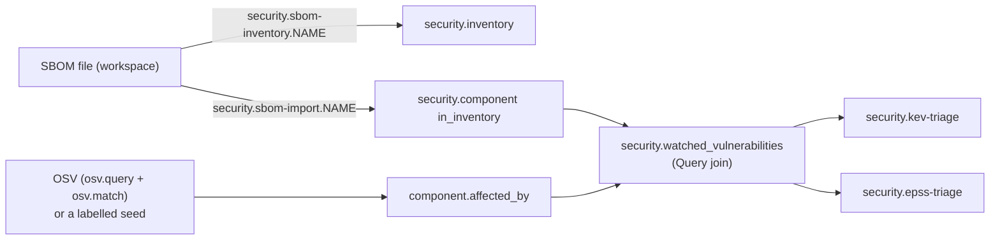
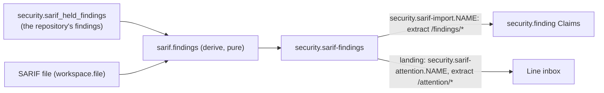

# The security kit in the Claim-authority form: KEV, EPSS and SBOM inventory

This directory is the security kit re-authored for the Procedure template
(D-R37): `read -> fetch -> derive* -> extract -> claims`. It holds KEV and EPSS
(the pilot) and batch 1, the SBOM inventory and the watch list. The 1.3.0
artifacts beside it (`artifacts/`, `reference.md`) are the old form, and
`reference.md` is generated from those, so this page is the reference for the
new form until the generator reads it.

| File | What |
|---|---|
| `definitions.py` | Every authoring payload, in install order: CaptureKinds, vocabulary (Contracts, ClaimTypes, SubjectKinds, Queries), Procedures, automation (Lines, Mandates, Triggers), and state (catalog, vulnerabilities, seeds) |
| `inventory.py` | Batch 1: the SBOM import, the inventory and component kinds, `affected_by`, and the SBOM authoring lint |
| `osv.py` | **Prepared, not wired.** The OSV Procedure and Line, waiting for core lanes A and B |
| `findings.py` | Batch 2, code findings: the SARIF import and attention Procedures, the finding kind, its scan and judgment ClaimTypes, and their Lines |
| `install.py` | Installs everything into an instance through the served CLI |
| `test_pilot_gate.py`, `test_inventory_gate.py`, `test_findings_gate.py` | The gate, run on recorded real bytes |
| `../providers/security-sarif-provider` | The code-findings derive `sarif.findings` (pure) and its SARIF test data |
| `../providers/security-osv-provider` | **Prepared, not wired.** The protocol-2 OSV provider (`osv.query` fetch, `osv.match` derive) and its recorded OSV exchanges |

## The chain

Lines depend on each other only through state (D-R35). An SBOM's inventory Line
runs before its import Line, because a membership names a live inventory
Subject. A `capture_landing` Trigger on the SBOM's kind and logical source
starts the import. KEV and EPSS read the watch list.

## Kinds and fields

| Kind | Key | Fields |
|---|---|---|
| `security.inventory` | `inventory_id`: the SBOM's `metadata.component` purl, or its workspace path when it has none | `sbom_path` (observation, from the SBOM) |
| `security.component` | `purl`: purl@version, with qualifiers dropped by the `purl-type` package normalizer | `in_inventory` (many, Subject-valued → inventory, observation from the SBOM, mirrored on absence); `affected_by` (many, Subject-valued → vulnerability: OSV's observation, or an agent's normative statement) |
| `security.vulnerability` | `cve_id` | KEV and EPSS fields (see `definitions.py`) |

## Applicability is a Query (K-B1-2)

`security.watched_vulnerabilities` returns every vulnerability that some
component's `affected_by` names, where that component is `in_inventory` of some
inventory. Each vulnerability is one row (Subject-shaped), with the row Contract
KEV and EPSS already read. No applicability or assessment Claims are stored.
Agents' judgments, such as not_affected, come in batch 2.

## SBOM import

- **The inventory's name (K-B1-5).** It is the SBOM's own `metadata.component`
  purl. `inventory.lint_sbom` reads it when the Line is authored. An SBOM
  without one is named by its workspace path, and the lint warns
  `cruxible.kit.security.sbom_unnamed`, because moving that file starts a new
  inventory.
- **Removal.** A component the SBOM no longer lists has its membership retired
  (`when_absent: mirror`), and the complete read is the witness.
- **Absence never crosses inventories.** Each SBOM's Lines read under their own
  logical source (`cyclonedx.sbom.<name>`), and absence only retires Claims from
  the same source.
- **Nested components.** Only top-level `components` are read. An extract
  selects one `*` level.

## Distro coverage and "not checked" (K-B1-6)

OSV's distribution ecosystems (Debian, Ubuntu, Alpine, the RPM distributions)
are keyed by **source** package name. An SBOM lists **binary** packages: to OSV,
`pkg:deb/debian/libc6` is `glibc` and `libssl3` is `openssl`. Version 1 cannot
map binary names to source names, so:

- every distro component (purl type `deb`, `rpm` or `apk`) is left out of the
  OSV query and out of `queried`;
- such a component reads **not checked**. It is never clean: no `affected_by`
  is written for it, and nothing says it is unaffected;
- absence never retires its Claims, because only components OSV answered in
  full are judged.

The same applies to a component whose OSV answer was incomplete: a failed or
truncated batch, or an advisory record OSV could not serve. Post-v1, binary
names will map to source names, from SBOM source-name metadata (syft
`sourceName`) or from a distro name table. The recorded exchanges in
`security-osv-provider/tests/recordings` show the gap: `libc6@2.36-9+deb12u7`
gets no answer, while `glibc` at the same version gets 33 advisories.

## OSV (prepared, not wired)

- **`osv.query`** (fetch) returns OSV's responses verbatim, one Capture each: a
  `POST /v1/querybatch` per 1000 components, then a `GET /v1/vulns/{id}` per
  advisory named.
- **`osv.match`** (derive, pure) emits one JSON document with `queried`,
  `not_checked`, `affected` (purl, cve_id, osv_id) and `unkeyed`. `unkeyed`
  holds advisories with no CVE alias, such as certifi's and uv's
  GHSA ↔ PYSEC pairs.
- **The Line (K-B1-4)** settles `affected_by` and may create
  `security.vulnerability` Subjects.

Until it is wired, an instance states `affected_by` through an agent's
own-word proposal (`definitions.seed_affected_by`). Its rationale begins
"Seed, not OSV".

## Demo SBOMs (K-B1-7)

`../../examples/sboms` holds two SBOMs, both recorded as gate fixtures:

- `cruxible-env.cdx.json`: Cruxible's own Python environment, 55 PyPI packages.
  It was written by `env_sbom.py`, the local equivalent of `cyclonedx-py
  environment`.
- `log4j-demo-app.cdx.json`: a **demo app**, not real software. It pins
  log4j-core 2.14.1, which reaches CVE-2021-44228 on KEV.

## Code findings (batch 2)

Two Procedures, each with one terminal, compose through the derived document:

| ClaimType on `security.finding` | Role | Written by |
|---|---|---|
| `repo`, `weakness`, `locus` | key | the import (subject `create: if_absent`) |
| `rule`, `reported_by` (many) | observation | the import |
| `severity` | observation, or normative | the import; an agent's judgment holds (`held_disagrees`) |
| `reported_at` (path:line) | observation, mirrored | the import; it revises when a finding moves and retires when it is fixed |
| `verification` (present / fixed) | observation; `fixed` needs complete input | the import; `fixed` only for a covered finding |
| `verdict`, `justification`, `fixed_by` | normative (own words) | agents, never a Mandate |

- **`expect` is the header's `covered`.** These are the held findings a full
  run's rule set covers. They are the only Subjects whose absence the run
  judges.
- **Why the inbox goes through a second Procedure.** A Procedure has one
  terminal, and neither a regression nor a gap is a core finding kind. So the
  attention Procedure runs on the landing of the derived Capture (a
  `capture_landing` Trigger); the Trigger substitutes the Capture for the
  derive call.
- **The Line reads its own logical source** (`sarif.NAME`). Absence then
  retires only what that scanner's file wrote.
- **Fail-closed rules.** A refused record, a duplicate key or a count
  mismatch makes the read incomplete, so nothing is fixed or retired. A result
  the derive cannot place (no repository path, no stable locator, an over-long
  or multi-line locus, malformed locations) is a location gap, never a record,
  and it taints its rule: that rule covers nothing in the scan, so none of its
  held findings is fixed or retired. A result that is no record, or names no
  rule, taints its whole tool for the scan: no held finding that tool reported
  is fixed or retired, whatever another run of the tool says (a rule catalog
  can be empty or incomplete). The header lists the tainted rules and tools. An unreadable SARIF file is refused by the derive, and
  nothing is written.
- **Not yet in core.** Today a record that is no object (or an out-of-bounds
  key part) fails the whole run rather than only itself. The gate holds this as
  a strict xfail with a core owner.
