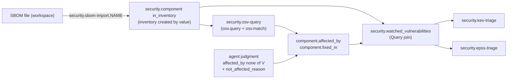
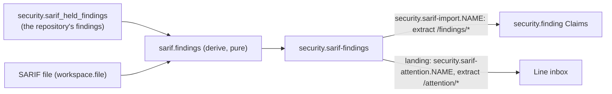

# The security kit in the Claim-authority form: the dependency loop

This directory is the security kit re-authored for the Procedure template
(D-R37): `read -> fetch -> derive* -> extract -> claims`. It holds the
dependency loop: SBOM import, OSV, KEV and EPSS, agents' not_affected
judgments, the triage worklists and the track record. The 1.3.0 artifacts beside
it (`artifacts/`, `reference.md`) are the old form, and `reference.md` is
generated from those, so this page is the reference for the new form until the
generator reads it.

| File | What |
|---|---|
| `definitions.py` | Every authoring payload, in install order: CaptureKinds, the provider Contracts, vocabulary (Contracts, ClaimTypes, SubjectKinds, Queries), Procedures, automation (Lines, Mandates, Triggers), and state (catalog, vulnerabilities, seeds) |
| `inventory.py` | The SBOM import, the inventory and component kinds, `affected_by` (with its inverse), `fixed_in` and `not_affected_reason` |
| `osv.py` | The OSV Procedure and Line, the OSV response kind and the provider's Contracts as an authoring change set |
| `triage.py` | The triage and track-record Queries, and `judgment()`: the two writes of a not_affected judgment |
| `findings.py` | Code findings: the SARIF import and attention Procedures, the finding kind, its scan and judgment ClaimTypes, and their Lines; security audits: the coverage unit, `found_in` and the audit Queries |
| `install.py` | Installs everything into an instance through the served CLI |
| `dependency_replay.py` | Gate support: runs the real provider code in-process on recorded OSV exchanges |
| `test_pilot_gate.py`, `test_inventory_gate.py`, `test_dependency_gate.py`, `test_findings_gate.py`, `test_audit_gate.py` | The gate, run on recorded real bytes |
| `../providers/security-osv-provider` | The protocol-2 provider: `sbom.components` (derive), `osv.query` (fetch), `osv.match` (derive), with its recorded OSV exchanges |
| `../providers/security-sarif-provider` | The code-findings derive `sarif.findings` (pure) and its SARIF test data |

## The chain

Lines depend on each other only through state (D-R35). Run the SBOM import
Lines, then OSV, then KEV and EPSS.

## Kinds and fields

| Kind | Key | Fields |
|---|---|---|
| `security.inventory` | `inventory_id`: the SBOM's `metadata.component` purl, or its workspace path when it has none | (none; created by value) |
| `security.component` | `purl`: purl@version, with qualifiers dropped by the `purl-type` package normalizer | `in_inventory` (many, Subject-valued → inventory, observation from the SBOM's derived components, mirrored on absence); `affected_by` (many, Subject-valued → vulnerability: OSV's observation; its inverse "none of V" is an agent's not_affected judgment); `fixed_in` (qualified by a CVE id: the versions OSV lists as fixed); `not_affected_reason` (qualified by a CVE id: the VEX justification) |
| `security.vulnerability` | `cve_id` | KEV and EPSS fields (see `definitions.py`); created by value when OSV first names it |

## SBOM import: one Procedure (K-B1-G1)

`security.sbom-import`: read every held membership → fetch the SBOM through
core's builtin `workspace.file` → derive `sbom.components` → extract
`/components/*` → claims.

- **The inventory's name (K-B1-5).** `sbom.components` names the inventory by
  the SBOM's own `metadata.component` purl, on every record. An SBOM without one
  is named by its workspace path, and the derived document and every record
  carry `warning: sbom_unnamed`, because moving that file starts a new
  inventory. The claims create the inventory by value (`create: if_absent`).
- **One Line per SBOM file.** A Line names only the file's path and its logical
  source (`cyclonedx.sbom.<name>`). `workspace.file` reads one path, and a Line
  run takes no per-run input before R-ON5, so one Line serves one file.
- **Removal.** A component the SBOM no longer lists has its membership retired
  (`when_absent: mirror`), and the complete read is the witness. `expect` is the
  derived document's `held` header: the components this inventory held before
  the run. Core refuses a read parameterized by a runtime value ("admission
  selectors cannot depend on runtime output"), so the import reads every held
  membership and the derive selects the inventory's own. **Blocked on core:**
  that read grows with every other inventory in the instance, and past the
  Procedure's 20,000-row read ceiling it stops even a small SBOM importing. A
  read keyed by the derive's inventory (queued in the core batch) makes it
  constant; the gate's strict xfail
  `test_a_fixed_sbom_imports_in_constant_work_beside_growing_unrelated_inventories`
  pins it.
- **Absence never crosses inventories.** Each SBOM's Line reads under its own
  logical source, and absence only retires Claims from the same source. A
  component two SBOMs list has a membership from each; importing one surfaces
  the other's as `claim_not_in_source` in the run report. The SBOM Lines do not
  route that finding to their inbox (it would fire for every shared component on
  every run).
- **Fail closed.** A purl core's normalizer cannot key is inadmissible and makes
  the read incomplete, so nothing retires (blocked today by a core bug: the run
  fails instead; see the gate's strict xfail). Two spellings that fold to one key
  are a duplicate: nothing is written for that key. A component with no purl is
  counted in `unidentified` and is never a record, but it is in the derive's
  `count`, so the extract's `complete_when` count check reads that SBOM as
  incomplete: its keyed components write and nothing retires. A held component
  whose purl went missing never reads as removed.
- **Nested components** are flattened by the derive.

## OSV: one Procedure (K-B1-3, K-B1-4)

`security.osv-query`: read every inventoried component → fetch `osv.query` (a
list of Captures: one `POST /v1/querybatch` per 1000 components, then one
`GET /v1/vulns/{id}` per advisory named) → derive `osv.match` → extract
`/affected/*` → claims.

- **`affected_by`** creates each vulnerability OSV names by value
  (`create: if_absent`). OSV's own version matching decides; the kit has no
  version-range code.
- **`fixed_in`**, qualified by the CVE id, is a list: every version OSV's
  advisories for that CVE list as a `fixed` range event of the component's own
  package (matched by the advisory's `package.purl`, version and qualifiers
  dropped; PyPI names under PEP 503), sorted as text. One version per release
  line OSV knows (log4j-core 2.14.1 × CVE-2021-44228: `2.12.2, 2.15.0, 2.3.1`).
  The kit compares no versions, so it does not pick the one above the
  component's own; agents read the list.
- **`expect` is the derived document's `queried` header**: only components OSV
  answered in full are judged. A vulnerability OSV no longer lists for one of
  them retires on the complete read (`mirror`), and settles (K-B2-G4).
- **Incomplete answers.** A request that got no response at all is left out of
  the list and `osv.query` names `responses` in `incomplete_captures` (R-ON2):
  positives still write, absence never retires. A response with an error status
  is a member; the derive leaves the components it concerns out of `queried`.
- **The Line** settles `affected_by` and `fixed_in` on the extracted record and
  their retirement on absence, may create `security.vulnerability` Subjects, and
  routes `held_disagrees` to its inbox.

## Distro coverage and "not checked" (K-B1-6)

OSV's distribution ecosystems (Debian, Ubuntu, Alpine, the RPM distributions)
are keyed by **source** package name. An SBOM lists **binary** packages: to OSV,
`pkg:deb/debian/libc6` is `glibc` and `libssl3` is `openssl`. Version 1 cannot
map binary names to source names, so:

- every distro component (purl type `deb`, `rpm` or `apk`) is left out of the
  OSV query and out of `queried`;
- such a component reads **not checked**. It is never clean: no `affected_by`
  is written for it, and nothing says it is unaffected;
- absence never retires its Claims, because only components OSV answered in
  full are judged.

The same applies to a component whose OSV answer was incomplete: a failed or
truncated batch, or an advisory record OSV could not serve. Post-v1, binary
names will map to source names, from SBOM source-name metadata (syft
`sourceName`) or from a distro name table. The recorded exchanges in
`security-osv-provider/tests/recordings` show the gap: `libc6@2.36-9+deb12u7`
gets no answer, while `glibc` at the same version gets 33 advisories.

## Judgments: not_affected (K-B2-J1, J1b)

A not_affected judgment is the inverse on the `affected_by` unit: "component
`affected_by` none of V", normative, in the agent's own words. `affected_by`
declares `inverse: {key: object, evidence_rules: [self]}`, and a self-sourced
normative none satisfies `self`. It is two writes, **in this order**
(`triage.judgment()` builds both, as `.reason` and `.verdict`):

1. `cruxible authoring submit FILE`: the Claim
   `security.component.not_affected_reason` (one of `component_not_present`,
   `vulnerable_code_not_present`, `vulnerable_code_not_in_execute_path`,
   `vulnerable_code_cannot_be_controlled_by_adversary`,
   `inline_mitigations_already_exist`), qualified by the CVE id. Free-text
   specifics stay in the rationale. (The write verbs carry no qualifier, so the
   reason is a separate submit.)
2. `cruxible write FILE`: retire OSV's observation of V on that component
   (`reason: superseded`; a none beside the live value of its unit is refused)
   and add `{"none": "security.vulnerability/<cve>"}` with `role: normative`.

Only the none hides the pair: the exposure, the backlog and the watch list all
key on it. A judgment that stops after the first write leaves the pair exposed,
and `triage.judgment_status()` reads it **judgment incomplete** (a reason with
no none); making the second write finishes it. The two are not one atomic
change: core has no single change that states a none and a qualified Claim
together (surface gap G4).

Queries skip nones, so V leaves the watch list for that component only: a
vulnerability another component still has stays watched. OSV's next run cannot
override the normative holder; it records a `held_disagrees` finding (held: none
of V, incoming: V), which the OSV Line routes to its inbox.

## Triage worklists and the track record (K-B2-TR)

| Query | Rows |
|---|---|
| `security.urgent_exposures` | One per (inventory, component, vulnerability): KEV-listed first (by `kev_date_added`), then by EPSS score; with KEV dates, ransomware use and EPSS |
| `security.kev_triage_backlog` | The KEV-listed exposures nobody has judged (a judged pair is no exposure) |
| `security.not_affected_judgments` | Every component with a not_affected reason: its VEX reasons and `affected_by` values (candidates; each pair's status is `triage.judgment_status()`) |
| `security.watched_vulnerabilities` | One per vulnerability some inventoried component is affected by (K-B1-2) |

Which pairs are judged, and who judged them when: the compact query
`cruxible query security.component --select purl,not_affected_reason,affected_by --claims`
gives each reason's CVE qualifier and Claim id and each none's Claim id;
`triage.judgment_status(row)` pairs them per CVE (`judged`, or `judgment
incomplete` when only the reason exists), and `cruxible get CLM-… --detail
history` gives the actor and the accepted time. (A named Query cannot pair a
reason's qualifier with a none's value, so the per-pair status is this view.)
A source that later disagrees is the OSV Line's `held_disagrees` inbox item.

## Demo SBOMs (K-B1-7)

`../../examples/sboms` holds two SBOMs, both recorded as gate fixtures:

- `cruxible-env.cdx.json`: Cruxible's own Python environment, 55 PyPI packages.
  It was written by `env_sbom.py`, the local equivalent of `cyclonedx-py
  environment`.
- `log4j-demo-app.cdx.json`: a **demo app**, not real software. It pins
  log4j-core 2.14.1, which reaches CVE-2021-44228 on KEV.

## Code findings (batch 2)

Two Procedures, each with one terminal, compose through the derived document:

| ClaimType on `security.finding` | Role | Written by |
|---|---|---|
| `repo`, `weakness`, `locus` | key | the import (subject `create: if_absent`) |
| `rule`, `reported_by` (many) | observation | the import |
| `severity` | observation, or normative | the import; an agent's judgment holds (`held_disagrees`) |
| `reported_at` (path:line) | observation, mirrored | the import; it revises when a finding moves and retires when it is fixed |
| `verification` (present / fixed) | observation; `fixed` needs complete input | the import; `fixed` only for a covered finding |
| `verdict`, `justification`, `fixed_by` | normative (own words) | agents, never a Mandate |

- **`expect` is the header's `covered`.** These are the held findings a full
  run's rule set covers. They are the only Subjects whose absence the run
  judges.
- **Why the inbox goes through a second Procedure.** A Procedure has one
  terminal, and neither a regression nor a gap is a core finding kind. So the
  attention Procedure runs on the landing of the derived Capture (a
  `capture_landing` Trigger); the Trigger substitutes the Capture for the
  derive call.
- **The Line reads its own logical source** (`sarif.NAME`). Absence then
  retires only what that scanner's file wrote.
- **Fail-closed rules.** A refused record, a duplicate key or a count
  mismatch makes the read incomplete, so nothing is fixed or retired. A result
  the derive cannot place (no repository path, no stable locator, an over-long
  or multi-line locus, malformed locations) is a location gap, never a record,
  and it taints its rule: that rule covers nothing in the scan, so none of its
  held findings is fixed or retired. A result that is no record, or names no
  rule, taints its whole tool for the scan: no held finding that tool reported
  is fixed or retired, whatever another run of the tool says (a rule catalog
  can be empty or incomplete). The header lists the tainted rules and tools. An unreadable SARIF file is refused by the derive, and
  nothing is written.
- **A record that is no object** (or an out-of-bounds key part) is refused on
  its own (D-R40): its siblings write, and the read is incomplete, so nothing
  is fixed or retired.

## Security audits

An audit agent hunts for vulnerabilities in a repository and reports them as
ordinary `security.finding`s, keyed exactly as SARIF results are (K-CA1), so a
scanner and an agent that find the same weakness at the same place converge on
one finding with two reporters. What it checked is state too: a
`security.coverage_unit` per (repo, surface, concern) (K-CA3).

| ClaimType | Role | Evidence |
|---|---|---|
| `coverage_unit.repo`, `.surface`, `.concern` | key | the unit's create (own words) |
| `coverage_unit.status` (checked / deferred / blocked / out_of_scope) | normative, never a Mandate | own words, or a file receipt of the examined passage |
| `finding.found_in` (many, → coverage unit) | normative, never a Mandate | own words |
| `finding.reported_at`, `.rule`, `.reported_by` (`audit`) | observation | a SARIF scan, or a file receipt of the code at the location |

- **File receipts.** The `file` rule admits any catalogued workspace file (a
  `files.yaml` name): the `workspace_file` family (D1), a Capture under an
  accepted foreign-source contract. The catalog is the boundary: the writer's
  side refuses an uncatalogued path, and a Capture of a file never cited through
  the workspace write path (no accepted contract) is refused. **Core bug:** the
  write that first cites a file installs its contract but is not admitted by it
  (reported_at refuses, a status lands uncovered); the gate's strict xfail
  `test_core_d1_a_first_citation_is_admitted` pins it.
- **Planning.** `security.coverage_plan` (one repository) lists the units never
  checked, deferred or blocked. A checked unit whose cited passage changed is a
  workspace-aware `cruxible next` `citation_drifted` row naming its status
  Claim. `security.findings_by_unit` lists one unit's findings. **Blocked on
  core:** both reads load every coverage unit and finding (query pushdown does
  not narrow a conjunction with `not exists`, a traversal or a Subject-valued
  value); the gate's strict xfail
  `test_core_audit_reads_are_constant_in_unrelated_units` pins it.
- **Guidance** (`../guidance/`): `hunter.md` (reporting a finding and keeping
  coverage), `verifier.md` (judging one: verdict, severity, justification) and
  `coverage.md` (the units and their status), each naming the ClaimTypes it
  guides; `../reference/` holds optional hunting strategy (the attack classes,
  ten domain companions and implicit state machines). They install as governed
  Documents once kits ship Documents (core-surface item 11;
  `install.guidance_members()` is the member list, a TODO until then).
- **Review is on the honor system.** The verifier writes its verdict with
  `accept: never`, and a different agent approves it after reading the
  guidance; the author never approves its own verdict.

## Known limits

- **EPSS URL (D-R34).** The EPSS Line's URL still carries the watched CVEs, so a
  CVE OSV adds needs a Line change. cruxible-provider-web 0.5.0's `web.fetch`
  has the typed `query` map; the EPSS re-author is queued with the rest of the
  kit.
- **The provider lock.** `security-osv-provider` has no committed `uv.lock`:
  `cruxible-provider-runtime` 0.4.0 is not on PyPI yet. The scratch instance
  locks it against the providers checkout and installs the runtime wheel as a
  transferred dependency.
