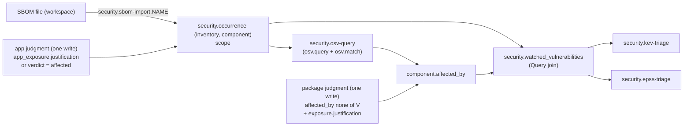
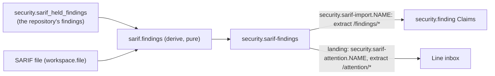

# The security kit in the Claim-authority form: the dependency loop

This directory is the security kit re-authored for the Procedure template
(D-R37): `read -> fetch -> derive* -> extract -> claims`. It holds the
dependency loop: SBOM import, OSV, KEV and EPSS, agents' package-level and
app-level not_affected judgments and app-level affected verdicts, the triage
worklists, the confirmed list and the track record.
`../build_release.py` builds the committed kit from these definitions through
the public CLI; see [the release recipe](../README.md). The code-findings and
audit modules (`findings.py`) are bundled too: the vocabulary, Procedures,
Queries, provider and guidance, never their Lines.

| File | What |
|---|---|
| `definitions.py` | Every authoring payload, in install order: CaptureKinds, the provider Contracts, vocabulary (Contracts, ClaimTypes, SubjectKinds, Queries), Procedures, automation (Lines, Mandates, Triggers), and state (catalog, vulnerabilities, seeds) |
| `inventory.py` | The SBOM import, the inventory and component kinds, the pair kinds (occurrence, exposure, app_exposure) and their ClaimTypes, and `affected_by` (with its inverse) |
| `osv.py` | The OSV Procedure and Line, the OSV response kind and the provider's Contracts as an authoring change set |
| `triage.py` | The triage, confirmed and track-record Queries, and the judgment writes: `judgment()`, `app_judgment()`, `affected_judgment()`, `reverse_judgment()`, and `investigation()` (under investigation) |
| `findings.py` | Code findings: the SARIF import and attention Procedures, the finding kind, its scan and judgment ClaimTypes, and their Lines; security audits: the coverage unit, `found_in` and the audit Queries |
| `install.py` | Installs everything into an instance through the served CLI |
| `dependency_replay.py` | Gate support: runs the real provider code in-process on recorded OSV exchanges |
| `test_pilot_gate.py`, `test_inventory_gate.py`, `test_dependency_gate.py`, `test_findings_gate.py`, `test_audit_gate.py` | The gate, run on recorded real bytes |
| `../providers/security-osv-provider` | The protocol-2 provider: `sbom.components` (derive), `osv.query` (fetch), `osv.match` (derive), with its recorded OSV exchanges |
| `../providers/security-sarif-provider` | The code-findings derive `sarif.findings` (pure) and its SARIF test data |
| `../guidance/dependency.md` | Judging a dependency exposure: the review guidance the two justifications and the app-level verdict point to |

## The chain

Lines depend on each other only through state (D-R35). Run the SBOM import
Lines, then OSV, then KEV and EPSS.

## Kinds and fields

A plain relationship is a link; a relationship with facts of its own is a pair
Subject keyed by its ends (D-R43). Every pair kind is `unique`, and its ends
never change (a new identity is a new pair).

| Kind | Key | Fields |
|---|---|---|
| `security.inventory` | `inventory_id`: the SBOM's `metadata.component` purl, or its workspace path when it has none | (none; created by the import) |
| `security.component` | `purl`: purl@version, with qualifiers dropped by the `purl-type` package normalizer: one package release, the same in every inventory | `affected_by` (many, Subject-valued → vulnerability: OSV's observation; its inverse "none of V" is an agent's package-level not_affected judgment) |
| `security.occurrence` | (`inventory`, `component`) | `scope`: the CycloneDX scope (`required`, `optional`, `excluded`; `required` when the SBOM states none). The membership fact (R3): live while the SBOM lists the component, retired when it no longer does |
| `security.exposure` | (`component`, `vulnerability`) | `justification`: `vulnerable_code_not_present` only (package level, normative; cites the code read or own words) |
| `security.app_exposure` | (`occurrence`, `vulnerability`) | `justification`: `component_not_present`, `vulnerable_code_not_in_execute_path`, `vulnerable_code_cannot_be_controlled_by_adversary` or `inline_mitigations_already_exist` (one inventory, normative; cites the code read or own words). `verdict`: `affected` (alone: reachable here, citing the code on the call path) or `not_affected` (optional beside a justification) |
| `security.vulnerability` | `cve_id` | KEV and EPSS fields (see `definitions.py`); created by value when OSV first names it |

`security.inventory_components` lists one inventory's current components
(`--param inventory=security.inventory/<id>`): its occurrences holding a scope.

## SBOM import: one Procedure (K-B1-G1, D-R46 R3)

`security.sbom-import`: fetch the SBOM through core's builtin `workspace.file`
→ derive `sbom.components` → extract `/components/*` → claims. It reads no
state.

- **The inventory's name (K-B1-5).** `sbom.components` names the inventory by
  the SBOM's own `metadata.component` purl, in the derived document's header.
  An SBOM without one is named by its workspace path, and the derived document
  and every record carry `warning: sbom_unnamed`, because moving that file
  starts a new inventory.
- **The row is the occurrence.** Its two ends are nested templates, both
  created if absent: the inventory (from the header) and the component (from
  the record's purl). One run creates the inventory, its components and their
  occurrences, ends first, and writes each occurrence's `scope`. The Mandate
  creates all three kinds and settles `scope`.
- **One Line per SBOM file.** A Line names only the file's path and its logical
  source (`cyclonedx.sbom.<name>`).
- **Removal.** `expect: {by: inventory, ends: [header]}`: absence is judged by
  the inventory alone. Core finds that inventory's current occurrences from its
  pair index, so an import costs its own inventory's occurrences, never
  another inventory's or history (`test_a_fixed_sbom_imports_in_constant_work_beside_growing_unrelated_inventories`).
  A component the complete SBOM no longer lists has its occurrence's `scope`
  retired (`when_absent: mirror`), with the complete read as the witness. The
  occurrence stays as history; listed again, the component lands on it.
- **Absence never crosses inventories.** Another inventory's occurrence of a
  shared component is never a candidate, so nothing about it even surfaces.
- **Fail closed.** A purl core's normalizer cannot key is inadmissible and makes
  the read incomplete, so nothing retires. Two spellings that fold to one key
  are a duplicate: nothing is written for that key; so is one purl listed with
  two scopes. A component with no purl is counted in `unidentified` and is
  never a record, but it is in the derive's `count`, so the extract's
  `complete_when` count check reads that SBOM as incomplete: its keyed
  components write and nothing retires. A held component whose purl went
  missing never reads as removed. A scope outside CycloneDX's three is refused
  on its own: the component is still listed, so its occurrence keeps the scope
  it held.
- **Nested components** are flattened by the derive.

## OSV: one Procedure (K-B1-3, K-B1-4)

`security.osv-query`: read every inventoried component (a component some
occurrence holds a scope for) → fetch `osv.query` (a list of Captures: one
`POST /v1/querybatch` per 1000 components, then one `GET /v1/vulns/{id}` per
advisory named) → derive `osv.match` → extract `/affected/*` → claims.

- **`affected_by`** creates each vulnerability OSV names by value
  (`create: if_absent`). OSV's own version matching decides; the kit has no
  version-range code. OSV writes no pair Subjects.
- **Fixed versions are no Claim** (D-R44). Each `osv.match` record lists every
  version OSV's advisories for that CVE list as a `fixed` range event of the
  component's own package (matched by the advisory's `package.purl`, version
  and qualifiers dropped; PyPI names under PEP 503), sorted as text (log4j-core
  2.14.1 × CVE-2021-44228: `2.12.2, 2.15.0, 2.3.1`). Every `affected_by` cites
  that document, where agents read them; the kit compares no versions.
- **`expect` is the derived document's `queried` header**: only components OSV
  answered in full are judged. A vulnerability OSV no longer lists for one of
  them retires on the complete read (`mirror`), and settles (K-B2-G4).
- **Incomplete answers.** A request that got no response at all is left out of
  the list and `osv.query` names `responses` in `incomplete_captures` (R-ON2):
  positives still write, absence never retires. A response with an error status
  is a member; the derive leaves the components it concerns out of `queried`.
- **The Line** settles `affected_by` on the extracted record and its retirement
  on absence, may create `security.vulnerability` Subjects, and routes
  `held_disagrees` to its inbox.

## Distro coverage and "not checked" (K-B1-6)

OSV's distribution ecosystems (Debian, Ubuntu, Alpine, the RPM distributions)
are keyed by **source** package name. An SBOM lists **binary** packages: to OSV,
`pkg:deb/debian/libc6` is `glibc` and `libssl3` is `openssl`. Version 1 cannot
map binary names to source names, so:

- every distro component (purl type `deb`, `rpm` or `apk`) is left out of the
  OSV query and out of `queried`;
- such a component reads **not checked**. It is never clean: no `affected_by`
  is written for it, and nothing says it is unaffected;
- absence never retires its Claims, because only components OSV answered in
  full are judged.

The same applies to a component whose OSV answer was incomplete: a failed or
truncated batch, or an advisory record OSV could not serve. Post-v1, binary
names will map to source names, from SBOM source-name metadata (syft
`sourceName`) or from a distro name table. The recorded exchanges in
`security-osv-provider/tests/recordings` show the gap: `libc6@2.36-9+deb12u7`
gets no answer, while `glibc` at the same version gets 33 advisories.

## Judgments: not_affected and affected (K-B2-J1, D-R46 R4)

A vulnerability affects an occurrence unless a judgment holds, and the row
stays in the worklists until an agent judges it. Each judgment is ONE
`cruxible write`: it lands or refuses as a whole.

- **Package level** (`triage.judgment()`): the vulnerable code is not in this
  package release (`vulnerable_code_not_present`), so it holds for every
  inventory. The write retires OSV's observation of V on the component
  (`reason: superseded`; a none beside the live value of its unit is refused),
  adds `{"none": "security.vulnerability/<cve>"}` with `role: normative`
  (`affected_by` declares `inverse: {key: object, evidence_rules: [self]}`),
  creates the pair `security.exposure` (component, V), landing on it when it
  exists, and sets its `justification`.
- **App level** (`triage.app_judgment()`): one of the four app-level reasons,
  for one inventory. The write creates `security.app_exposure` (the row's
  `occurrence`, V) and sets its `justification`. It never states the global
  none: OSV's observation, the watch list and every other inventory's row
  stay.
- **Affected** (`triage.affected_judgment()`): the vulnerable code is
  reachable here. The write creates `security.app_exposure` (the row's
  `occurrence`, V) and sets `verdict = affected`, citing the code on the call
  path (or own words), with no justification. The row moves to
  `security.confirmed_exposures`; every other inventory's row stays.
  Confirmed-affected is always app level.
- **One rule reads the judgment pairs** (`triage._PACKAGE_NOT_AFFECTED`,
  `_APP_NOT_AFFECTED`, `_APP_AFFECTED`), and a judgment counts only when its
  value is resolved (one uncontested, supported value): a resolved
  justification is not_affected when the pair holds no verdict or a resolved
  `not_affected` verdict, a resolved `verdict = affected` with no
  justification is affected, and anything else (a contested verdict or
  justification, both, or a bare `not_affected` verdict) is no judgment: the
  row stays in the worklists and in neither list. Core has no
  cross-Claim refusal, so a write setting both lands; the guidance tells the
  reviewer to reject it, and the read keeps the row visible meanwhile.
- **Reversal** (`triage.reverse_judgment()`): one write retiring the
  justification (or the affected verdict) and, at package level, the none.
  The pairs stay as history; OSV's next run re-observes V. Affected to
  not_affected is `triage.app_judgment(..., verdict=True)`: one write that
  revises the verdict Claim to `not_affected` and sets the justification.
- **A confirmed exposure clears** when the SBOM no longer lists the
  component: the occurrence's `scope` retires, the row leaves
  `security.confirmed_exposures`, and core resurfaces the verdict (a Claim on
  a pair whose end lost its last observation) as `claim_dependency_stale` in
  `next`.
- **Under investigation** (K-CF1, `triage.investigation()`): no judgment. Attest
  `--unsure` on OSV's `affected_by` Claim, with the reason (`--because` or a
  cited section) and `--valid-until` capped at the end of the KEV due date (a
  due date already past refuses: judge the pair instead). The pair stays in
  the worklists and the KEV backlog; `triage.under_investigation()` over that
  one Claim's `get --detail evidence` attestations marks it.

OSV's next run cannot override a package-level judgment's normative none; it
records a `held_disagrees` finding (held: none of V, incoming: V), which the
OSV Line routes to its inbox.

**Review is on the honor system (K-CF2a).** The helpers write with
`accept: never`; a different agent approves after reading
`../guidance/dependency.md` (a governed Document that `guides` both
justification ClaimTypes and the app-level verdict, so a proposal's
`guidance` shows it). No Mandate settles a justification or a verdict, or
creates a judgment pair.

## Triage worklists and the track record (K-B2-TR)

| Query | Rows |
|---|---|
| `security.urgent_exposures` | One per (inventory, component, vulnerability) occurrence nobody has judged (no package-level justification, no app-level judgment): KEV-listed first (by `kev_date_added`), then by EPSS score; with the occurrence id, its scope, KEV dates, ransomware use and EPSS |
| `security.kev_triage_backlog` | The KEV-listed rows of the above (pairs under investigation stay) |
| `security.confirmed_exposures` | One per occurrence judged `affected` whose SBOM still lists the component, with its app_exposure id and the same fields, KEV first then EPSS; the fixed versions are in the `osv.match` document the component's `affected_by` Claim cites |
| `security.not_affected_judgments` | Every package-level judgment: exposure, component, CVE, justification |
| `security.app_not_affected_judgments` | Every app-level judgment: app_exposure, inventory, component, CVE, justification |
| `security.watched_vulnerabilities` | One per vulnerability some inventoried component is affected by (K-B1-2); a package-level judgment drops it, an app-level one does not (a Subject-shaped query takes no optional hop) |

The worklists walk vulnerability ← `affected_by` ← component → its occurrences
holding a scope (the pair index) → inventory, then the two judgment pairs by
whole key; the confirmed list starts from the judgment pairs. An unrelated
inventory costs them nothing
(`test_triage_reads_are_flat_in_unrelated_inventories`). Who judged and when:
`cruxible get CLM-… --detail history` on the justification (and the none).
A source that later disagrees is the OSV Line's `held_disagrees` inbox item.

## Demo SBOMs (K-B1-7)

`../../examples/sboms` holds two SBOMs, both recorded as gate fixtures:

- `cruxible-env.cdx.json`: Cruxible's own Python environment, 55 PyPI packages.
  It was written by `env_sbom.py`, the local equivalent of `cyclonedx-py
  environment`.
- `log4j-demo-app.cdx.json`: a **demo app**, not real software. It pins
  log4j-core 2.14.1, which reaches CVE-2021-44228 on KEV.

## Code findings (batch 2)

Two Procedures, each with one terminal, compose through the derived document:

| ClaimType on `security.finding` | Role | Written by |
|---|---|---|
| `repo`, `weakness`, `locus` | key | the import (subject `create: if_absent`) |
| `rule`, `reported_by` (many) | observation | the import |
| `severity` | observation, or normative | the import; an agent's judgment holds (`held_disagrees`) |
| `reported_at` (path:line) | observation, mirrored | the import; it revises when a finding moves and retires when it is fixed |
| `verification` (present / fixed) | observation; `fixed` needs complete input | the import; `fixed` only for a covered finding |
| `verdict`, `justification`, `fixed_by` | normative (own words) | agents, never a Mandate |

- **`expect` is the header's `covered`.** These are the held findings a full
  run's rule set covers. They are the only Subjects whose absence the run
  judges.
- **Why the inbox goes through a second Procedure.** A Procedure has one
  terminal, and neither a regression nor a gap is a core finding kind. So the
  attention Procedure runs on the landing of the derived Capture (a
  `capture_landing` Trigger); the Trigger substitutes the Capture for the
  derive call.
- **The Line reads its own logical source** (`sarif.NAME`). Absence then
  retires only what that scanner's file wrote.
- **Fail-closed rules.** A refused record, a duplicate key or a count
  mismatch makes the read incomplete, so nothing is fixed or retired. A result
  the derive cannot place (no repository path, no stable locator, an over-long
  or multi-line locus, malformed locations) is a location gap, never a record,
  and it taints its rule: that rule covers nothing in the scan, so none of its
  held findings is fixed or retired. A result that is no record, or names no
  rule, taints its whole tool for the scan: no held finding that tool reported
  is fixed or retired, whatever another run of the tool says (a rule catalog
  can be empty or incomplete). The header lists the tainted rules and tools. An unreadable SARIF file is refused by the derive, and
  nothing is written.
- **A record that is no object** (or an out-of-bounds key part) is refused on
  its own (D-R40): its siblings write, and the read is incomplete, so nothing
  is fixed or retired.

## Security audits

An audit agent hunts for vulnerabilities in a repository and reports them as
ordinary `security.finding`s, keyed exactly as SARIF results are (K-CA1), so a
scanner and an agent that find the same weakness at the same place converge on
one finding with two reporters. What it checked is state too: a
`security.coverage_unit` per (repo, surface, concern) (K-CA3).

| ClaimType | Role | Evidence |
|---|---|---|
| `coverage_unit.repo`, `.surface`, `.concern` | key | the unit's create (own words) |
| `coverage_unit.status` (checked / deferred / blocked / out_of_scope) | normative, never a Mandate | own words, or a file receipt of the examined passage |
| `finding.found_in` (many, → coverage unit) | normative, never a Mandate | own words |
| `finding.reported_at`, `.rule`, `.reported_by` (`audit`) | observation | a SARIF scan, or a file receipt of the code at the location (`rule`: the notes file's `Trace` section) |
| `finding.verdict` | normative, never a Mandate | own words (the reasoning section the same write appends), or a file receipt of the observed run output (confirmed) |

- **File receipts.** The `file` rule admits any catalogued workspace file (a
  `files.yaml` name): the `workspace_file` family (D1), a Capture under an
  accepted foreign-source contract. The catalog is the boundary: the writer's
  side refuses an uncatalogued path, and a Capture of a file never cited through
  the workspace write path (no accepted contract) is refused. The write that
  first cites a file installs its contract, and that contract admits the
  write's own Captures (`test_a_first_citation_is_admitted`).
- **Planning.** `security.coverage_plan` (one repository) lists the units never
  checked, deferred or blocked. A checked unit whose cited passage changed is a
  workspace-aware `cruxible next` `citation_drifted` row naming its status
  Claim. `security.findings_by_unit` lists one unit's findings. The plan costs
  O(units in the queried repository), its own scope; other repositories' units
  and findings in other units cost neither read anything
  (`test_core_audit_reads_are_constant_in_unrelated_units`).
- **Guidance** (`../guidance/`): `hunter.md` (reporting a finding and keeping
  coverage), `verifier.md` (judging one: verdict, severity, justification) and
  `coverage.md` (the units and their status), each naming the ClaimTypes it
  guides; `../../reference/` holds optional hunting strategy (the attack classes,
  ten domain companions and implicit state machines), shipped in the release as
  plain kit files. The guidance installs as governed Documents (`install.install_guidance`: `body store`, then `document propose`,
  after the findings vocabulary), so `kit build` ships them as `documents/` kit
  artifacts and `kit add` installs them. A guidance Document `guides` the
  ClaimTypes its `Guides:` header names: `get ClaimType:
 detail=backlinks`
  and a proposal's `guidance` show it. The pilot can also install the
  references as Documents (`references=True`); those guide nothing and are
  `document_kind: security.reference` in `orient --section documents`.
- **Review is on the honor system.** The verifier writes its verdict with
  `accept: never`, and a different agent approves it after reading the
  guidance; the author never approves its own verdict.

## Known limits

- **Fresh install only (D-R46 R9).** This model replaces `component.in_inventory`,
  `component.fixed_in` and `component.not_affected_reason`; no instance holding
  them is carried over.
- **EPSS pages (D-R34).** The EPSS Procedure sends the watched CVE ids as the
  `cve` parameter through `web.fetch.pages`, at most 100 per page (FIRST's page
  size). A list extract declares no `complete_when`, so a page's own `/total` is
  not checked; the 100-id bound keeps every page whole, and a failed page makes
  the run incomplete. With nothing watched, `web.fetch.pages` sends no request
  and returns no Captures (providers `0343359`): the EPSS run succeeds, writes
  nothing and is complete (`test_epss_with_nothing_watched_asks_nothing_and_writes_nothing`;
  `security.start` on an inventory nothing affects:
  `test_start_on_an_inventory_nothing_affects_completes_and_asks_epss_nothing`).
- **The provider lock.** `security-osv-provider` has no committed `uv.lock`:
  `cruxible-provider-runtime` 0.4.0 is not on PyPI yet. The scratch instance
  locks it against the providers checkout and installs the runtime wheel as a
  transferred dependency.
