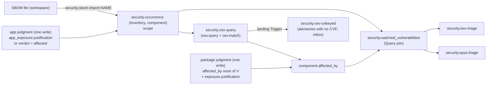
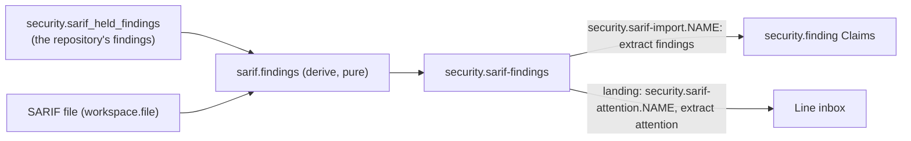

# The security kit in the Claim-authority form: the dependency loop

This directory is the security kit re-authored for the Procedure template
(D-R37): `read -> fetch -> derive* -> extract -> claims`. It holds the
dependency loop: SBOM import, OSV, KEV and EPSS, agents' package-level and
app-level not_affected judgments and app-level affected verdicts, the triage
worklists, the confirmed list and the track record.
`../build_release.py` builds the committed kit from these definitions through
the public CLI; see [the release recipe](../README.md). The code-findings and
audit modules (`findings.py`) are bundled too: the vocabulary, Procedures,
Queries, provider and guidance, never their Lines.

| File | What |
|---|---|
| `definitions.py` | Every authoring payload, in install order: CaptureKinds (their layouts staged after the vocabulary), vocabulary (Contracts, ClaimTypes, SubjectKinds, Queries), Procedures, automation (Lines, Mandates), and state (catalog, vulnerabilities, seeds); the KEV and EPSS layouts |
| `capabilities.py` | The kit's four capabilities and their request and result Contracts, and the offline rendering the kit providers' registrations copy (`../providers/build_registrations.py`) |
| `template.py` | The automation template (`../../automation.json`): the Lines and Mandates, the `security.start` and `security.maintain` Runbooks, the one daily Trigger `security.maintain-daily` aimed at `security.maintain`, and the unkeyed Line's landing Trigger `security.osv-matches-landed` |
| `inventory.py` | The SBOM import, the inventory and component kinds, the pair kinds (occurrence, exposure, app_exposure) and their ClaimTypes, and `affected_by` (with its inverse) |
| `osv.py` | The OSV Procedure and Line, the unkeyed Procedure, Line and Trigger (advisories with no CVE alias to the inbox), and the OSV response kind |
| `triage.py` | The triage, confirmed and track-record Queries, and the judgment writes: `judgment()`, `app_judgment()`, `affected_judgment()`, `reverse_judgment()`, and `investigation()` (under investigation) |
| `findings.py` | Code findings: the SARIF import and attention Procedures, the finding kind, its scan and judgment ClaimTypes, and their Lines; security audits: the coverage unit, `found_in` and the audit Queries |
| `assets.py` | The deployment anchor: `it.asset` (keyed by `slug`; `title`, `owner`, `environment`, `exposure`, `criticality`) and `security.inventory.asset`, the inventory's optional link to it; `triage.ASSET_URGENT` reads them |
| `facts.py` | Codebase facts: `security.code_fact` (keyed by repo and topic; `category`, `holds`), `rests_on` on findings, app exposures and coverage units, and their Queries |
| `install.py` | Installs everything into an instance through the served CLI |
| `dependency_replay.py` | Gate support: runs the real provider code in-process on recorded OSV exchanges |
| `test_pilot_gate.py`, `test_inventory_gate.py`, `test_dependency_gate.py`, `test_findings_gate.py`, `test_audit_gate.py`, `test_facts_gate.py`, `test_start_gate.py` | The gate, run on recorded real bytes |
| `../providers/security-osv-provider` | The protocol-2 provider: `sbom.components` (derive), `osv.query` (fetch), `osv.match` (derive; both derives are `@derive` functions on cruxible-provider-runtime 0.6, so a rebuilt build is a pure `provider install --move`), serving the kit's capabilities of the same names under `security.`, with its recorded OSV exchanges |
| `../providers/security-sarif-provider` | The code-findings derive `sarif.findings` (pure, a `@derive` function), serving `security.sarif.findings`, and its SARIF test data |
| `../providers/build_registrations.py` | Writes both kit providers' `registration.json` (schema 3) from the kit's definitions |
| `../guidance/dependency.md` | Judging a dependency exposure: the review guidance the two justifications and the app-level verdict point to |

## The chain

## Capabilities, layouts and the base kit

A Procedure slot names a capability, never a Contract pair. The file read
(`workspace.file@1`) and the web fetches (`web.fetch@1`, `web.fetch.pages@1`)
are the base kit's: the kit requires `base` 1.0.0 and carries none of their
definitions (`kit build` leaves them out). The kit owns four:

| Capability | Effect | Sends | Gets back |
|---|---|---|---|
| `security.osv.query@1` | external_read | components, logical source | OSV's responses, `list<capture<security.osv-response>>` |
| `security.osv.match@1` | pure | responses, components, logical source | `capture<security.osv-matches>` |
| `security.sbom.components@1` | pure | `capture<security.cyclonedx-sbom>`, path, logical source | `capture<security.sbom-components>` |
| `security.sarif.findings@1` | pure | `list<capture<security.sarif-log>>`, held findings, repo, logical source | `capture<security.sarif-findings>` |

The kinds an EXTRACT reads declare their layout: header fields and named record
sets (path, key, row Contract, field rules, count). KEV's and EPSS's state the
origin's format; the three derived kinds' state the document the capability
promises, and an operation serving it binds only when its carried copy of the
layout covers the instance's. Each EXTRACT step names a record set and header
fields and nothing else (`{capture, records, header}`, plus `only_keys` for
EPSS); `fixtures/extracts/` holds the full specs they replaced, and two gate
tests check each node still resolves to its spec field for field. The raw kinds
only a derive reads (`security.osv-response`, `security.cyclonedx-sbom`,
`security.sarif-log`) declare no layout.

| Kind | Header | Record sets |
|---|---|---|
| `security.kev-catalog` | `catalog_version` | `vulnerabilities` (counted) |
| `security.epss-scores` | none | `scores` |
| `security.osv-matches` | `queried` | `affected` (counted), `not_checked`, `unkeyed` |
| `security.sbom-components` | `inventory` | `components` (counted) |
| `security.sarif-findings` | `covered` | `findings` (counted), `attention` |

A reading a layout lacks is another record set over the same path, added to the
kind by ordinary authoring. For a derived kind that also needs a provider whose
carried copy declares it: a grown layout stops every Line whose operation's copy
lacks the new record set (`cruxible.line.binding_unfit`), until a covering build
is installed (`test_audit_gate.py`'s status probe does exactly this).

## Running the Lines

Lines depend on each other only through state (D-R35). Run the SBOM import
Lines, then OSV, then KEV and EPSS. The automation template's `security.start`
Runbook runs them once in that order; its one Trigger, `security.maintain-daily`
(cron `0 14 * * *`), runs `security.maintain` (OSV, KEV, EPSS; the SBOM import
runs when the SBOM changes) under each Line's own enablement
(`test_start_gate.py`). `security.osv-unkeyed` is no Runbook step: it binds its
triggering Capture, so its own Trigger runs it on each OSV result.

What each Line must supply, and what a file it reads must contain, is written
on the Procedure's params Contract (`<procedure>.params@2`: a description of
the Contract and of each field), which `cruxible runbook preview security.start`
lists as each step's needed inputs and `cruxible get
Contract:security.sbom-import.params` shows. The texts live beside each
Procedure (`SBOM_PARAMS`, `KEV_PARAMS`, `EPSS_PARAMS`, `OSV_PARAMS`,
`IMPORT_PARAMS`), written from what the providers and CaptureContracts check.
Version 1 of each is the undescribed shape core co-proposed from the earlier
inline params; it stays in the release as version 2's predecessor, so an
instance that installed it keeps it and adds version 2.

## Kinds and fields

A plain relationship is a link; a relationship with facts of its own is a pair
Subject keyed by its ends (D-R43). Every pair kind is `unique`, and its ends
never change (a new identity is a new pair).

| Kind | Key | Fields |
|---|---|---|
| `security.inventory` | `inventory_id`: the SBOM's `metadata.component` purl, or its workspace path when it has none | (none; created by the import) |
| `security.component` | `purl`: purl@version, with qualifiers dropped by the `purl-type` package normalizer: one package release, the same in every inventory | `affected_by` (many, Subject-valued → vulnerability: OSV's observation; its inverse "none of V" is an agent's package-level not_affected judgment) |
| `security.occurrence` | (`inventory`, `component`) | `scope`: the CycloneDX scope (`required`, `optional`, `excluded`; `required` when the SBOM states none). The membership fact (R3): live while the SBOM lists the component, retired when it no longer does |
| `security.exposure` | (`component`, `vulnerability`) | `justification`: `vulnerable_code_not_present` only (package level, normative; cites the code read or own words) |
| `security.app_exposure` | (`occurrence`, `vulnerability`) | `justification`: `component_not_present`, `vulnerable_code_not_in_execute_path`, `vulnerable_code_cannot_be_controlled_by_adversary` or `inline_mitigations_already_exist` (one inventory, normative; cites the code read or own words). `verdict`: `affected` (alone: reachable here, citing the code on the call path) or `not_affected` (optional beside a justification) |
| `it.asset` | `slug` | `title`, `owner`, `environment` (prod/staging/dev), `exposure` (internet/internal/isolated), `criticality` (critical/high/medium/low): normative, own words or a cited file; `security.inventory.asset` (one, normative) links an inventory to it |
| `security.vulnerability` | `cve_id` | KEV and EPSS fields (see `definitions.py`); created by value when OSV first names it |

`security.inventory_components` lists one inventory's current components
(`--param inventory=security.inventory/<id>`): its occurrences holding a scope.

## SBOM import: one Procedure (K-B1-G1, D-R46 R3)

`security.sbom-import`: read the SBOM through core's builtin `workspace.file`
(the call sends only `relative_path` and `logical_source`) → derive
`sbom.components` → extract the `components` record set → claims. It reads no
state.

- **The inventory's name (K-B1-5).** `sbom.components` names the inventory by
  the SBOM's own `metadata.component` purl, in the derived document's header.
  An SBOM without one is named by its workspace path, and the derived document
  and every record carry `warning: sbom_unnamed`, because moving that file
  starts a new inventory.
- **The row is the occurrence.** Its two ends are nested templates, both
  created if absent: the inventory (from the header) and the component (from
  the record's purl). One run creates the inventory, its components and their
  occurrences, ends first, and writes each occurrence's `scope`. The Mandate
  creates all three kinds and settles `scope`.
- **One Line per SBOM file.** A Line names only the file's path and its logical
  source (`cyclonedx.sbom.<name>`). What the file must contain is the
  `relative_path` description on `security.sbom-import.params@2`. A generator
  for the project's ecosystem writes it; for a Python project with a
  `requirements.txt`:
  `uvx --from cyclonedx-bom cyclonedx-py requirements requirements.txt --of JSON -o sbom.cdx.json`
  (no `pyproject.toml` needed; without one the SBOM has no root purl, so the
  inventory is named by the file's path).
- **Removal.** `expect: {by: inventory, ends: [header]}`: absence is judged by
  the inventory alone. Core finds that inventory's current occurrences from its
  pair index, so an import costs its own inventory's occurrences, never
  another inventory's or history (`test_a_fixed_sbom_imports_in_constant_work_beside_growing_unrelated_inventories`).
  A component the complete SBOM no longer lists has its occurrence's `scope`
  retired (`when_absent: mirror`), with the complete read as the witness. The
  occurrence stays as history; listed again, the component lands on it.
- **Absence never crosses inventories.** Another inventory's occurrence of a
  shared component is never a candidate, so nothing about it even surfaces.
- **Fail closed.** A purl core's normalizer cannot key is inadmissible and makes
  the read incomplete, so nothing retires. Two spellings that fold to one key
  are a duplicate: nothing is written for that key; so is one purl listed with
  two scopes. A component with no purl is counted in `unidentified` and is
  never a record, but it is in the derive's `count`, so the extract's
  `complete_when` count check reads that SBOM as incomplete: its keyed
  components write and nothing retires. A held component whose purl went
  missing never reads as removed. A scope outside CycloneDX's three is refused
  on its own: the component is still listed, so its occurrence keeps the scope
  it held.
- **Nested components** are flattened by the derive.

## OSV: two Procedures (K-B1-3, K-B1-4)

`security.osv-query`: read every inventoried component (a component some
occurrence holds a scope for) → fetch `osv.query` (a list of Captures: one
`POST /v1/querybatch` per 1000 components, then one `GET /v1/vulns/{id}` per
advisory named) → derive `osv.match` → extract the `affected` record set →
claims.

- **`affected_by`** creates each vulnerability OSV names by value
  (`create: if_absent`). OSV's own version matching decides; the kit has no
  version-range code. OSV writes no pair Subjects.
- **Fixed versions are no Claim** (D-R44). Each `osv.match` record lists every
  version OSV's advisories for that CVE list as a `fixed` range event of the
  component's own package (matched by the advisory's `package.purl`, version
  and qualifiers dropped; PyPI names under PEP 503), sorted as text (log4j-core
  2.14.1 × CVE-2021-44228: `2.12.2, 2.15.0, 2.3.1`). Every `affected_by` cites
  that document, where agents read them; the kit compares no versions. Each
  record also carries the list as one line, `fixed_versions` (row
  `security.osv-affected@2`, at most 240 characters, `none listed` when empty),
  which the claims template writes into the Claim's reason: `OSV
  GHSA-jfh8-c2jp-5v3q lists CVE-2021-44228 for ...@2.14.1 (fixed in: 2.12.2,
  2.15.0, 2.3.1).` (`test_each_affected_by_reason_names_the_fixed_versions`).
- **`expect` is the derived document's `queried` header**: only components OSV
  answered in full are judged. A vulnerability OSV no longer lists for one of
  them retires on the complete read (`mirror`), and settles (K-B2-G4).
- **Incomplete answers.** A request that got no response at all is left out of
  the list and `osv.query` names `responses` in `incomplete_captures` (R-ON2):
  positives still write, absence never retires. A response with an error status
  is a member; the derive leaves the components it concerns out of `queried`.
- **The Line** settles `affected_by` on the extracted record and its retirement
  on absence, may create `security.vulnerability` Subjects, and routes
  `held_disagrees` to its inbox.
- **Advisories with no CVE alias** (a GHSA or PYSEC id OSV has no CVE for yet)
  key no vulnerability, so no Claim records them: `osv.match` lists each as an
  `unkeyed` record (purl, advisory id), and summarises them in one
  `unkeyed_summary` record (count, the first 20 pairs, the SHA-256 of the whole
  set). `security.osv-unkeyed` (`osv.unkeyed_spec`) posts that record as ONE
  `security.osv-unkeyed@1` item (`count`, `sample`, `matches` = the match
  document, `set_digest`), deduped on `set_digest`: the same set again is the
  item seen again, a changed set a new item. The list already exists as
  evidence, so the item only calls for attention and points at it. It runs on the
  landing of the match document (the `capture_landing` Trigger
  `security.osv-matches-landed` on `osv.dev.query`; the match call is substituted,
  never re-run, as for `security.sarif-attention`): a Procedure has one terminal,
  so the claims and this inbox egress are two Procedures composed through the
  derived Capture. Its Line observes only and has no Mandate. When OSV lists a
  CVE for the advisory, the next OSV run writes the ordinary `affected_by` and
  the set changes (a new item); the old item stays in the inbox as it was.

## Distro coverage and "not checked" (K-B1-6)

OSV's distribution ecosystems (Debian, Ubuntu, Alpine, the RPM distributions)
are keyed by **source** package name. An SBOM lists **binary** packages: to OSV,
`pkg:deb/debian/libc6` is `glibc` and `libssl3` is `openssl`. Version 1 cannot
map binary names to source names, so:

- every distro component (purl type `deb`, `rpm` or `apk`) is left out of the
  OSV query and out of `queried`;
- such a component reads **not checked**. It is never clean: no `affected_by`
  is written for it, and nothing says it is unaffected;
- absence never retires its Claims, because only components OSV answered in
  full are judged.

The same applies to a component whose OSV answer was incomplete: a failed or
truncated batch, or an advisory record OSV could not serve. Post-v1, binary
names will map to source names, from SBOM source-name metadata (syft
`sourceName`) or from a distro name table. The recorded exchanges in
`security-osv-provider/tests/recordings` show the gap: `libc6@2.36-9+deb12u7`
gets no answer, while `glibc` at the same version gets 33 advisories.

## Judgments: not_affected and affected (K-B2-J1, D-R46 R4)

A vulnerability affects an occurrence unless a judgment holds, and the row
stays in the worklists until an agent judges it. Each judgment is ONE
`cruxible write`: it lands or refuses as a whole.

- **Package level** (`triage.judgment()`): the vulnerable code is not in this
  package release (`vulnerable_code_not_present`), so it holds for every
  inventory. The write retires OSV's observation of V on the component
  (`reason: superseded`; a none beside the live value of its unit is refused),
  adds `{"none": "security.vulnerability/<cve>"}` with `role: normative`
  (`affected_by` declares `inverse: {key: object, evidence_rules: [self]}`),
  creates the pair `security.exposure` (component, V), landing on it when it
  exists, and sets its `justification`.
- **App level** (`triage.app_judgment()`): one of the four app-level reasons,
  for one inventory. The write creates `security.app_exposure` (the row's
  `occurrence`, V) and sets its `justification`. It never states the global
  none: OSV's observation, the watch list and every other inventory's row
  stay.
- **Affected** (`triage.affected_judgment()`): the vulnerable code is
  reachable here. The write creates `security.app_exposure` (the row's
  `occurrence`, V) and sets `verdict = affected`, citing the code on the call
  path (or own words), with no justification. The row moves to
  `security.confirmed_exposures`; every other inventory's row stays.
  Confirmed-affected is always app level.
- **One rule reads the judgment pairs** (`triage._PACKAGE_NOT_AFFECTED`,
  `_APP_NOT_AFFECTED`, `_APP_AFFECTED`), and a judgment counts only when its
  value is resolved (one uncontested, supported value): a resolved
  justification is not_affected when the pair holds no verdict or a resolved
  `not_affected` verdict, a resolved `verdict = affected` with no
  justification is affected, and anything else (a contested verdict or
  justification, both, or a bare `not_affected` verdict) is no judgment: the
  row stays in the worklists and in neither list. Core has no
  cross-Claim refusal, so a write setting both lands; the guidance tells the
  reviewer to reject it, and the read keeps the row visible meanwhile.
- **Reversal** (`triage.reverse_judgment()`): one write retiring the
  justification (or the affected verdict) and, at package level, the none.
  The pairs stay as history; OSV's next run re-observes V. Affected to
  not_affected is `triage.app_judgment(..., verdict=True)`: one write that
  revises the verdict Claim to `not_affected` and sets the justification.
- **A confirmed exposure clears** when the SBOM no longer lists the
  component: the occurrence's `scope` retires, the row leaves
  `security.confirmed_exposures`, and core resurfaces the verdict (a Claim on
  a pair whose end lost its last observation) as `claim_dependency_stale` in
  `next`.
- **Under investigation** (K-CF1, `triage.investigation()`): no judgment. Attest
  `--unsure` on OSV's `affected_by` Claim, with the reason (`--because` or a
  cited section) and `--valid-until` at most 14 days ahead, or the end of the
  KEV due date if that is sooner and still in the future (`triage.hold_until()`;
  a due date already past neither shortens nor cancels the hold; read the
  `affected_by` Claim and the due date at one coordinate, `--at`). The pair
  stays in the worklists and the KEV backlog; `triage.under_investigation()`
  over that one Claim's `get --detail evidence` attestations marks it.

OSV's next run cannot override a package-level judgment's normative none; it
records a `held_disagrees` finding (held: none of V, incoming: V), which the
OSV Line routes to its inbox.

**Review is on the honor system (K-CF2a).** The helpers write with
`accept: never`; a different agent approves after reading
`../guidance/dependency.md` (a governed Document that `guides` both
justification ClaimTypes and the app-level verdict, so a proposal's
`guidance` shows it). No Mandate settles a justification or a verdict, or
creates a judgment pair.

## Triage worklists and the track record (K-B2-TR)

| Query | Rows |
|---|---|
| `security.urgent_exposures` | One per (inventory, component, vulnerability) occurrence nobody has judged (no package-level justification, no app-level judgment): KEV-listed first (by `kev_date_added`), then by EPSS score; with the occurrence id, its scope, KEV dates, ransomware use and EPSS |
| `security.asset_urgent_exposures` | The same rows and order, each with the IT asset its inventory runs as (`security.inventory.asset`, an optional hop) and the asset's owner, environment, exposure and criticality; empty for an inventory linked to no asset (`test_the_asset_worklist_is_the_worklist_with_each_inventorys_asset_beside_it`). A judgment pinned to `it.asset/<slug>#exposure` comes back in `next` as `claim_dependency_stale` when it changes (`test_a_judgment_pinned_to_the_assets_exposure_resurfaces_when_the_exposure_changes`) |
| `security.kev_triage_backlog` | The KEV-listed rows of the above (pairs under investigation stay) |
| `security.confirmed_exposures` | One per occurrence judged `affected` whose SBOM still lists the component, with its app_exposure id and the same fields, KEV first then EPSS; the fixed versions are in the reason of the component's `affected_by` Claim (and the `osv.match` document it cites) |
| `security.not_affected_judgments` | Every package-level judgment: exposure, component, CVE, justification |
| `security.app_not_affected_judgments` | Every current app-level judgment (its occurrence still holds a scope): app_exposure, inventory, component, CVE, justification |
| `security.departed_app_not_affected_judgments` | The app-level judgments whose component the inventory's SBOM no longer lists (an upgraded or removed release), same row: kept as history while `next` lists each as `claim_dependency_stale` (`test_upgrading_a_package_moves_its_app_judgment_out_of_the_current_track_record`) |
| `security.watched_vulnerabilities` | One per vulnerability some inventoried component is affected by (K-B1-2); a package-level judgment drops it, an app-level one does not (a Subject-shaped query takes no optional hop) |
| `security.covered_app_exposures` | One per occurrence OSV still lists V for whose app-level not_affected judgment is resolved |
| `security.covered_package_exposures` | One per occurrence holding a scope of a component whose package-level judgment is resolved (every inventory holding it), except an occurrence confirmed affected at app level |
| `security.pair_without_judgment_exposures` | The worklist rows whose judgment pair exists but holds no judgment Claim: a judgment withdrawn (the pair stays as history), or a pair created before any judgment (e.g. linked with `rests_on`); a Query sees no history, so it cannot tell which |
| `security.unjudged_exposures`, `security.contested_exposures` | The worklist split by why a pair is there: no judgment Claim at all, or one that does not count |
| `security.unjudged_exposures_over` (`min_epss`), `security.inventory_unjudged_exposures_over` (`inventory`, `min_epss`) | The unjudged split, only pairs whose vulnerability is KEV-listed, or has an EPSS score at or above `min_epss`, or has no EPSS score yet, in every inventory or in one; what the unjudged attention Lines post |

**The inbox** (`triage.attention_spec`). Two observe-only Lines, the last steps of
`security.start` and `security.maintain`, post exposures to the Line inbox:
`security.exposure-attention.unjudged` reads `security.unjudged_exposures_over`
(no judgment Claim on the pair, and KEV-listed, EPSS at or above the Line's
`min_epss` (`0.1` in the template), or no EPSS Claim yet:
`exists v.kev_date_added or v.epss_score >= $min_epss or not exists v.epss_score`) and `.contested` reads
`security.contested_exposures` (a judgment Claim that does not count; no
threshold). The Line's `parameters` carry `min_epss` and the Procedure passes it
to the Query, so the threshold is tuned by editing the Line. It is a required
parameter: the compact Query form declares required params only (a default needs
the explicit typed definition) and a Procedure's params Contract has no field
defaults, so the template's value is the default. A comparison with an absent
or contested value never matches, so the absence test is what admits a pair FIRST
has not scored yet, and a contested score (`exists` holds, the comparison does
not) is not posted unless KEV-listed; it stays in the whole worklist. The inbox item carries no score. When a score arrives, a pair at or above the threshold stays the same item (seen again, its status and decision kept); a pair below it stops being posted, and its item stays in the inbox as it was, no longer seen again (core does not withdraw inbox items). A
maintainer can add Lines on `security.exposure-attention.unjudged-inventory`
(reads `security.inventory_unjudged_exposures_over`), one per inventory with its
own threshold. A Query param cannot be optional in the compact form, so "every
inventory" and "one inventory" are two Queries and two Procedures, not one
optional `inventory` param. Items are per Line: a pair two Lines post is an item
in each inbox, decided apart. A Procedure has one terminal (a second is
unreachable without a guard, and guards are closed), so each state is its own
Procedure and Line: a state read, then one `post_inbox` with the state as a
literal field, no provider slot and no Mandate. An item is only stable identity (inventory, component, CVE,
occurrence id, state; `dedupe_key` occurrence, CVE, state): a pair seen daily in
the same state is one item re-sighted, a contested judgment a new one. Each run
posts at most 100 (declared `max_items`), the first rows in worklist order (KEV
first, then EPSS), and past that reports `inbox_truncation`. A decided item stays
decided when its pair comes back in the same state, as after a withdrawn
judgment (`security.pair_without_judgment_exposures` lists such pairs)
(`test_urgent_pairs_reach_the_inbox_once_and_decisions_stand`,
`test_a_newly_urgent_or_contested_pair_posts_exactly_one_new_item`,
`test_an_attention_run_posts_at_most_100_items_most_urgent_first`,
`test_the_unjudged_line_posts_kev_listed_scored_at_its_threshold_and_unscored_pairs`,
`test_a_line_for_one_inventory_posts_only_its_pairs_at_its_own_threshold`; the
filtered reads cost no more than the unfiltered one beside an unrelated inventory,
`test_triage_reads_are_flat_in_unrelated_inventories`).

**Exposure counts.** The Query engine has no count or union form, so each
number is the rows of named Queries (`triage.COUNT_QUERIES`), and
`triage.exposure_counts(answer, at=None)` sums them from the served answers (a
page's rows plus `remaining`; a capped answer refuses rather than under-counts).
`answer(name, at)` is `cruxible query --name NAME --at OID --json`: the first
read fixes the accepted coordinate and every later read is pinned to it, and an
answer whose receipt names another coordinate refuses `MixedCoordinates` (retry)
rather than combining two heads. It returns an `ExposureCounts` with the
coordinate (`at`) the four were read at
(`test_exposure_counts_read_every_query_at_one_coordinate`):
covered = `covered_app_exposures` + `covered_package_exposures` (they never
share a row), confirmed = `confirmed_exposures`, pair without judgment =
`pair_without_judgment_exposures`, and new = `urgent_exposures` less the pairs
without judgment. The four partition the exposures over every package x app
judgment state (`test_the_four_counts_partition_every_package_and_app_judgment_state`):
a resolved app-level `affected` verdict beside a package-level not_affected
judgment is confirmed, not covered (the more specific judgment wins). The last is
what state shows, not a count of withdrawals: a Query sees no history, so a pair
created before any judgment (linked with `rests_on` first) counts too; the
guidance says to add `rests_on` in the write that sets the judgment. A judgment
whose cited code changed still stands: it is `next`'s `citation_drifted`
(`test_exposure_counts_say_covered_new_confirmed_and_pair_without_judgment`).

The worklists walk vulnerability ← `affected_by` ← component → its occurrences
holding a scope (the pair index) → inventory, then the two judgment pairs by
whole key; the confirmed list starts from the judgment pairs. An unrelated
inventory costs them nothing
(`test_triage_reads_are_flat_in_unrelated_inventories`). Who judged and when:
`cruxible get CLM-… --detail history` on the justification (and the none).
A source that later disagrees is the OSV Line's `held_disagrees` inbox item.

## Demo SBOMs (K-B1-7)

`../../examples/sboms` holds two SBOMs, both recorded as gate fixtures:

- `cruxible-env.cdx.json`: Cruxible's own Python environment, 55 PyPI packages.
  It was written by `env_sbom.py`, the local equivalent of `cyclonedx-py
  environment`.
- `log4j-demo-app.cdx.json`: a **demo app**, not real software. It pins
  log4j-core 2.14.1, which reaches CVE-2021-44228 on KEV.

## Code findings (batch 2)

Two Procedures, each with one terminal, compose through the derived document:

| ClaimType on `security.finding` | Role | Written by |
|---|---|---|
| `repo`, `weakness`, `locus` | key | the import (subject `create: if_absent`) |
| `rule`, `reported_by` (many) | observation | the import |
| `severity` | observation, or normative | the import; an agent's judgment holds (`held_disagrees`) |
| `reported_at` (path:line) | observation, mirrored | the import; it revises when a finding moves and retires when it is fixed |
| `verification` (present / fixed) | observation; `fixed` needs complete input | the import; `fixed` only for a covered finding |
| `verdict`, `justification`, `fixed_by` | normative (own words) | agents, never a Mandate |

- **`expect` is the header's `covered`.** These are the held findings a full
  run's rule set covers. They are the only Subjects whose absence the run
  judges.
- **Why the inbox goes through a second Procedure.** A Procedure has one
  terminal, and neither a regression nor a gap is a core finding kind. So the
  attention Procedure runs on the landing of the derived Capture (a
  `capture_landing` Trigger); the Trigger substitutes the Capture for the
  derive call.
- **The Line reads its own logical source** (`sarif.NAME`). Absence then
  retires only what that scanner's file wrote.
- **Fail-closed rules.** A refused record, a duplicate key or a count
  mismatch makes the read incomplete, so nothing is fixed or retired. A result
  the derive cannot place (no repository path, no stable locator, an over-long
  or multi-line locus, malformed locations) is a location gap, never a record,
  and it taints its rule: that rule covers nothing in the scan, so none of its
  held findings is fixed or retired. A result that is no record, or names no
  rule, taints its whole tool for the scan: no held finding that tool reported
  is fixed or retired, whatever another run of the tool says (a rule catalog
  can be empty or incomplete). The header lists the tainted rules and tools. An unreadable SARIF file is refused by the derive, and
  nothing is written.
- **A record that is no object** (or an out-of-bounds key part) is refused on
  its own (D-R40): its siblings write, and the read is incomplete, so nothing
  is fixed or retired.

## Security audits

An audit agent hunts for vulnerabilities in a repository and reports them as
ordinary `security.finding`s, keyed exactly as SARIF results are (K-CA1), so a
scanner and an agent that find the same weakness at the same place converge on
one finding with two reporters. What it checked is state too: a
`security.coverage_unit` per (repo, surface, concern) (K-CA3).

| ClaimType | Role | Evidence |
|---|---|---|
| `coverage_unit.repo`, `.surface`, `.concern` | key | the unit's create (own words) |
| `coverage_unit.status` (checked / deferred / blocked / out_of_scope) | normative, never a Mandate | own words, or a file receipt of the examined passage |
| `finding.found_in` (many, → coverage unit) | normative, never a Mandate | own words |
| `finding.reported_at`, `.rule`, `.reported_by` (`audit`) | observation | a SARIF scan, or a file receipt of the code at the location (`rule`: the notes file's `Trace` section) |
| `finding.verdict` | normative, never a Mandate | own words (the reasoning section the same write appends), or a file receipt of the observed run output (confirmed) |

- **File receipts.** No rule names them: every field that does not require
  captured evidence takes the core's default rule, which admits own words and
  any catalogued workspace file or section (a `files.yaml` name; the
  `workspace_file` family beside the own-words contract). `reported_at`, `rule`
  and `reported_by` therefore require `self` evidence and list the SARIF contract
  in `evidence`; `verification` stays SARIF-only (captured). Since core PR #32 a
  kit authors no family-only rule (`cruxible.claim_type.family_rule_not_authored`).
  The catalog is the boundary: the writer's
  side refuses an uncatalogued path, and a Capture of a file never cited through
  the workspace write path (no accepted contract) is refused. The write that
  first cites a file installs its contract, and that contract admits the
  write's own Captures (`test_a_first_citation_is_admitted`).
- **Planning.** `security.coverage_plan` (one repository) lists the units never
  checked, deferred or blocked. A checked unit whose cited passage changed is a
  workspace-aware `cruxible next` `citation_drifted` row naming its status
  Claim. `security.findings_by_unit` lists one unit's findings. The plan costs
  O(units in the queried repository), its own scope; other repositories' units
  and findings in other units cost neither read anything
  (`test_core_audit_reads_are_constant_in_unrelated_units`).
- **Guidance** (`../guidance/`): `hunter.md` (reporting a finding and keeping
  coverage), `verifier.md` (judging one: verdict, severity, justification) and
  `coverage.md` (the units and their status), each naming the ClaimTypes it
  guides; `../../reference/` holds optional hunting strategy (the attack classes,
  ten domain companions and implicit state machines), shipped in the release as
  plain kit files. The guidance installs as governed Documents (`install.install_guidance`: `body store`, then `document propose`,
  after the findings vocabulary), so `kit build` ships them as `documents/` kit
  artifacts and `kit add` installs them. A guidance Document `guides` the
  ClaimTypes its `Guides:` header names: `get ClaimType:
 detail=backlinks`
  and a proposal's `guidance` show it. The pilot can also install the
  references as Documents (`references=True`); those guide nothing and are
  `document_kind: security.reference` in `orient --section documents`.
- **Review is on the honor system.** The verifier writes its verdict with
  `accept: never`, and a different agent approves it after reading the
  guidance; the author never approves its own verdict.

## Codebase facts

What an agent learns about how a repository's code works, that security
judgments rest on, so the next session reads it instead of re-deriving it
(`facts.py`). Short labels that identify a thing are typed keys; anything
compared is an enum, a reference or a number; anything that argues goes in a
notes document a Claim cites.

| ClaimType | Value | Evidence |
|---|---|---|
| `code_fact.repo`, `.topic` | key (`topic`: a short stable slug, e.g. `authn-middleware`) | the fact's create (own words) |
| `code_fact.category` | `control`, `invariant`, `boundary`, `hazard` (`kind` is a field name core's read verbs reserve) | the notes section stating the fact, where it holds and its exceptions (own words when the same write appends it) |
| `code_fact.holds` | `yes`, `partly`, `no`; never a Mandate's | required: a file receipt of the code passage that decides it (own words refused) |
| `finding.rests_on`, `app_exposure.rests_on`, `coverage_unit.rests_on` (many, → fact) | the judgment was made in light of that fact; never a Mandate's | own words |

- **One write records a fact**: append the notes section, create the fact, set
  `category` citing the section and `holds` citing the code. A write change
  carries one `evidence`, so one Claim cannot cite both the code and the notes
  (`test_one_write_records_a_fact_its_notes_and_the_code_it_rests_on`).
- **Drift**: editing the cited passage brings `holds` back in `next` as
  `citation_drifted`; an edit elsewhere in the file does not. Two Claims citing
  one passage each come back, so a judgment that cites the fact's passage
  itself comes back on its own.
- **Core does not act on `rests_on`**: the judgments resting on a fact that
  comes back do not come back with it. `security.findings_resting_on`,
  `security.app_exposures_resting_on` and `security.coverage_units_resting_on`
  (`--param fact=security.code_fact/<id>`) list them, one Query per judging kind
  (the engine has no union); the three `*_on_weakened_facts` Queries list, for
  one repository, each judgment resting on at least one fact whose resolved
  `holds` is `no` or `partly` (a contested `holds` is no resolved value), once:
  Subject-shaped with the judgment as the result binding, so Subject dedupe keys
  on it. The three `security.weakened_causes_of_*` Queries list the (judgment,
  fact) pairs behind them; to pair a view with its causes, read the second with
  `--at` set to the first answer's receipt coordinate. `security.code_facts`
  lists one repository's facts. The reads cost the same beside 10 or 40
  unrelated components and other repositories' facts
  (`test_fact_reads_are_flat_in_unrelated_inventories_and_repositories`).

## Known limits

- **Fresh install only (D-R46 R9).** This model replaces `component.in_inventory`,
  `component.fixed_in` and `component.not_affected_reason`; no instance holding
  them is carried over.
- **EPSS pages (D-R34).** The EPSS Procedure sends the watched CVE ids as the
  `cve` parameter through `web.fetch.pages`, at most 100 per page (FIRST's page
  size). A list extract declares no `complete_when`, so a page's own `/total` is
  not checked; the 100-id bound keeps every page whole, and a failed page makes
  the run incomplete. With nothing watched, `web.fetch.pages` sends no request
  and returns no Captures (providers `0343359`): the EPSS run succeeds, writes
  nothing and is complete (`test_epss_with_nothing_watched_asks_nothing_and_writes_nothing`;
  `security.start` on an inventory nothing affects:
  `test_start_on_an_inventory_nothing_affects_completes_and_asks_epss_nothing`).
- **The provider runtime.** `cruxible-provider-runtime` 0.6.0 is not on PyPI
  yet: each kit provider's committed `uv.lock` names it by path, and the release
  bundles its wheel, built reproducibly from the recorded providers commit, as a
  transferred dependency.
